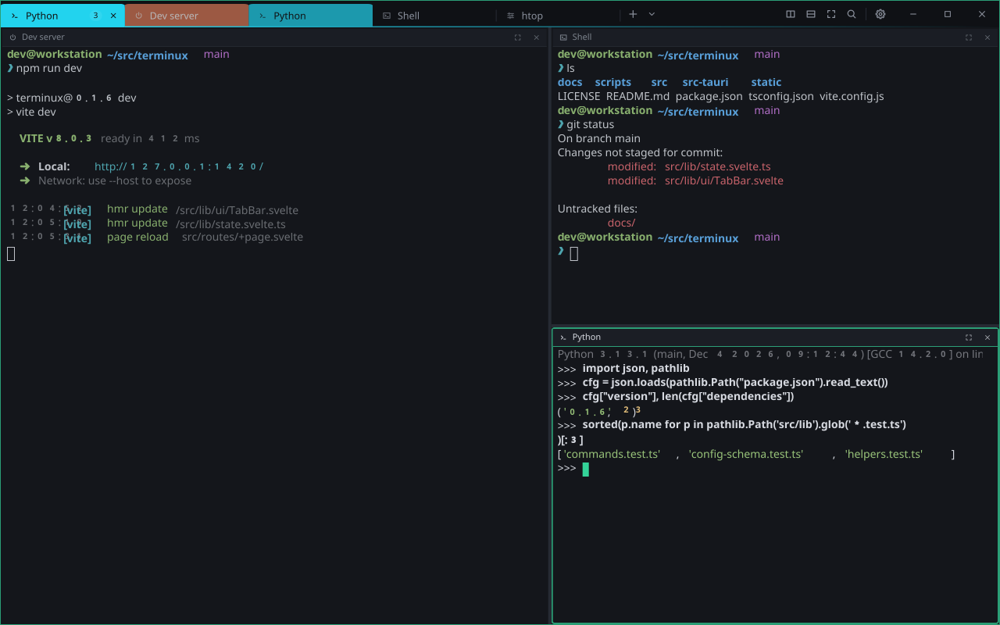

# Terminux

<p align="center"></p>

<p align="center"></p>

Tauri v2 + Svelte 5 terminal multiplexer.

Windows Terminal feature parity (names, actions and default keys follow Windows Terminal, in snake_case).

**📖 Full documentation: [docs/](docs/README.md)** — [installation](docs/user-guide/01-installation.md), [getting started](docs/user-guide/02-getting-started.md), [configuration reference](docs/reference/configuration.md), [actions](docs/reference/actions.md), [developer docs](docs/developer/architecture.md).

Highlights:

- Tabs: rename, color, duplicate, reorder by drag, tear out to a new window or drop on another one, MRU switcher (`tab_switcher_mode`), tab search, close others / to the right, restore last closed, progress ring (OSC 9;4), width modes, `tab_title_ellipsis`, vertical tabs on the left or right (`tab_position`, resizable, collapsible)
- Sidebar (left or right, per window): Git view (`Ctrl+Shift+G`, VS Code-style source control for the focused terminal's repository, local / SSH / WSL: stage, discard, commit / amend, diff tab, branches, fetch / pull / push / publish, log, stashes) and snippets view
- Panes: split in any direction with size, duplicate (SSH panes reconnect in the remote directory), swap, title bar (`show_pane_title_bar`, rename), drag by the title bar to dock / swap / move to another tab or window, `move_pane_*`, zoom (pane or subtree), toggle orientation, focus by direction / MRU / creation order / parent / child, read-only, broadcast input, restart connection
- Profiles: `[defaults]` + per profile color scheme (17 built-in, `[[scheme]]`), font (face, weight, cell size, ligatures, features), cursor, padding, opacity / acrylic, background image, retro effect, `unfocused_appearance`, bell style / sound, close on exit, path translation; generated profiles (WSL, SSH hosts, PowerShell, cmd), fragments in `fragments/*.toml`, portable mode (`.portable` next to the binary)
- Text: mark mode (keyboard selection, block selection), copy as HTML / ANSI / single line, paste warnings and filtering, OSC 52 clipboard writes (opt-in: `osc52_clipboard`), search with regex / case / whole word and match count, scroll marks, shell integration (OSC 133 / 633 / 7 / 9;9: command marks, select command / output, recent command suggestions, click to move the cursor), snippets sidebar, search the web, export buffer, highlight selection, Sixel images, OSC 8 links
- Windows: multiple windows, rename / identify, fullscreen, focus mode, always on top, launch mode / size / position, session restore (on by default; `first_window_preference = "default_profile"` to disable), quake mode and `global_summon` (global shortcuts), tray icon, autostart, headless mode
- Command palette (actions, nested menus, `>`-less command-line mode), `[[action]]` custom actions (`send_input`, `multiple_actions`, …), customizable `new_tab_menu`
- Customizable title-bar toolbar (`toolbar = ["duplicate_pane_right", "find", "separator", "open_settings"]`: any command, `[[action]]` id or `"separator"`); right-click it or drag its buttons to add, remove, reorder or reset them (UI edits are written to the `toolbar` key of config.toml)
- Shift+Enter newline, OSC 9/777 + bell desktop notifications, file drag & drop pastes paths
- Bundled fonts (JetBrains Mono, Symbols Nerd Font Mono, Twemoji Mozilla, Noto Sans Symbols/Symbols 2/Math)
- Config in `~/.config/terminux/config.toml` (Windows: `%APPDATA%\terminux\config.toml`), hot-reloaded; settings UI (forms for global settings, profiles, schemes, UI themes, key bindings, actions, new tab menu, toolbar; Ctrl+,) and a TOML editor with completion and validation on the same draft, comments preserved, read-only defaults (Ctrl+Alt+,)

Not implemented (no equivalent in Tauri / xterm.js): default terminal of the OS, elevation, jump list, HLSL shaders, ClearType settings, snap to grid on resize, AltGr aliasing, localization.

## Command line

`terminux [options] [command ; command ...]`, same syntax as `wt.exe`:

```sh
terminux -M nt -p python ; sp -V -s .3 -p shell ; ft -t 0
terminux -w 0 nt -d ~/src htop       # in the most recent window
terminux --help
```

`windowing_behavior` decides where a second invocation goes. The command palette runs the same syntax when its leading `>` is deleted. See the [command-line reference](docs/reference/command-line.md).

## Shell integration

Emit OSC 133 marks from the prompt to get colored command marks, select command / output, recent command suggestions and the current directory for new splits (zsh, fish, PowerShell, cmd: see [shell integration](docs/user-guide/10-shell-integration.md)):

```sh
# bash (~/.bashrc)
PS0='\[\e]133;C\a\]'
PROMPT_COMMAND='printf "\e]133;D;%s\a\e]7;file://%s%s\a" "$?" "$HOSTNAME" "$PWD"'
PS1='\[\e]133;A\a\]'"$PS1"'\[\e]133;B\a\]'
```

## Dev

```sh
npm install
npm run tauri dev
npx vitest run && cargo test --manifest-path src-tauri/Cargo.toml
```

## Build (Docker)

```sh
scripts/build-linux.sh      # deb, rpm, AppImage
scripts/build-windows.sh    # NSIS installer + portable exe (cross-compiled with cargo-xwin)
scripts/docker-build.sh     # both
```

Artifacts go to `dist/`. Details: [building and release](docs/developer/building-and-release.md). Toolchains: `docker/Dockerfile` (base images and tools pinned by digest/checksum); caches in Docker volumes `terminux-*`.

Linux: deb/rpm built on Ubuntu 22.04 (glibc ≥ 2.35, host `webkit2gtk-4.1`). The AppImage is repacked from the deb by quick-sharun (Arch Linux) with WebKitGTK, GTK, Mesa and glibc bundled: runs on RHEL/Rocky 8 (glibc 2.28).

## Keys

Windows Terminal defaults:

| Action | Default |
| --- | --- |
| New tab / window / duplicate tab | Ctrl+Shift+T / Ctrl+Shift+N / Ctrl+Shift+D |
| New tab with profile 1..9 | Ctrl+Shift+1..9 |
| Close pane / window | Ctrl+Shift+W / Alt+F4 |
| Duplicate pane right / down / auto | Alt+Shift+Plus / Alt+Shift+- / Alt+Shift+D |
| Focus / resize / move pane | Alt+Arrows / Alt+Shift+Arrows / Ctrl+Alt+Shift+Arrows |
| Previous pane | Ctrl+Alt+Left |
| Tabs | Ctrl+Tab, Ctrl+Shift+Tab, Ctrl+Alt+1..8, Ctrl+Alt+9 (last) |
| Find / command palette / new tab menu | Ctrl+Shift+F / Ctrl+Shift+P / Ctrl+Shift+Space |
| Copy / paste | Ctrl+C (with selection), Ctrl+Shift+C, Ctrl+Insert, Enter / Ctrl+V, Ctrl+Shift+V, Shift+Insert |
| Select all / mark mode | Ctrl+Shift+A / Ctrl+Shift+M |
| Scroll line / page / top / bottom | Ctrl+Shift+Up/Down, PgUp/PgDn, Home/End |
| Previous / next command mark | Ctrl+Up / Ctrl+Down |
| Clear buffer | Ctrl+Shift+K |
| Font size | Ctrl+Plus / Ctrl+Minus / Ctrl+0, Ctrl+wheel |
| Fullscreen | F11, Alt+Enter |
| Suggestions | Ctrl+Shift+Period |
| Settings / settings file (external editor) / defaults | Ctrl+, / Ctrl+Shift+, / Ctrl+Alt+, |
| Quake mode (global) | Win+` |

Full list: [key bindings](docs/reference/keybindings.md). Override in `[keys]` (`find = "F3"`, a list of combos, or `""` to unbind). Pre-parity names (`split_right`, `zoom`, `tab_1`, …) are still accepted. Ctrl+V with an image in the clipboard is passed through to the application.

## Font licenses

See `static/fonts/LICENSES/` (SIL OFL 1.1, MIT, CC-BY 4.0 / Apache 2.0).
