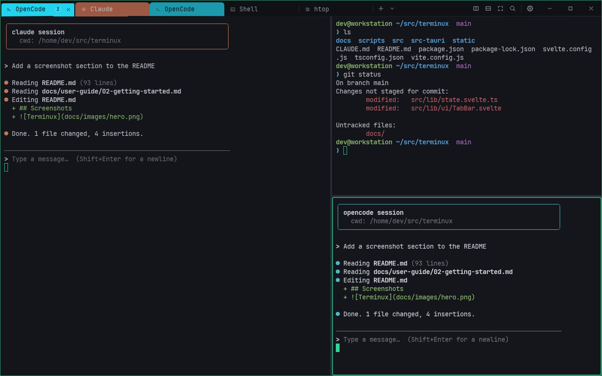

# Terminux documentation

Terminux is a Tauri v2 + Svelte 5 terminal multiplexer with Windows Terminal feature parity: same actions, settings and default keys, written in snake_case.

## Where to start

| You want to… | Read |
| --- | --- |
| Install Terminux | [Installation](user-guide/01-installation.md) |
| Learn the basics in 10 minutes | [Getting started](user-guide/02-getting-started.md) |
| Coming from Windows Terminal | [Migrating from Windows Terminal](user-guide/17-migrating-from-windows-terminal.md) |
| Look up a setting, action or key | [Reference](#reference) |
| Hack on Terminux | [Developer docs](#developer-documentation) |

## User guide

1. [Installation](user-guide/01-installation.md): packages, requirements, portable mode
2. [Getting started](user-guide/02-getting-started.md): UI tour and first steps
3. [Tabs](user-guide/03-tabs.md): create, rename, color, reorder, tear out, switch, vertical tabs
4. [Panes](user-guide/04-panes.md): split, navigate, resize, zoom, swap, broadcast
5. [Windows](user-guide/05-windows.md): multiple windows, session restore, quake mode, tray
6. [Profiles](user-guide/06-profiles.md): `[defaults]`, `[[profile]]`, generated profiles, fragments, new tab menu
7. [Appearance](user-guide/07-appearance.md): color schemes, fonts, cursor, opacity, background, themes
8. [Text and clipboard](user-guide/08-text-and-clipboard.md): selection, mark mode, copy, paste, links
9. [Search and navigation](user-guide/09-search-and-navigation.md): find, scroll marks, export buffer
10. [Shell integration](user-guide/10-shell-integration.md): OSC 133 / 633 / 7 / 9;9 setup for bash, zsh, fish, PowerShell, cmd
11. [Command palette](user-guide/11-command-palette.md): actions, command-line mode, snippets, suggestions
12. [Custom actions](user-guide/12-custom-actions.md): `[[action]]`, `send_input`, `multiple_actions`, bindings
13. [Toolbar](user-guide/13-toolbar.md): title-bar buttons
14. [Notifications and bell](user-guide/14-notifications-and-bell.md)
15. [Recipes](user-guide/15-recipes.md): ready-made configurations
16. [Troubleshooting](user-guide/16-troubleshooting.md) and FAQ
17. [Migrating from Windows Terminal](user-guide/17-migrating-from-windows-terminal.md)

## Reference

- [Configuration](reference/configuration.md): every global setting
- [Profile settings](reference/profile-settings.md): every `[defaults]` / `[[profile]]` setting
- [Actions](reference/actions.md): every command, its arguments and default keys
- [Key bindings](reference/keybindings.md): default keymap and `[keys]` syntax
- [Command line](reference/command-line.md): `terminux` options and subcommands
- [Color schemes](reference/color-schemes.md): built-in schemes and `[[scheme]]`
- [File locations](reference/file-locations.md): config, fragments, session, portable mode
- [Escape sequences](reference/escape-sequences.md): supported OSC / CSI sequences
- [Annotated example config](reference/config-example.toml)

## Developer documentation

- [Architecture](developer/architecture.md)
- [Frontend](developer/frontend.md)
- [Backend](developer/backend.md)
- [Adding features](developer/adding-features.md)
- [Testing](developer/testing.md)
- [Building and release](developer/building-and-release.md)
- [Contributing](developer/contributing.md)
