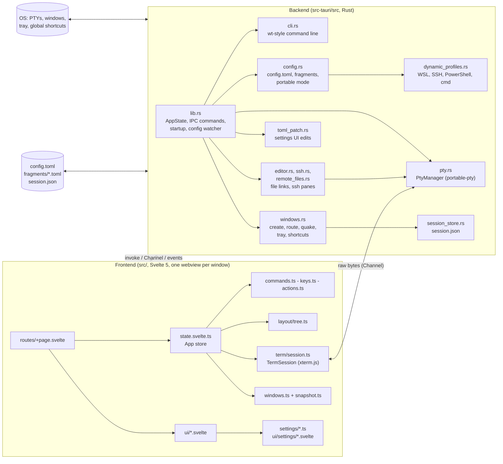
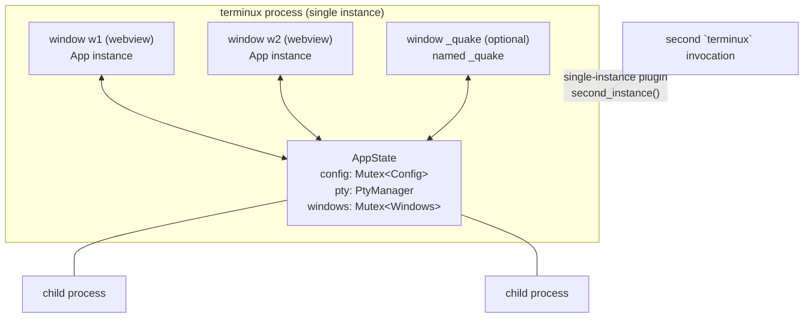
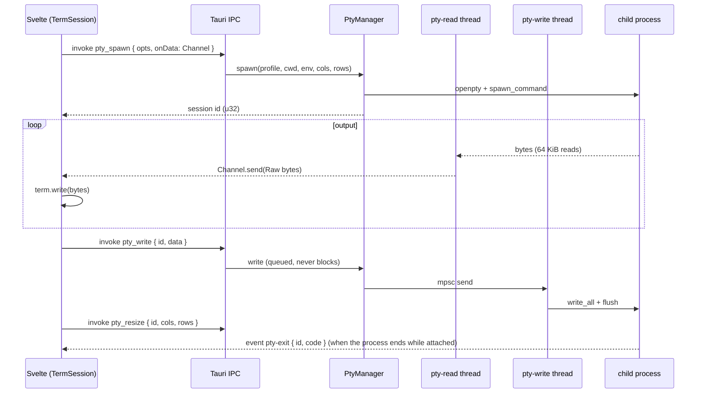
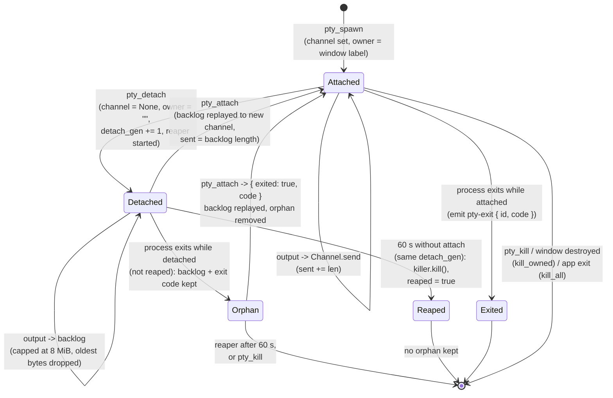
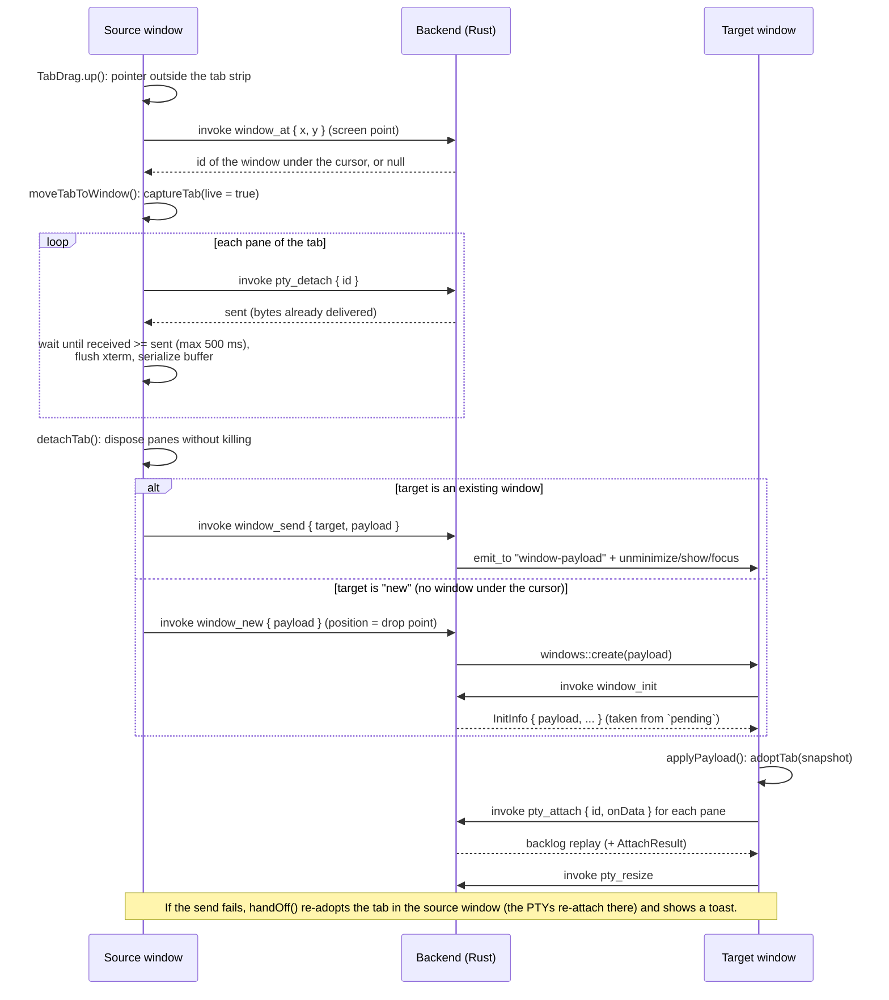
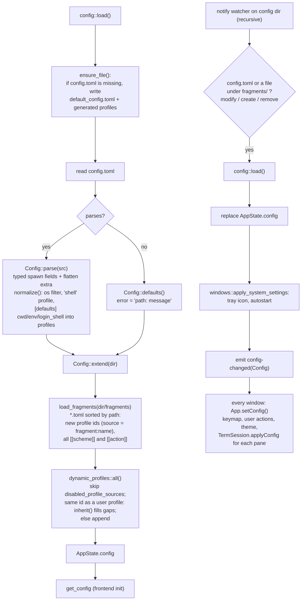
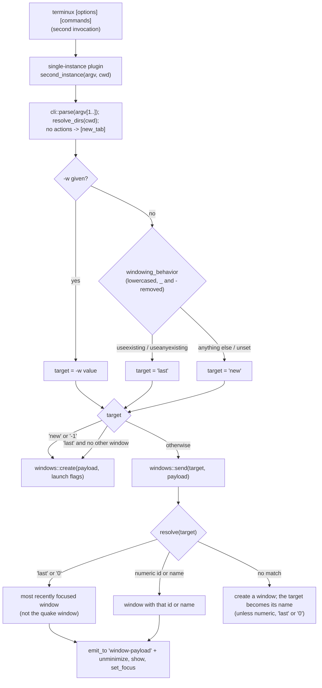

# Architecture

Terminux is a Tauri v2 application: a thin Rust backend owns processes, the config file and native windows, and a Svelte 5 (SvelteKit, SPA through `adapter-static`) frontend renders everything else with xterm.js. This page shows how the pieces fit together, with diagrams of the IPC surface, the PTY lifecycle, tab tear-out, config hot reload and window routing.

## Contents

- [Component overview](#component-overview)
- [Process and window model](#process-and-window-model)
- [IPC: commands, channels, events](#ipc-commands-channels-events)
- [PTY lifecycle](#pty-lifecycle)
- [Tab tear-out between windows](#tab-tear-out-between-windows)
- [Config load, merge, watch, hot reload](#config-load-merge-watch-hot-reload)
- [Window routing](#window-routing)
- [Startup sequence](#startup-sequence)
- [Security model](#security-model)
- [See also](#see-also)

## Component overview



Division of labour:

| Concern | Owner |
| --- | --- |
| Spawning and killing processes, byte streaming | Backend (`pty.rs`) |
| Parsing `config.toml`, merging fragments and generated profiles, hot reload | Backend (`config.rs`, `dynamic_profiles.rs`, watcher in `lib.rs`) |
| Interpreting appearance, keys, actions, menus, toolbar | Frontend (the backend passes unknown keys through untouched) |
| Creating, routing and persisting windows | Backend (`windows.rs`, `session_store.rs`) |
| Comment-preserving edits of `config.toml` for the settings UI | Backend (`toml_patch.rs`), driven by `src/lib/settings/` |
| Opening Ctrl+clicked file paths, ssh pane detection, remote file copies | Backend (`editor.rs`, `ssh.rs`, `remote_files.rs`) |
| Tabs, panes, focus, closed-tab history | Frontend (`App` in `state.svelte.ts`) |
| Terminal emulation, selection, search, OSC handling | Frontend (xterm.js in `TermSession`) |
| `wt`-style command line parsing | Backend (`cli.rs`), also exposed to the palette via `cli_parse` |

Every window is its own webview running its own copy of the frontend, so each window has its own `App` instance. The only shared state is in the Rust `AppState` (config, `PtyManager`, `Windows`).

## Process and window model

`tauri.conf.json` declares `"windows": []`: no window is created from configuration. `windows::create` builds every window (`WebviewWindowBuilder`, label `w<N>`, `decorations(false)` because the frontend draws its own title bar, `visible(false)` until the frontend sized it). A 5 second failsafe thread shows the window anyway if the frontend never does.



The `tauri-plugin-single-instance` plugin forwards a second invocation's argv and cwd to the running process (see [Window routing](#window-routing)).

## IPC: commands, channels, events

Three mechanisms are used. The complete command list is in [backend.md](backend.md#ipc-commands).

1. **Commands** (`invoke("name", args)`), registered in `generate_handler!` in `src-tauri/src/lib.rs`.
2. **Channels**: `pty_spawn` / `pty_attach` take a `Channel<InvokeResponseBody>` (`onData` on the JS side). The reader thread pushes raw bytes (`InvokeResponseBody::Raw`) into it.
3. **Events** emitted by the backend: `config-changed`, `pty-exit`, `window-payload`, `identify`, `persist`.



Notes on the data path:

- Input goes through an unbounded mpsc queue drained by a dedicated writer thread, so a child that stops reading its tty cannot freeze the UI thread (`PtyManager::write` never blocks).
- Output is read in 64 KiB chunks and sent as a raw binary payload; the frontend wraps it in `Uint8Array` and calls `term.write`.
- `pty_write` takes a `String`, so input is UTF-8 text (xterm's `onData` and `onBinary` both go through `TermSession.input`).

The backend-to-frontend events:

| Event | Emitted by | Target | Payload | Handled in |
| --- | --- | --- | --- | --- |
| `config-changed` | config watcher (`lib.rs`) | all windows (`app.emit`) | full `Config` | `App.init` -> `setConfig` |
| `pty-exit` | pty waiter thread | all windows (`app.emit`) | `{ id, code }` | `App.init` -> `onPaneExit` |
| `window-payload` | `windows::send` | one window (`emit_to`) | `Payload` (`actions`, `snapshot`, `position`) | `windows.ts` `applyPayload` |
| `identify` | `windows::identify_all` | each window | text (`"<id>"` or `"<id>: <name>"`) | `windows.ts` `showIdentify` |
| `persist` | `windows::quit` | each window | none | `windows.ts` `saveSession` |

## PTY lifecycle

A session lives in `PtyManager.sessions` (`HashMap<u32, Session>`); a session that exited while detached moves to `PtyManager.orphans`. The `Sink` holds the output `Channel`, a backlog buffer and a `sent` byte counter.



Details, all in `src-tauri/src/pty.rs`:

- **Constants**: `BACKLOG_MAX = 8 MiB`, `DETACH_TIMEOUT = 60 s`, `DRAIN_TIMEOUT = 500 ms`.
- **Threads per session**: `pty-write-<id>` (input queue), `pty-read-<id>` (64 KiB read loop into the `Sink`), `pty-wait-<id>` (waits for the child, then retires the session), and a short-lived `pty-reap-<id>` per detach.
- **Detach** (`pty_detach`) clears the owner and the channel and returns `sent`, the number of bytes already delivered to the old channel. The frontend waits (up to 500 ms) until it has received that many bytes before serializing the terminal, so no output is lost across a hand-off.
- **Attach** (`pty_attach`) works for a live session (`{ exited: false }`) and for an orphan (`{ exited: true, code }`). It holds the `sessions` lock while looking up orphans, because the exit path moves a session to `orphans` under the same lock.
- **Exit path**: on exit the waiter drops the master and the writer queue (this unblocks the reader on Windows/ConPTY), waits up to `DRAIN_TIMEOUT` for trailing output, then removes the session. If a channel is still attached it emits `pty-exit`; otherwise (and unless the reaper killed it) it stores an `Orphan`.
- **Reaper**: after `DETACH_TIMEOUT` it only acts if the session still has no owner and `detach_gen` is unchanged (a later detach/attach cycle cancels it logically). If the session is gone it drops the matching orphan.
- **Window destruction**: `on_window_event(Destroyed)` calls `kill_owned(label)`. Because `detach` clears the owner, sessions in flight between windows survive the source window closing.
- **Broken channel**: if `Channel.send` fails (webview gone), the sink drops the channel and starts buffering.

## Tab tear-out between windows

Dragging a tab out of the tab strip (or running `move_tab` / `move_pane` with a `window` argument) serializes the tab, detaches its PTYs, and recreates it in another window, which re-attaches to the same processes.



The snapshot types (`PaneSnapshot`, `TabSnapshot`, `WindowSnapshot`) live in `src/lib/snapshot.ts`. The same capture/adopt machinery powers undo-close (`restore_last_closed`), duplicate tab, and session persistence; only `live = true` hands over PTYs, the others store the serialized buffer and start a fresh process.

## Config load, merge, watch, hot reload



Points worth knowing:

- Portable mode: `config_dir()` returns `<exe dir>/settings` if a `.portable` file sits next to the executable. `state_dir()` (the `session.json` location) follows the same directory in that case.
- A fragment contributes profiles (only ids not already defined), `[[scheme]]` and `[[action]]` entries. Other fragment keys (root settings, `[defaults]`, `[keys]`) are parsed but ignored. An invalid fragment is skipped with a message on stderr.
- The watcher is created in `setup` and kept alive via `app.manage(Mutex<RecommendedWatcher>)`. It creates `fragments/` if needed.
- The settings tab has two views of one draft (`src/lib/settings/doc.svelte.ts`). The TOML editor uses `read_config` -> edit -> `validate_config` -> `write_config`. The settings UI reads the raw document with `config_parse`, turns each edit into `PatchOp`s and applies them to the draft text with `config_patch`, so comments survive; auto-save then calls `write_config`. Saving triggers the watcher like any external edit, and a change on disk while the draft is dirty is reported (`changedOnDisk`).
- Some settings only take effect at window creation (transparency, `always_on_top`); the frontend warns with `transparencyHint`.

## Window routing

Routing decides which window receives actions from a command line. It runs in two places: first launch (`open_initial_windows`) and every later invocation (`second_instance`).



First launch (`open_initial_windows`):

1. Parse argv. A parse error is printed and an empty `Cli` used. `-h`/`--help`/`-?`/`/?` is detected earlier in `run()`, prints `cli::HELP` and exits (on Windows it first calls `AttachConsole`).
2. If the command line carries actions, open one window with them (launch flags `--maximized`, `--fullscreen`, `--focus`, `--size`, `--pos` apply; `-w <name>` names the window unless it is `new`, `-1`, `0`, `last` or numeric).
3. Otherwise, if `first_window_preference` is `persisted_window_layout` (the default) and `session.json` has windows, recreate each one with its snapshot and saved bounds.
4. Otherwise run `startup_actions` (a command-line string parsed with `cli::parse_line`) in a single window.

Window identity inside `Windows`: numeric `id` (1, 2, ...), label `w<id>`, optional `name` (`rename`, `-w <name>`, or the reserved `_quake`), and an MRU list of labels updated on focus.

## Startup sequence

```mermaid
sequenceDiagram
  participant M as main.rs
  participant L as lib.rs run()
  participant C as config::load
  participant W as windows::create
  participant F as Frontend (+page.svelte)

  M->>M: Linux: WEBKIT_DISABLE_DMABUF_RENDERER=1 (unless set);<br/>AppImage: unset GTK_MODULES
  M->>L: terminux_lib::run()
  L->>L: --help? print and return
  L->>C: manage(AppState { config: load(), ... })
  L->>L: plugins: single-instance, opener, notification,<br/>clipboard-manager, dialog, global-shortcut, autostart
  L->>L: setup: watch_config, apply_system_settings
  L->>W: open_initial_windows(args)
  W-->>F: hidden window loads index.html
  F->>L: window_init -> InitInfo (payload, grid, launch_mode, center)
  F->>L: get_config, listen config-changed / pty-exit
  F->>F: applyPayload (snapshot / actions), else newTab()
  F->>W: show window, size to grid, apply launch mode
```

## Security model

- **CSP** (`tauri.conf.json`): `default-src 'self'`; scripts from self only (dev CSP additionally allows inline scripts and `ws://localhost:1420`); `connect-src` limited to self and the Tauri IPC origins; no frames, objects or forms.
- **Capabilities** (`src-tauri/capabilities/default.json`, applied to all windows): `core:default`, a hand-picked list of `core:window:*` permissions (dragging, resize dragging, minimize, maximize, close, destroy, show/hide, focus, fullscreen, always-on-top, size, position, center, title, progress bar, user attention), `opener:default`, `notification:default`, and clipboard `allow-read-text`, `allow-write-text`, `allow-write-html`. Dialog, global-shortcut and autostart are only driven from Rust and need no frontend permissions.
- **File IPC is allow-listed**: `read_binary` and `save_text` (with an explicit path) only accept paths that appear as string values somewhere in the loaded config (`referenced_by_config`), so a compromised webview cannot read arbitrary files. `read_binary` also caps files at 64 MiB. `open_path` only opens directories. The built-in editor can only write files it read first (`file_read` records them in `OpenFiles`, `file_write` refuses others), `open_in_editor` takes its program from `file_link_editor` in the config, and ssh and `scp` arguments are derived from a command the user launched in that pane, never from the webview.
- **OSC 52** clipboard writes are off by default (`osc52_clipboard`) and reads are never answered.

## See also

- [backend.md](backend.md): modules, every IPC command, plugins
- [frontend.md](frontend.md): App store, action pipeline, TermSession
- [adding-features.md](adding-features.md): step-by-step extension recipes
- [contributing.md](contributing.md): conventions and project layout
- [../reference/file-locations.md](../reference/file-locations.md): where config, fragments and the session file live
- [../user-guide/05-windows.md](../user-guide/05-windows.md): user-facing view of windows, `-w` and sessions
