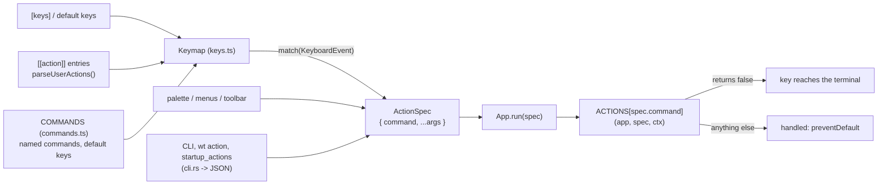

# Frontend

The frontend (`src/`) is a SvelteKit single-page app (`adapter-static` with `fallback: "index.html"`, `ssr = false`) written in Svelte 5 runes and TypeScript. One instance runs per window. This page explains the central `App` store, the action pipeline, the pane layout tree, `TermSession`, appearance resolution, OSC handling, multi-window code, the config schema and the UI component map.

## Contents

- [Layout of src/](#layout-of-src)
- [The App store](#the-app-store)
- [Action pipeline](#action-pipeline)
- [Layout tree](#layout-tree)
- [TermSession and SessionHooks](#termsession-and-sessionhooks)
- [Appearance resolution](#appearance-resolution)
- [OSC handling and shell integration](#osc-handling-and-shell-integration)
- [Snapshots and multi-window code](#snapshots-and-multi-window-code)
- [Config, schema and the editor](#config-schema-and-the-editor)
- [Toolbar, snippets, themes](#toolbar-snippets-themes)
- [UI component map](#ui-component-map)
- [Frontend conventions](#frontend-conventions)
- [See also](#see-also)

## Layout of src/

```text
src/
  app.html, app.css          document shell and global styles (CSS custom properties)
  routes/
    +layout.ts               export const ssr = false
    +layout.svelte           imports xterm.css/app.css; mirrors console.info/warn/error and
                             unhandled errors to the backend (frontend_log)
    +page.svelte             mounts the UI; calls app.init() on mount
  lib/
    state.svelte.ts          App class: central runes store (exports `app`)
    commands.ts              COMMANDS, LEGACY_NAMES, ActionSpec, [[action]] parsing, icons
    keys.ts                  Keymap: combo parsing and matching
    actions.ts               ACTIONS: command name -> handler
    layout/tree.ts           pure split-tree operations
    term/                    session.ts, appearance.ts, marks.ts, markmode.ts, shell-integration.ts,
                             file-link-provider.ts, link-tooltip.ts
    osc.ts                   pure OSC parsers
    file-links.ts            file path detection in terminal output (Ctrl+click)
    file-langs.ts            syntax mode of the built-in file editor, from the file name
    windows.ts, snapshot.ts  multi-window, persistence, closing
    config.ts                Config types, defaults, fonts, profile lookup
    config-schema.ts         schema for completion/lint in the editor
    config-edit.ts           targeted TOML edits (setRootKey)
    color-swatch.ts          hex color detection for the TOML editor swatches
    emoji-icons.ts           emoji suggestions for `icon` keys
    settings/                settings UI model: doc.svelte.ts (shared config.toml draft), pages.ts
                             (which fields go on which page), value.ts (paths, controls, PatchOp)
    schemes.ts, ui-theme.ts  color schemes, application themes
    toolbar.ts, snippets.ts, paste.ts, paths.ts, audio.ts
    ui/                      Svelte components and UI helpers
      settings/              settings UI components (SettingsView, Field, KeysEditor, ...)
```

## The App store

`src/lib/state.svelte.ts` exports the class `App` and a singleton `app`. It is the single source of truth for a window; most features route through it. State uses `$state` (deep reactivity) and `$state.raw` for objects that are replaced wholesale (`palette`, `menu`, `dialog`, `keymap`, `ui`).

Core state:

| Field | Meaning |
| --- | --- |
| `config` | Current `Config` (from `get_config`, replaced on `config-changed`) |
| `tabs: Tab[]`, `activeTab` | Tab list (`kind` is `"term"`, `"config"` (settings tab) or `"defaults"` (read-only defaults); the last two are editor tabs) |
| `panes: Record<string, PaneInfo>` | Per-pane UI state: `kind` (`"term"`, `"snippets"`, `"file"`, `"config"`, `"defaults"`), spec, title, user `name`, bell/activity flags, read-only, progress, cwd, resolved `look`, mark mode, visual-bell `flash`, `dirty` (file pane) |
| `keymap`, `userActions` | Rebuilt from the config (`setConfig`) |
| `palette`, `menu`, `dialog`, `toasts`, `tabSwitcher`, `colorPicker`, `renaming`, `renamingPane`, `about`, `identify` | Overlays and transient UI |
| `configDirty`, `keyCapture`, `editors`, `paneEditors` | Unsaved settings draft flag, "settings UI is recording a key combo" (bindings do not run), focus callbacks of mounted editors and file editor panes |
| `searchPane`, `search` | Find bar target and options (`regex`, `caseSensitive`, `wholeWord`) |
| `fontDelta` | Global font zoom (clamped to -8..40) added to every profile's font size |
| `dark`, `ui` | Effective brightness and the resolved `UiLook` |
| `fullscreen`, `focusMode`, `alwaysOnTop`, `windowFocused`, `windowName`, `windowId` | Window state |

A pane is usually a terminal, but `PaneKind` also covers a diff view (`DiffPane.svelte`, `spec.diff`, opened in its own tab by the Git sidebar), a file editor pane (`FilePane.svelte`, `spec.file`) and the settings editor shown as a pane (`config` / `defaults`, see `open_settings_pane`). `Tab` fields: `id`, `kind`, `root` (layout tree), `active` (focused pane id), `zoom` (node shown alone), `name`, `color`, `broadcast`, `mru` (pane ids by recency), `group` (split selected with "move focus to parent").

Responsibilities, grouped as in the file:

- **Lifecycle**: `init()` loads the config, subscribes to `config-changed` and `pty-exit`, installs the drag-and-drop handler (dropped paths are pasted through `droppedPaths`), capture-phase `keydown`/`keyup` listeners, window focus/blur and the system color scheme listener, migrates the legacy toolbar, then calls `windows.init(app)` and opens a first tab if none exists. `setConfig()` rebuilds `userActions` and `keymap`, refreshes the theme, calls `applyConfig` on every `TermSession`, and runs `windows.configChanged` (global shortcuts, title).
- **Session hooks**: a private `hooks: SessionHooks` object connects every `TermSession` back to the store (title, bell, output activity, notifications, input filtering for read-only/broadcast, exit handling, context menu, progress, cwd, look, wheel zoom/opacity, mark mode, paste requests, links). See [TermSession and SessionHooks](#termsession-and-sessionhooks).
- **Panes**: `specFrom`, `createPane`, `splitPane`, `closePane`, `closeOtherPanes`, `focusPane`, `moveFocus`, `swapPane`, `movePane`, `movePaneDir`, `renamePane`, `openEditorPane`, `resizePane`, `setSizes`, `equalize`, `toggleZoom`, `toggleSplitOrientation`, `setReadOnly`, `toggleBroadcast`. `split` accepts `left`/`right`/`up`/`down`/`auto` (auto picks the direction with the most room); a split continues the source pane unless a profile/index is given.
- **Tabs**: `newTab`, `insertTab` (honours `new_tab_position`), `openEditor`, `gotoTab`, `cycleTab` (direct, or the MRU overlay depending on `tab_switcher_mode`), `commitTabSwitcher`, `closeTab(s)`, `moveTab`, `renameTab`, `setTabColor`, `duplicateTab`, `detachTab`. Closing the last tab calls `windows.lastTabClosed` (the window closes).
- **Snapshots**: `capturePane`, `captureTab`, `captureNode`, `adoptPane`, `adoptTab`, plus the closed history (`remember`, `restoreLastClosed`, at most `MAX_CLOSED = 20` entries).
- **Appearance**: `adjustFont`, `resetFont`, `adjustOpacity`, `setColorScheme`, `toggleRetro` (per-pane overrides live in `PaneInfo.spec`).
- **Clipboard**: `copy` (`single_line`, `with_control_sequences`, `copy_formatting`, `dismiss_selection`), `paste` (sanitizes, applies `trim_paste`, shows the large/multi-line confirmation, passes a literal `Ctrl+V` through when the clipboard holds no text), `searchWeb`.
- **Toolbar**: `toolbar`, `toolbarItems`, `setToolbar`, `addToToolbar`, `removeFromToolbar`, `moveToolbarItem(To)`, `resetToolbar`. Edits are written back to `config.toml` (`read_config` -> `setRootKey` -> `write_config`) through a serialized queue, with an optimistic `toolbarPending`.
- **Dialogs**: `confirm(title, message, opts)` and `promptText(title, value, placeholder)` return promises; `toast(message, kind)`.
- **Per-machine UI preferences** (tab position, vertical tab width/collapsed) live in `localStorage` (`terminux.tabPosition`, `terminux.verticalTabWidth`, `terminux.verticalTabsCollapsed`) through guarded `lsGet`/`lsSet`. The settings tab keeps its own (`terminux.settingsView`, `terminux.settingsAutoSave`, `terminux.settingsNavWidth`); see [file-locations](../reference/file-locations.md#per-machine-ui-state).
- **Actions**: `run(action)` and the key handlers (next section).

`App` imports `actions.ts` and `actions.ts` imports the `App` type only, which keeps the dependency one-directional at runtime.

## Action pipeline

Everything a user can trigger (default keys, `[keys]` overrides, `[[action]]` entries, palette items, menus, toolbar buttons, CLI subcommands, `startup_actions`) is reduced to an `ActionSpec` and dispatched through the same path.



### commands.ts (data)

- `ActionSpec = { command: string; [arg: string]: unknown }`.
- `COMMANDS: Record<string, NamedCommand>`: each entry has `spec`, `label`, default `keys: string[]`, optional `hidden` (not listed in the palette) and an `icon` filled in at load. Entries are created with the helper `n(label, command, args, keys, hidden)`. Direction families (`split_pane_*`, `move_focus_*`, `resize_pane_*`, `swap_pane_*`) and the numbered ones (`new_tab_profile_1..9`, `move_pane_to_tab_1..9`, `switch_to_tab_1..8`) are generated by loops below the literal table.
- `LEGACY_NAMES`: pre-parity Terminux names still accepted in `[keys]` (`zoom`, `search`, `palette`, `font_bigger`, `focus_left`, `resize_left`, `tab_1`..`tab_9`, ...). `commandName(name)` resolves a name or legacy alias to the canonical name, or `undefined`.
- `specKey(spec)` gives a stable identity (key-order independent); it is used to find the key hint and icon of an arbitrary spec.
- `parseAction(table)` normalizes an `[[action]]` table: `command = "x"` plus arguments, Windows Terminal style `command = { action = "x", ... }`, or `commands = [...]` (becomes `multiple_actions`). `id`, `name`, `icon`, `keys` are metadata and are not copied into the spec. `parseUserActions` produces `UserAction { id?, name, icon?, keys, spec }`.
- `describe(spec)` labels any action (the named command label when the spec matches one, else `Command (arg: value, ...)`).
- `actionIcon` / `commandIcon` map actions to built-in icon names (`ui/icons.ts`); a test asserts every command has a valid icon.

### keys.ts

- `parseCombo("Ctrl+Shift+PgUp")` -> `{ ctrl, shift, alt, meta, key }` with aliases (`plus` -> `=`, `pgup` -> `pageup`, `menu` -> `contextmenu`, `win`/`super`/`cmd` -> meta, `Ctrl++` handled). A modifier-only string is invalid (`null`).
- `eventKey(e)` uses the physical position (`e.code`) for letters, digits and punctuation so shortcuts are layout independent; `eventKeys(e)` also tries the produced character (so `-` works on AZERTY).
- `Keymap(user, actions)`: builds a signature map. Defaults are bound first so user bindings win a shared combo. Overrides in `[keys]` replace a command's defaults (an empty string unbinds). `[[action]]` `keys` and `[keys]` entries keyed by an action `id` are bound after. `match(event)` returns the `ActionSpec`; `hint(action)` returns the combo to display; `combos(name)` returns the effective combos (used for OS-level shortcuts).

### actions.ts (behavior)

- `ACTIONS: Record<string, Handler>` where `Handler = (app, spec, ctx) => unknown`. `ctx.event` carries the originating `KeyboardEvent` when there is one.
- A handler returning `false` means "not handled": the key is not consumed and reaches the terminal (for example `copy` with no selection, `find` on an editor tab). Any other return value (including `undefined` and promises) counts as handled.
- `withTerm(f)` wraps handlers that need the active terminal session and returns `false` when there is none.
- `GLOBAL_COMMANDS` is the set of commands that stay active while text is being edited (settings editor, palette, inputs); other commands are ignored in that situation.
- Besides the named commands, `ACTIONS` also holds command names that only exist as `[[action]]`/CLI commands: `send_input`, `multiple_actions`, `wt`, `global_summon`, `set_color_scheme`, `rename_window`, `rename_tab`, `rename_pane`, `set_tab_color`, `unbound`.

### Key handling

`App.onKeyDown` (capture phase):

1. While the MRU tab switcher is open it handles `Escape`, `Enter`, arrows and `Tab` itself.
2. If a dialog is open it returns.
3. Decides whether the target is "text" (editor tab, overlay open, or a real text input; xterm's helper textarea does not count).
4. If not text and mark mode is active, mark mode gets the key first.
5. `keymap.match(e)`; in text context only `GLOBAL_COMMANDS` pass.
6. `run(spec, { event })`; unless it returned `false`, the menu closes and the event is stopped.

## Layout tree

`src/lib/layout/tree.ts` is pure (no Svelte, no Tauri) and covered by `tree.test.ts`. A tab's `root` is a `LayoutNode`:

```ts
type Dir = "row" | "col";                    // row = side by side, col = stacked
interface PaneNode  { kind: "pane"; id: string }
interface SplitNode { kind: "split"; id: string; dir: Dir; sizes: number[]; children: LayoutNode[] } // sizes sum to 1
```

| Function | Behavior |
| --- | --- |
| `newId(prefix)` | Unique id (`p`, `s`, `t` prefixes for panes, splits, tabs) |
| `pane(id)`, `paneIds(node)`, `firstPane(node)` | Construction and traversal |
| `contains(node, id)`, `find(node, id)`, `parentOf(root, id)` | Lookup (works for panes and split nodes) |
| `insert(root, target, dir, add, {before, size})` / `split(...)` | Split `target` and add a node next to it; same-direction neighbours are flattened into the parent; `size` is the new pane's share, clamped to 0.05..0.95 |
| `remove(root, target)` | Removes a node; a split left with one child collapses; freed space is redistributed proportionally; returns `null` when the tree becomes empty |
| `swap(root, a, b)` | Exchanges two disjoint nodes |
| `toggleOrientation(root, target)` | Flips the direction of the split holding `target` |
| `remap(node, ids)` | Copy with pane ids replaced and fresh split ids (used by `adoptTab`) |
| `rects(root)`, `rectOf(root, id)` | Pane rectangles in the unit square |
| `neighbor(root, from, d)` | Closest pane in a direction, preferring the largest overlap |
| `resize(root, target, d, delta)` | Moves a separator (min share 0.05); prefers the edge facing `d`, else the opposite edge, like Windows Terminal |
| `setSizes`, `equalize` | Set sizes of one split / equalize all |

`SplitView.svelte` renders the tree recursively (with separator dragging through `app.setSizes`), and `TerminalPane.svelte` renders a leaf.

## TermSession and SessionHooks

`src/lib/term/session.ts` defines `TermSession`, one per terminal pane (kept in the module-level `sessions` map keyed by pane id, and `byPty` by PTY id; `sessionByPty(id)` is used for the `pty-exit` event). It wraps an xterm.js `Terminal` and a backend PTY.

Addons loaded: `FitAddon`, `SearchAddon`, `SerializeAddon`, `Unicode11Addon` (active version 11), `WebLinksAddon` (when `detect_urls` is not `false`; with `detect_file_paths`, `file-link-provider.ts` adds a link provider for file paths using `findFileLinks`), `ImageAddon` (inline images; guarded by try/catch), and one renderer addon, `WebglAddon` or `CanvasAddon`, chosen by `rendererOf(config)`: the `renderer` setting, else `canvas` on Linux and `webgl` elsewhere. A WebGL context loss falls back to canvas. A DOM renderer is opt-in.

Lifecycle:

1. `new TermSession(paneId, spec, config, hooks, restore)` resolves the look and creates the xterm instance (no DOM yet; `allowTransparency` is fixed at creation, so when a look later needs transparency the terminal is rebuilt, preserving content via `SerializeAddon`).
2. `attach(container)` (from `TerminalPane.svelte`) waits for the bundled fonts (`loadFonts`, 2 s cap), opens the terminal, writes the restored buffer, applies the look, then `connect()`.
3. `connect(adopt)` creates a `Channel`, then either `pty_attach` (adopt a live PTY from another window) or `pty_spawn` with `{ profileId, cwd, inheritCwd, commandline, env, cols, rows }`. Spawn failures retry with exponential backoff (1 s, 2 s, 4 s...) up to `startup_retries`; a process that prints no visible text within `startup_timeout` seconds is killed and restarted (`watchStartup`).
4. Output arrives on the channel as bytes and is written to xterm; `hooks.onOutput` flags background activity.
5. `input(data)` is the single entry for user input: exited sessions route to `hooks.onExitedKey` (Enter restarts, `Ctrl+D` closes), `hooks.onInput` can veto (read-only) and mirror (broadcast), then `write` sends `pty_write`.
6. `release()` hands the PTY over (`pty_detach`, drain, serialize); `dispose(kill)` tears everything down; `restart()` kills and reconnects in place; `markExited(code)` prints the exit banner.

Notable behaviors implemented here: Shift+Enter sends `ESC CR` (newline instead of submit), middle/right click paste and context menu, `Ctrl+wheel` zoom and `Ctrl+Shift+wheel` opacity (through `hooks.onWheel`), click-to-reposition-cursor with shell integration, ED2 (`Ctrl+L`/clear) pushes the visible screen into scrollback first (uses a private xterm API; guarded), ligature joiner, block-selection padding, highlight decorations, export of the whole buffer as text.

### SessionHooks

The only way a session talks back to the app (implemented by `App.hooks`):

```ts
interface SessionHooks {
  env(): { dark: boolean; fontDelta: number };          // window-level inputs of appearance resolution
  onTitle(paneId, title): void;                          // OSC 0/2 (unless suppressed)
  onBell(paneId): void;
  onOutput(paneId): void;                                // activity indicator
  onNotify(paneId, title, body): void;                   // OSC 9 / 777
  onFocus(paneId): void;
  onInput(paneId, data): boolean;                        // false drops the input (read-only)
  onExitedKey(paneId, data): void;
  onExit(paneId, code): void;
  onContextMenu(paneId, x, y): void;
  onProgress(paneId, progress): void;                    // OSC 9;4
  onCwd(paneId, cwd): void;                              // OSC 7 / 9;9 / 633;P
  onLook(paneId, look: Resolved): void;                  // pane chrome follows the resolved look
  onWheel(paneId, kind: "zoom" | "opacity", delta): void;
  onMarkMode(paneId, active, block): void;
  requestPaste(paneId): void;                            // mouse paste goes through App.paste
  onCopy(paneId): void;                                  // selection copied (copy_on_select, right click): toast
  openLink(uri): void;
  openFile(paneId, path, line?, col?, remote?): void;    // Ctrl+click on a file path
}
```

To add a hook, extend the interface, implement it in `App.hooks`, and call it from `TermSession`.

## Appearance resolution

`resolve(cfg, spec, env)` in `src/lib/term/appearance.ts` turns config + pane state into a `Resolved` object (xterm options plus chrome values). `TermSession.update()` re-runs it whenever the config, focus, global zoom (`fontDelta`), brightness or a per-pane override changes, and applies the result with `xtermOptions()`.

Order of precedence, lowest to highest:

1. **Root-level legacy keys** as fallbacks: `font_size`, `font_family`, `scrollback`, `right_click_context_menu`, and the built-in defaults (scheme "Terminux", padding `6, 4, 2, 2`, `startup_timeout` 15, `startup_retries` 2, ...).
2. **`[defaults]`** (`cfg.defaults`).
3. **The profile** (`mergedSettings(cfg, profile)`): profile keys override `[defaults]`; the nested `font` and `unfocused_appearance` tables are merged key by key.
4. **Unfocused overlay**: when the window/pane is unfocused, the keys of `unfocused_appearance` that are appearance keys (`color_scheme`, `foreground`, `background`, `selection_background`, `cursor_color`, `cursor_shape`, `cursor_height`, `opacity`, `use_acrylic`, `background_image*`, `retro_terminal_effect`) override the merged values.
5. **Per-pane overrides** in `PaneSpec`: `colorScheme`, `opacity`, `retro`, `tabTitle`, `tabColor`, `suppressApplicationTitle` (set by actions, the CLI, `set_color_scheme`, `adjust_opacity`, `toggle_shader_effects`).
6. **Global window zoom**: `env.fontDelta` is added to the font size (result clamped to 6..72).

Color theme: the scheme named by `spec.colorScheme` or `schemeName(color_scheme, dark)` (a `{ light, dark }` pair is picked by `env.dark`) is looked up in user `[[scheme]]` entries first, then the built-ins; the `[theme]` table overrides individual colors on top; then `foreground`, `background`, `selection_background`, `cursor_color` of the merged settings override the theme. A pane is `transparent` when opacity < 100 or it has a background image (then the xterm background becomes fully transparent and the CSS pane background carries the alpha).

`wantsTransparency(cfg, spec)` evaluates both the focused and unfocused looks and decides, at terminal creation, whether the xterm canvas must be see-through.

## OSC handling and shell integration

Sequences are registered in `TermSession.createTerminal` and parsed by pure functions in `src/lib/osc.ts` (tested in `helpers.test.ts`):

| OSC | Parser | Effect |
| --- | --- | --- |
| 9;4 | `parseProgress` | Taskbar/tab progress (`state` 1 normal, 2 error, 3 indeterminate, 4 paused; 0 clears) |
| 9;9 | `parseCwd99` | Current directory (ConEmu) |
| 9 (other) | n/a | iTerm2-style notification (`onNotify`) |
| 777;notify | inline | urxvt desktop notification |
| 7 | `parseCwd7` | Current directory (`file://host/path`, Windows drive paths fixed up) |
| 133 | `parse133` | FinalTerm marks: `A` prompt, `B` command start, `C` output start, `D[;exit]` command end |
| 633 | `parse633` | VS Code: same marks plus `E` (command line text) and `P;Cwd=` |
| 52 | `parseOsc52` | Clipboard write only when `osc52_clipboard` is on (max 1,048,576 base64 chars); queries are ignored |

`hasVisibleText` detects printable output (skipping CSI/OSC/DCS/other escapes) for the startup watchdog, because ConPTY emits terminal-only sequences even when the child hangs.

- `term/shell-integration.ts` (`ShellIntegration`) tracks commands from OSC 133/633 marks (up to 500): prompt/command/output markers, exit codes, the typed command line. It powers `select_command` / `select_output`, recent-command suggestions (`recent`), `currentCommandLine()` and click-to-reposition.
- `term/marks.ts` (`Marks`) manages scroll marks (`user`, `prompt`, `success`, `error` kinds, with colors) shown as gutter decorations and on the scrollbar; `targetLine` is the pure navigation helper behind `scroll_to_mark`.
- `term/markmode.ts` (`MarkMode`) implements keyboard selection (`move`, `wordAt` are pure and tested); the session asks it to handle keys before the keymap.

## Snapshots and multi-window code

- `snapshot.ts`: types `PaneSnapshot`, `TabSnapshot`, `WindowSnapshot`; `sanitizeTab` validates a persisted tab and strips live PTY ids (a restored session starts fresh processes but replays the saved buffer).
- `windows.ts`:
  - `init(app)`: `window_init`, registers `window-payload`, `identify`, `persist` listeners and the close-requested handler, applies the launch mode (`focus`, `maximized`, `maximized_focus`, `fullscreen`) and sizes the window to `initial_cols` x `initial_rows` from the measured cell size (`sizeToGrid`), shows the window and starts the periodic session save (every 30 s).
  - `applyPayload`: adopts a received `snapshot` (tabs, editors, active tab) and runs received `actions`.
  - Moving: `moveTabToWindow`, `movePaneToWindow`, `handOff` (re-adopts locally if the send fails), `windowAt`.
  - Persistence: `snapshotWindow`, `saveSession` (skipped unless `first_window_preference` is `persisted_window_layout`).
  - Closing: `closeWindow` (confirms with a "Don't ask again" checkbox that writes `confirm_close_all_tabs = false` to the config), `lastTabClosed`, `quit`.
  - Misc: `toggleFullscreen`, `toggleAlwaysOnTop`, `renameWindow`, `identify`, `newWindow`, `runCommandLine` (the palette's command-line mode and the `wt` action go through the backend `cli_parse`), `syncTitle`, `syncProgress`, `configChanged` (registers global shortcuts for `quake_mode` and `global_summon` actions), `focusChanged` (`auto_hide_window`).
- Details of the hand-off protocol: [architecture.md](architecture.md#tab-tear-out-between-windows).

## Config, schema and the editor

- `config.ts`: TypeScript types mirroring what the backend serializes (`Config`, `Profile`, `ProfileSettings`, `Appearance`, `FontConfig`, `UiTheme`, `MenuEntry`), `FALLBACK_CONFIG` (used before `get_config` resolves), font constants (`FONT_FAMILIES`: JetBrains Mono, Symbols Nerd Font Mono, Twemoji Mozilla, Noto Sans Symbols 2, Noto Sans Symbols, Noto Sans Math, served from `static/fonts`), `DEFAULT_THEME` (the "Terminux" scheme), and helpers `findProfile`, `visibleProfiles`, `wordSeparatorOf`.
- `config-schema.ts`: the schema that powers the in-app editor. It exports `ROOT_FIELDS`, `SETTINGS_FIELDS` (accepted in `[defaults]` and each profile), `PROFILE_FIELDS`, the field tables of `[[scheme]]`, `[theme]`, `[[ui_theme]]`, `[[action]]`, `new_tab_menu` entries and `[keys]` (generated from `COMMANDS`), the list `HEADERS` offered for table completion, `ACTION_COMMANDS` and the argument list `ACTION_ARGS`. Pure functions: `contextAt` (where the cursor is), `completions`, `unknownKeys` (keys/sections serde would silently ignore), `keyInfoAt` (hover docs), `profileIds`.
- `settings/doc.svelte.ts` (`settingsDoc`): the `config.toml` draft shared by both views of the settings tab (`kind: "config"`, rendered by `ui/settings/SettingsTab.svelte`): text, last saved text, parsed JSON (`config_parse`), current view (`ui` or `toml`), current page, auto-save, `changedOnDisk`. `patch(ops)` sends `PatchOp`s to `config_patch` and replaces the draft text, so UI edits keep comments and layout. Auto-save (on by default, 400 ms debounce) applies only to settings UI edits; the TOML view saves with `Ctrl+S`.
- `settings/pages.ts` decides which schema fields appear on which settings page (root groups, profile / `[defaults]` sub-pages); `settings/value.ts` has the pure helpers (paths, control choice per field, default values, key-binding values) and is tested.
- `ui/settings/`: `SettingsView.svelte` (page list, search, page routing), `Fields.svelte` / `Field.svelte` (one control per schema field), `ProfileEditor`, `KeysEditor` (key capture sets `app.keyCapture`), `ActionsEditor`, `SchemesEditor`, `UiThemesEditor` (+ `UiThemePreview`, **Try** applies a theme with `app.previewUiTheme` without saving), `ToolbarEditor`, `MenuEntries` (new tab menu), `ListPicker`, `SideTabs`.
- `ui/ConfigEditor.svelte`: a CodeMirror 6 editor (TOML via `@codemirror/legacy-modes`), used as the settings TOML view, the read-only "Default settings" tab and the settings pane. It reads with `read_config` (or `default_config`), lints with `validate_config` (backend parse errors, UTF-16 offsets) plus `unknownKeys` warnings, offers `completions` and hover docs from the schema, shows color swatches (`color-swatch.ts`) and saves with `write_config`. `ui/editor-theme.ts` (styling) and `ui/editor-search.ts` (find / replace panel styled like `SearchBar`) are shared with `FilePane.svelte`. `app.configDirty` drives the unsaved-changes dot and the confirmation on close.
- `config-edit.ts` (`setRootKey`, `tomlStringArray`): comment- and layout-preserving edit of one root key; used by the toolbar. Note that `snippets.ts` has its own, simpler `setRootKey` used by `windows.ts` (`confirm_close_all_tabs`) and snippet saving (`insertBlock`, `snippetToml`).

Keeping the schema in sync is a manual step: see [adding-features.md](adding-features.md#add-a-config-key).

## Toolbar, snippets, themes

- `toolbar.ts`: entries are command names (legacy names accepted), `[[action]]` ids or `"separator"`. `DEFAULT_TOOLBAR` is `duplicate_pane_right`, `duplicate_pane_down`, `toggle_pane_zoom`, `find`, `separator`, `open_settings`. `resolveToolbar` skips unknown entries (without removing them from the file) and collapses doubled separators; `moveEntry` reorders by display position while keeping hidden entries.
- `snippets.ts`: "tasks" are `[[action]]` entries whose command is `send_input` with a string `input`; `saveSnippet` appends a new `[[action]]` block (before `[keys]`/`[theme]`) through `read_config`/`write_config`. `SnippetsPane.svelte` lists them.
- `schemes.ts`: 17 built-in schemes (`BUILTIN_SCHEMES`: Terminux, Dimidium, Ottosson, Campbell, Campbell Powershell, Vintage, One Half Dark, One Half Light, Solarized Dark, Solarized Light, Tango Dark, Tango Light, Dark+, VSCode Dark Modern, VSCode Light Modern, CGA, IBM 5153), `toTheme` (snake_case Windows Terminal color keys to xterm theme keys: `cursor_color` -> `cursor`, `purple` -> `magenta`, ...), `findScheme` (user first, case-insensitive), `schemeName`, color helpers.
- `ui-theme.ts`: built-in application themes `dark`, `light`, `system`, `legacyDark`, `legacyLight`, `legacySystem` plus user `[[ui_theme]]`; `applyUiTheme` sets CSS custom properties and returns a `UiLook`.
- `paste.ts` (`sanitizePaste`, `pasteWarning`; large paste threshold `LARGE_PASTE = 5 KiB`), `paths.ts` (`quotePath`, `translatePath`, `droppedPaths`), `audio.ts` (`playBell`, `fileUrl` through `read_binary`).

## UI component map

Components in `src/lib/ui/` (Svelte 5):

| File | Role |
| --- | --- |
| `routes/+page.svelte` | Root: tab bar, optional vertical tab panel (left/right), one `<section>` per tab (terminal tabs render `SplitView`; the settings tab renders `SettingsTab`, the defaults tab a read-only `ConfigEditor`), `Palette`, `Menu`, `Overlays`, `ResizeHandles`, config-error banner, window background image |
| `TabBar.svelte` / `TabItem.svelte` | Top tab bar with the title-bar toolbar, window controls, new-tab dropdown; a tab (title, icon, progress ring, bell/activity, close, color, drag) |
| `VerticalTabs.svelte` | Vertical tab panel (resizable, collapsible to icons) |
| `SplitView.svelte` | Recursive split rendering with draggable separators |
| `Sidebar.svelte` | Window sidebar (`app.sidebar`, `sidebarSide`, `sidebarWidth`; `toggle_sidebar`): view bar, resize grip, `GitPane` (git via the `git_run` IPC command, `git.ts` parsers, `ui/git/run.ts`) or `SnippetsPane`; both work on `app.recentTerminal` |
| `TerminalPane.svelte` | A pane leaf: by `PaneInfo.kind` it renders a terminal (attaches `TermSession` to the DOM, background image, zoom badge, search bar), `DiffPane`, `FilePane` or `ConfigEditor` |
| `SearchBar.svelte` | Find UI (regex, case, whole word, match count) |
| `SnippetsPane.svelte` | Snippets (saved `send_input` actions) as a pane type |
| `Palette.svelte` | Command palette, tab search, scheme picker, suggestions; nested items, live preview, command-line mode |
| `Menu.svelte` | Context menus (pane, tab, tab bar, toolbar, new-tab dropdown) |
| `Overlays.svelte` | Confirm/prompt dialog, toasts, MRU tab switcher, tab color picker, About, window identification |
| `ConfigEditor.svelte` | CodeMirror TOML editor (settings TOML view, defaults, settings pane) |
| `settings/*.svelte` | Settings UI (see [Config, schema and the editor](#config-schema-and-the-editor)); `SettingsTab.svelte` hosts the UI / TOML switch |
| `FilePane.svelte` | Built-in file editor pane (CodeMirror; Ctrl+click on a file path with `file_link_open = "builtin"`; local files via `file_read` / `file_write`, ssh files via `remote_file_fetch`) |
| `PaneTitleBar.svelte` | Optional bar above a pane (`show_pane_title_bar`): icon, title, flags, zoom / close; double-click renames, dragging it starts a pane drag |
| `ResizeHandles.svelte` | Edge handles for the frameless window |
| `Icon.svelte`, `ProfileIcon.svelte`, `icons.ts` | Built-in 16x16 stroke icons; profile icon (emoji, image path or built-in name) |
| `menus.ts` | Builders: `paneMenu`, `tabMenu`, `tabBarMenu`, `toolbarMenu`, `newTabMenu` (expands `new_tab_menu`), `editorMenu` |
| `palettes.ts` | Builders: `commandPalette`, `colorSchemePalette`, `suggestionsPalette`, `tabSearchPalette` |
| `types.ts` | `PaletteItem`, `PaletteView`, `MenuItem`, `MenuRequest`, `DialogRequest`, `Toast` |
| `pane-drag.svelte.ts`, `pane-drag.ts`, `pane-title.ts` | Pane drag by its title bar (dock beside / swap with another pane, drop on a tab, as a new tab, or outside the window); `pane-drag.ts` is the pure drop-zone geometry and `pane-title.ts` the pure `show_pane_title_bar` rule (both tested) |
| `tab-drag.svelte.ts`, `tab-shift.ts`, `tab-baseline.ts`, `flip.svelte.ts`, `tab-info.ts` | Tab dragging (reorder, tear-out, drop on another window), pure slot geometry (tested), FLIP animation, shared per-tab display data |

## Frontend conventions

- Keep `commands.ts` free of app imports (pure data) and keep tree/osc/paste/paths/toolbar/config-schema functions pure so they stay unit-testable.
- Run `npm run check` (`svelte-kit sync && svelte-check`) before sending changes; `strict` TypeScript is on.
- User-facing names follow Windows Terminal in snake_case; normalize free-form enum values with the local `norm()` helper (lowercase, strip `_` and `-`) so `after_current_tab`, `afterCurrentTab` and `after-current-tab` all work.
- Guard `localStorage` access (it can throw); only per-machine UI preferences belong there. Anything persistent for the user belongs in `config.toml`.

## See also

- [architecture.md](architecture.md): component, IPC, PTY and window diagrams
- [backend.md](backend.md): the commands the frontend calls
- [adding-features.md](adding-features.md): adding actions, config keys, hooks
- [testing.md](testing.md): frontend test files
- [../reference/actions.md](../reference/actions.md), [../reference/keybindings.md](../reference/keybindings.md), [../reference/configuration.md](../reference/configuration.md)
