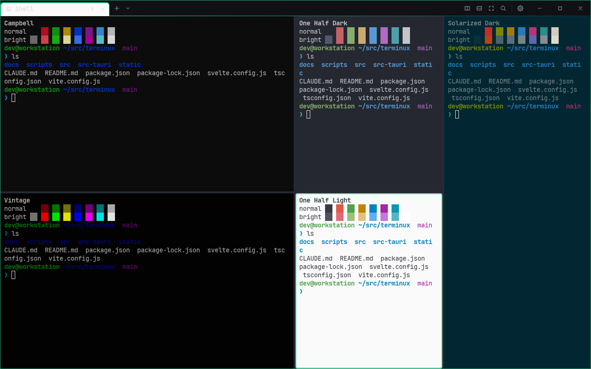

# Color schemes

The 17 built-in color schemes, the `[[scheme]]` format to define your own, and how a scheme is chosen. Terminux ships its own scheme plus the Windows Terminal set.

- [Selecting a scheme](#selecting-a-scheme)
- [Built-in schemes](#built-in-schemes)
- [Custom schemes: `[[scheme]]`](#custom-schemes-scheme)
- [Per-color overrides: `[theme]`](#per-color-overrides-theme)

## Selecting a scheme

- Per profile or for all profiles: [`color_scheme`](profile-settings.md#color_scheme) in `[defaults]` or `[[profile]]`. Without it the scheme is `Terminux`.
- Names are matched case-insensitively. A user `[[scheme]]` with the same name as a built-in one wins.
- Light/dark pair: `color_scheme = { light = "One Half Light", dark = "One Half Dark" }` picks by the effective UI brightness (see [`app_theme`](configuration.md#app_theme)). If only one of the two is given it is used for both.
- Per pane at runtime: the `set_color_scheme` action / the palette entry *Select color scheme...* (live preview, `Escape` restores), or `--colorScheme` on the [command line](command-line.md#new-tab).
- Layering order for the effective colors of a pane: scheme, then [`[theme]`](#per-color-overrides-theme) overrides, then the profile's `foreground`, `background`, `selection_background` and `cursor_color`.

```toml
[defaults]
color_scheme = { light = "One Half Light", dark = "One Half Dark" }

[[profile]]
id = "prod"
name = "Prod"
cmd = "ssh"
args = ["prod"]
color_scheme = "Campbell Powershell"
tab_color = "#c50f1f"
```

## Built-in schemes

Each scheme defines `background`, `foreground`, the cursor color, optionally a selection background, and the 16 ANSI colors (`brightX` are the intense variants). A dash means the scheme does not set it (the terminal default applies). Colors are shown as `#rrggbb`.



| Scheme | background | foreground | cursor | selection |
| --- | --- | --- | --- | --- |
| Terminux | `#14161b` | `#d6d9e0` | `#34d399` | `#3a4256` |
| Campbell | `#0c0c0c` | `#cccccc` | `#ffffff` | - |
| Campbell Powershell | `#012456` | `#cccccc` | `#ffffff` | - |
| Vintage | `#000000` | `#c0c0c0` | `#ffffff` | - |
| One Half Dark | `#282c34` | `#dcdfe4` | `#ffffff` | - |
| One Half Light | `#fafafa` | `#383a42` | `#4f525d` | `#383a42` |
| Solarized Dark | `#002b36` | `#839496` | `#ffffff` | - |
| Solarized Light | `#fdf6e3` | `#657b83` | `#002b36` | `#2c4d57` |
| Tango Dark | `#000000` | `#d3d7cf` | `#ffffff` | - |
| Tango Light | `#ffffff` | `#555753` | `#000000` | `#141414` |
| Dark+ | `#1e1e1e` | `#cccccc` | `#808080` | `#ffffff` |
| VSCode Dark Modern | `#1f1f1f` | `#cccccc` | `#ffffff` | `#264f78` |
| VSCode Light Modern | `#ffffff` | `#3b3b3b` | `#000000` | `#add6ff` |
| CGA | `#000000` | `#aaaaaa` | `#00aa00` | `#ffffff` |
| IBM 5153 | `#000000` | `#aaaaaa` | `#00aa00` | `#ffffff` |
| Ottosson | `#000000` | `#bebebe` | `#ffffff` | `#92a4fd` |
| Dimidium | `#141414` | `#bab7b6` | `#37e57b` | `#8db8e5` |

### Palettes

| Scheme | black | red | green | yellow | blue | magenta | cyan | white |
| --- | --- | --- | --- | --- | --- | --- | --- | --- |
| Terminux | `#1d2027` | `#e06c75` | `#98c379` | `#e5c07b` | `#61afef` | `#c678dd` | `#56b6c2` | `#d6d9e0` |
| Campbell | `#0c0c0c` | `#c50f1f` | `#13a10e` | `#c19c00` | `#0037da` | `#881798` | `#3a96dd` | `#cccccc` |
| Campbell Powershell | `#0c0c0c` | `#c50f1f` | `#13a10e` | `#c19c00` | `#0037da` | `#881798` | `#3a96dd` | `#cccccc` |
| Vintage | `#000000` | `#800000` | `#008000` | `#808000` | `#000080` | `#800080` | `#008080` | `#c0c0c0` |
| One Half Dark | `#282c34` | `#e06c75` | `#98c379` | `#e5c07b` | `#61afef` | `#c678dd` | `#56b6c2` | `#dcdfe4` |
| One Half Light | `#383a42` | `#e45649` | `#50a14f` | `#c18301` | `#0184bc` | `#a626a4` | `#0997b3` | `#fafafa` |
| Solarized Dark | `#002b36` | `#dc322f` | `#859900` | `#b58900` | `#268bd2` | `#d33682` | `#2aa198` | `#eee8d5` |
| Solarized Light | `#002b36` | `#dc322f` | `#859900` | `#b58900` | `#268bd2` | `#d33682` | `#2aa198` | `#eee8d5` |
| Tango Dark | `#000000` | `#cc0000` | `#4e9a06` | `#c4a000` | `#3465a4` | `#75507b` | `#06989a` | `#d3d7cf` |
| Tango Light | `#000000` | `#cc0000` | `#4e9a06` | `#c4a000` | `#3465a4` | `#75507b` | `#06989a` | `#d3d7cf` |
| Dark+ | `#000000` | `#cd3131` | `#0dbc79` | `#e5e510` | `#2472c8` | `#bc3fbc` | `#11a8cd` | `#e5e5e5` |
| VSCode Dark Modern | `#000000` | `#cd3131` | `#0dbc79` | `#e5e510` | `#2472c8` | `#bc3fbc` | `#11a8cd` | `#e5e5e5` |
| VSCode Light Modern | `#000000` | `#cd3131` | `#00bc00` | `#949800` | `#0451a5` | `#bc05bc` | `#0598bc` | `#555555` |
| CGA | `#000000` | `#aa0000` | `#00aa00` | `#aa5500` | `#0000aa` | `#aa00aa` | `#00aaaa` | `#aaaaaa` |
| IBM 5153 | `#000000` | `#aa0000` | `#00aa00` | `#c47e00` | `#0000aa` | `#aa00aa` | `#00aaaa` | `#aaaaaa` |
| Ottosson | `#000000` | `#be2c21` | `#3fae3a` | `#be9a4a` | `#204dbe` | `#bb54be` | `#00a7b2` | `#bebebe` |
| Dimidium | `#000000` | `#cf494c` | `#60b442` | `#db9c11` | `#0575d8` | `#af5ed2` | `#1db6bb` | `#bab7b6` |

| Scheme (bright) | bright_black | bright_red | bright_green | bright_yellow | bright_blue | bright_purple | bright_cyan | bright_white |
| --- | --- | --- | --- | --- | --- | --- | --- | --- |
| Terminux | `#5c6370` | `#ef8891` | `#b5e08f` | `#f4d398` | `#82c1f5` | `#d899ea` | `#7fd0db` | `#ffffff` |
| Campbell | `#767676` | `#e74856` | `#16c60c` | `#f9f1a5` | `#3b78ff` | `#b4009e` | `#61d6d6` | `#f2f2f2` |
| Campbell Powershell | `#767676` | `#e74856` | `#16c60c` | `#f9f1a5` | `#3b78ff` | `#b4009e` | `#61d6d6` | `#f2f2f2` |
| Vintage | `#808080` | `#ff0000` | `#00ff00` | `#ffff00` | `#0000ff` | `#ff00ff` | `#00ffff` | `#ffffff` |
| One Half Dark | `#5a6374` | `#e06c75` | `#98c379` | `#e5c07b` | `#61afef` | `#c678dd` | `#56b6c2` | `#dcdfe4` |
| One Half Light | `#4f525d` | `#df6c75` | `#98c379` | `#e4c07a` | `#61afef` | `#c577dd` | `#56b5c1` | `#ffffff` |
| Solarized Dark | `#073642` | `#cb4b16` | `#586e75` | `#657b83` | `#839496` | `#6c71c4` | `#93a1a1` | `#fdf6e3` |
| Solarized Light | `#073642` | `#cb4b16` | `#586e75` | `#657b83` | `#839496` | `#6c71c4` | `#93a1a1` | `#fdf6e3` |
| Tango Dark | `#555753` | `#ef2929` | `#8ae234` | `#fce94f` | `#729fcf` | `#ad7fa8` | `#34e2e2` | `#eeeeec` |
| Tango Light | `#555753` | `#ef2929` | `#8ae234` | `#fce94f` | `#729fcf` | `#ad7fa8` | `#34e2e2` | `#eeeeec` |
| Dark+ | `#666666` | `#f14c4c` | `#23d18b` | `#f5f543` | `#3b8eea` | `#d670d6` | `#29b8db` | `#e5e5e5` |
| VSCode Dark Modern | `#666666` | `#f14c4c` | `#23d18b` | `#f5f543` | `#3b8eea` | `#d670d6` | `#29b8db` | `#e5e5e5` |
| VSCode Light Modern | `#666666` | `#cd3131` | `#14ce14` | `#b5ba00` | `#0451a5` | `#bc05bc` | `#0598bc` | `#a5a5a5` |
| CGA | `#555555` | `#ff5555` | `#55ff55` | `#ffff55` | `#5555ff` | `#ff55ff` | `#55ffff` | `#ffffff` |
| IBM 5153 | `#555555` | `#ff5555` | `#55ff55` | `#ffff55` | `#5555ff` | `#ff55ff` | `#55ffff` | `#ffffff` |
| Ottosson | `#808080` | `#ff3e30` | `#58ea51` | `#ffc944` | `#2f6aff` | `#fc74ff` | `#00e1f0` | `#ffffff` |
| Dimidium | `#817e7e` | `#ff643b` | `#37e57b` | `#fccd1a` | `#688dfd` | `#ed6fe9` | `#32e0fb` | `#dee3e4` |

Notes:

- `Terminux` is the default scheme and the base that custom `[[scheme]]` colors are merged onto (unset keys fall back to it). Its `cursor_accent` is `#14161b`.
- The cursor accent (color of the character under a block cursor) is the scheme's `cursor_accent` when it defines one (the built-in Windows Terminal schemes do not, and custom schemes inherit `#14161b` from `Terminux`); otherwise it equals the background. A profile `background` override always makes it equal to that background.
- `Campbell`, `Campbell Powershell`, `Vintage`, `One Half Dark/Light`, `Solarized Dark/Light`, `Tango Dark/Light`, `Dark+`, `VSCode Dark/Light Modern`, `CGA`, `IBM 5153`, `Ottosson` and `Dimidium` follow the Windows Terminal schemes of the same names.
- Windows Terminal calls the magenta slot `purple`; both `purple` and `magenta` are accepted in `[[scheme]]`.

## Custom schemes: `[[scheme]]`

Define as many `[[scheme]]` tables as you like. `name` is required (it is what `color_scheme` refers to); every other key is a color. Keys use Windows Terminal names in snake_case; the xterm.js camelCase names (`cursor`, `magenta`, `brightMagenta`, `cursorAccent`, `selectionForeground`, ...) are accepted too. Unset colors fall back to the `Terminux` scheme.

| Key | Meaning |
| --- | --- |
| `name` | Scheme name |
| `background`, `foreground` | Default text colors |
| `cursor_color` | Cursor (alias `cursor`) |
| `cursor_accent` | Character color under a block cursor |
| `selection_background` | Selection (alias `selectionBackground`) |
| `selection_foreground` | Selected text color (xterm.js option) |
| `black`, `red`, `green`, `yellow`, `blue`, `purple`, `cyan`, `white` | ANSI 0-7 (`purple` = `magenta`) |
| `bright_black`, `bright_red`, `bright_green`, `bright_yellow`, `bright_blue`, `bright_purple`, `bright_cyan`, `bright_white` | ANSI 8-15 |

Colors are CSS color strings, typically `"#rrggbb"`.

```toml
[[scheme]]
name = "Midnight"
background = "#0b0f19"
foreground = "#c9d1d9"
cursor_color = "#58a6ff"
selection_background = "#1f2a44"
black = "#0b0f19"
red = "#ff7b72"
green = "#3fb950"
yellow = "#d29922"
blue = "#58a6ff"
purple = "#bc8cff"
cyan = "#39c5cf"
white = "#b1bac4"
bright_black = "#6e7681"
bright_red = "#ffa198"
bright_green = "#56d364"
bright_yellow = "#e3b341"
bright_blue = "#79c0ff"
bright_purple = "#d2a8ff"
bright_cyan = "#56d4dd"
bright_white = "#f0f6fc"

[defaults]
color_scheme = "Midnight"
```

Schemes can also be added from [fragments](file-locations.md#fragments) (`fragments/*.toml`).

## Per-color overrides: `[theme]`

`[theme]` accepts the same color keys (without `name`) and is applied on top of the active scheme for **every** pane, before the profile-level `foreground` / `background` / `selection_background` / `cursor_color`.

```toml
[theme]
cursor_color = "#ffcc00"
bright_black = "#7a8296"
```

## See also

- [profile-settings.md](profile-settings.md#color_scheme): `color_scheme`, `foreground`, `background`, `unfocused_appearance`
- [configuration.md](configuration.md#scheme): `[[scheme]]` and `[[ui_theme]]` (application chrome)
