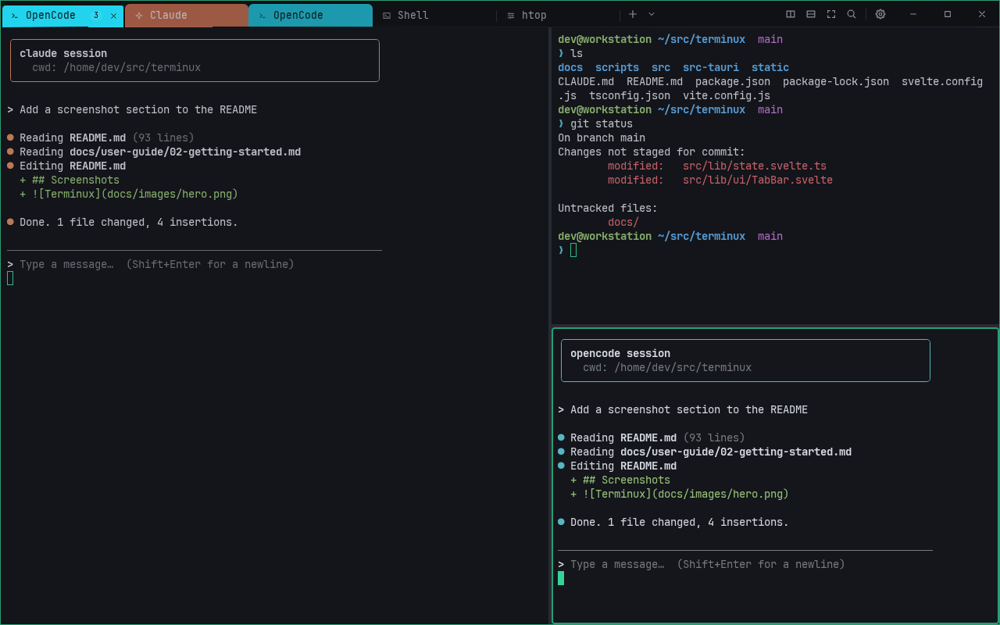
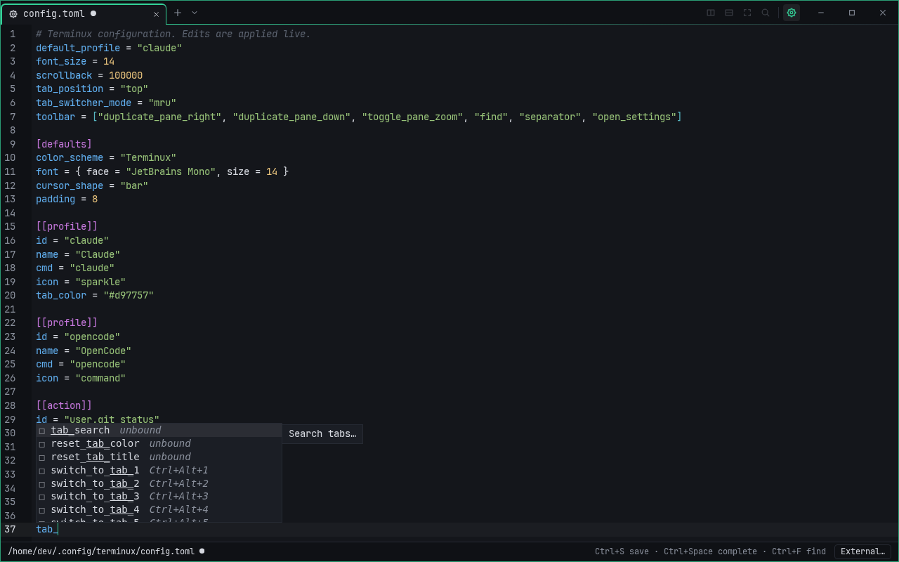

# Getting started

A tour of the Terminux window and a ten-minute walkthrough: open tabs, split panes, use the command palette, change the look and save your first customization.

## Contents

- [The window at a glance](#the-window-at-a-glance)
- [Core ideas](#core-ideas)
- [Ten-minute walkthrough](#ten-minute-walkthrough)
- [Keys worth learning first](#keys-worth-learning-first)
- [Everything is an action](#everything-is-an-action)
- [Editing the configuration](#editing-the-configuration)

## The window at a glance

Terminux draws its own title bar (the native frame is disabled), so everything lives in one strip at the top:



```
+--------------------------------------------------------------------------+
| [tab 1] [tab 2*] [tab 3]  [+][v]   <drag area>    [toolbar]   [_][o][x]  |
+--------------------------------------------------------------------------+
|                             |                                            |
|  pane (terminal)            |  pane (terminal)                           |
|                             |                                            |
+-----------------------------+--------------------------------------------+
```

| Part | What it does |
| --- | --- |
| Tabs | One tab per layout of panes. Click to switch, double-click to rename, middle-click to close, drag to reorder or tear out. See [Tabs](03-tabs.md). |
| `+` button | New tab with the default profile (`new_tab`, `Ctrl+Shift+T`). |
| `v` button | New tab dropdown: pick a profile (`open_new_tab_dropdown`, `Ctrl+Shift+Space`). Its content comes from [`new_tab_menu`](../reference/configuration.md#new_tab_menu); see [Profiles](06-profiles.md#new_tab_menu). |
| Empty tab-bar space | Drag to move the window. Right-click for the tab bar menu (new tab, tab position, focus mode, always on top, fullscreen, customize toolbar, settings, command palette). |
| Toolbar | Buttons for any command. Defaults: duplicate pane right, duplicate pane down, toggle pane zoom, find, a separator, settings. Right-click it or drag its buttons to customize; edits are written to [`toolbar`](../reference/configuration.md#toolbar) in `config.toml`. |
| Window buttons | Minimize, maximize/restore, close. |
| Panes | The terminals. A thin split line separates panes; drag it to resize. |
| Window title | `<active tab title> - Terminux` (see [`show_terminal_title_in_titlebar`](../reference/configuration.md#show_terminal_title_in_titlebar)). |

The tab bar can also be a vertical panel on the left or right ([`tab_position`](../reference/configuration.md#tab_position)); see [Vertical tabs](03-tabs.md#vertical-tabs). Hide all chrome with focus mode (`toggle_focus_mode`) or go fullscreen with `F11`.

Small indicators on a tab: a bell icon (a pane rang the bell while unfocused), a dot (new output in a background tab), a lock (a pane is read-only), a broadcast icon (input is mirrored to all panes), a number (pane count; a zoom icon beside it when a pane is zoomed) and a progress ring (OSC 9;4 progress from the running program).

## Core ideas

- **Profile**: a named command plus appearance (shell, WSL distro, SSH host, any program...). Defined in `config.toml`; generated automatically for WSL, SSH hosts and PowerShell. See [Profiles](06-profiles.md).
- **Tab**: holds a tree of panes. **Pane**: one terminal running one process.
- **Window**: holds tabs. You can have many windows, and tabs or panes move between them with their processes still running. See [Windows](05-windows.md).
- **Action**: every operation (new tab, split, zoom, find...) is a named command. Keys, the palette, the toolbar, menus and the command line all run the same actions.
- **Config**: one TOML file, hot-reloaded. Almost everything is optional.

## Ten-minute walkthrough

1. **Open a second tab.** `Ctrl+Shift+T`. Switch with `Ctrl+Tab` / `Ctrl+Shift+Tab` or jump directly with `Ctrl+Alt+1` ... `Ctrl+Alt+8` (`Ctrl+Alt+9` is the last tab).
2. **Pick a profile.** Click the dropdown arrow, or press `Ctrl+Shift+1` ... `Ctrl+Shift+9` to open the 1st-9th visible profile directly.
3. **Split.** `Alt+Shift+Plus` duplicates the pane to the right, `Alt+Shift+-` below, `Alt+Shift+D` picks the direction with more room. A split continues the current pane: same profile, and the same working directory (read from the process on Linux; on other systems the directory reported by the shell, see [shell integration](10-shell-integration.md)).
4. **Move between panes.** `Alt+Arrows` move focus; `Alt+Shift+Arrows` resize; `Ctrl+Alt+Left` returns to the previously focused pane. See [Panes](04-panes.md).
5. **Zoom a pane.** Use the toolbar button, or the command palette entry "Toggle pane zoom" (`toggle_pane_zoom` has no default key; bind one in [`[keys]`](../reference/configuration.md#keys)).
6. **Open the command palette.** `Ctrl+Shift+P`. Type to filter commands; each shows its key if it has one. Delete the leading `>` to type a `wt`-style command line instead, for example `new-tab -p shell ; split-pane -H`.
7. **Search the scrollback.** `Ctrl+Shift+F`. See [Search and navigation](09-search-and-navigation.md).
8. **Copy and paste.** Select with the mouse and press `Ctrl+Shift+C` (or `Ctrl+C` while a selection exists; with no selection `Ctrl+C` goes to the program). Paste with `Ctrl+Shift+V` or `Shift+Insert`. Right-click copies the selection, or pastes when nothing is selected. See [Text and clipboard](08-text-and-clipboard.md).
9. **Change the font size.** `Ctrl+Plus`, `Ctrl+Minus`, `Ctrl+0` to reset, or `Ctrl+wheel`.
10. **Change the colors.** Open the command palette and choose "Select color scheme..." for a live preview (Escape restores the previous scheme). To make it permanent, set `color_scheme` in `[defaults]`. See [Appearance](07-appearance.md).
11. **Open the settings.** `Ctrl+,`. Add this and save; the change applies at once:

    ```toml
    [defaults]
    color_scheme = { light = "One Half Light", dark = "One Half Dark" }
    font = { face = "JetBrains Mono", size = 15 }
    ```

12. **Close things.** `Ctrl+Shift+W` closes the pane (closing the last pane closes the tab; closing the last tab closes the window). Closed a tab or pane by mistake? Run "Restore last closed pane or tab" (`restore_last_closed`) from the palette: Terminux remembers the last 20.

## Keys worth learning first

| Do this | Key |
| --- | --- |
| New tab / window / duplicate tab | `Ctrl+Shift+T` / `Ctrl+Shift+N` / `Ctrl+Shift+D` |
| New tab with profile 1..9 | `Ctrl+Shift+1` ... `Ctrl+Shift+9` |
| Next / previous tab | `Ctrl+Tab` / `Ctrl+Shift+Tab` |
| Duplicate pane right / down / auto | `Alt+Shift+Plus` / `Alt+Shift+-` / `Alt+Shift+D` |
| Move focus / resize pane | `Alt+Arrows` / `Alt+Shift+Arrows` |
| Close pane | `Ctrl+Shift+W` |
| Command palette | `Ctrl+Shift+P` |
| Find | `Ctrl+Shift+F` |
| Mark mode (keyboard selection) | `Ctrl+Shift+M` |
| Settings | `Ctrl+,` |
| Fullscreen | `F11` or `Alt+Enter` |
| Quake mode (global) | `Win+\`` |

The complete list is in the [keybindings reference](../reference/keybindings.md). Rebind anything in the `[keys]` table:

```toml
[keys]
find = "F3"
paste = ["Ctrl+Shift+V", "Shift+Insert"]
toggle_pane_zoom = "Ctrl+Shift+Z"
new_window = ""            # empty string unbinds
```

A key whose action cannot act (for example `Ctrl+C` with no selection) is passed to the terminal instead of being swallowed.

## Everything is an action

The same operation can be started four ways:

| From | Example |
| --- | --- |
| A key | `Ctrl+Shift+D` runs `duplicate_tab` |
| The palette | "Duplicate tab" |
| A custom `[[action]]` | `command = "duplicate_tab"` |
| The command line | `terminux -w 0 nt -p shell ; sp -V -s .3` |

The command line follows `wt.exe` syntax; see the [command-line reference](../reference/command-line.md). For recurring layouts use [`startup_actions`](../reference/configuration.md#startup_actions) or a custom action.

## Editing the configuration



- `Ctrl+,` opens the built-in editor in a tab. `Ctrl+Space` completes keys and values; unknown keys are underlined; saving applies instantly.
- `Ctrl+Alt+,` opens the read-only defaults, a good place to discover keys.
- A config file with a syntax error is ignored (defaults are used) and a banner shows the error, so a typo never locks you out.

## See also

- [Installation](01-installation.md)
- [Tabs](03-tabs.md), [Panes](04-panes.md), [Windows](05-windows.md)
- [Profiles](06-profiles.md) and [Appearance](07-appearance.md)
- [Configuration reference](../reference/configuration.md) and [keybindings](../reference/keybindings.md)
