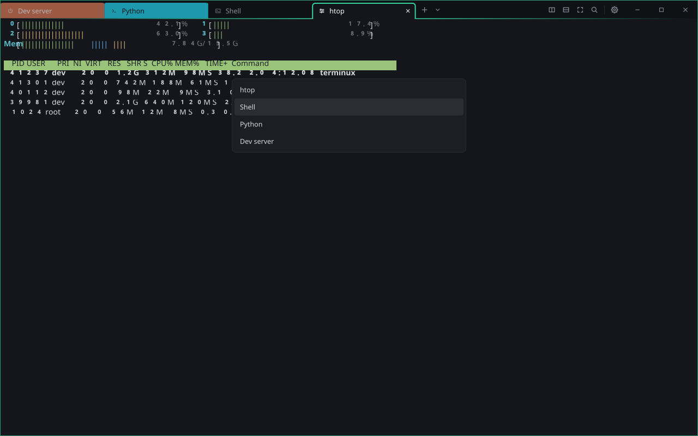
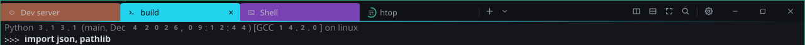
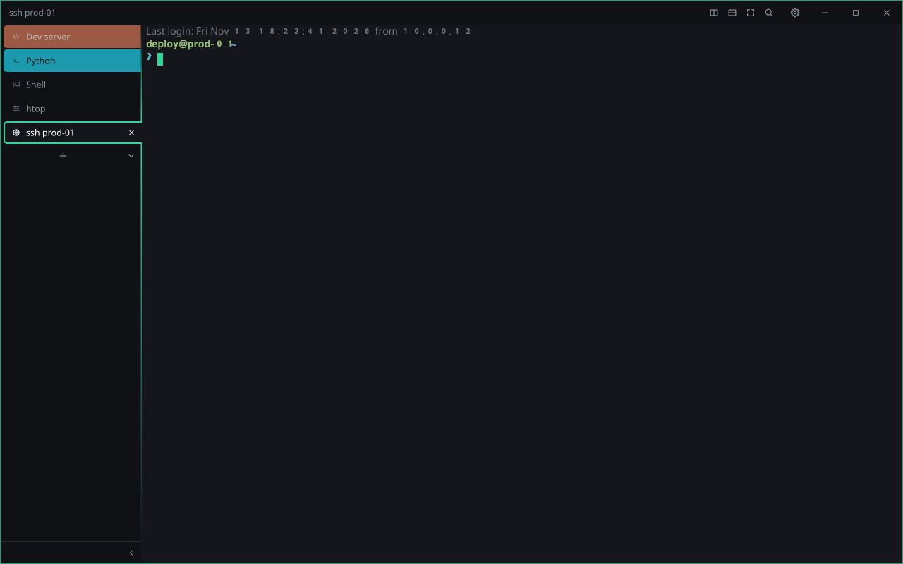
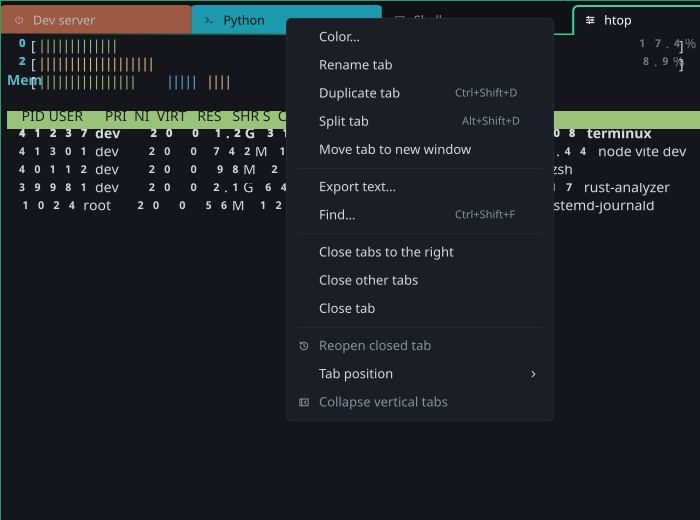

# Tabs

Tabs hold layouts of panes. This guide covers creating, naming, coloring, reordering and moving tabs, the MRU switcher, tab search, width modes, vertical tabs, progress indication and restoring closed tabs.

## Contents

- [Creating tabs](#creating-tabs)
- [Switching tabs](#switching-tabs)
- [Closing tabs and restoring them](#closing-tabs-and-restoring-them)
- [Titles and renaming](#titles-and-renaming)
- [Colors](#colors)
- [Reordering and moving between windows](#reordering-and-moving-between-windows)
- [Width modes](#width-modes)
- [Vertical tabs](#vertical-tabs)
- [Activity, bell and progress indicators](#activity-bell-and-progress-indicators)
- [The tab context menu](#the-tab-context-menu)
- [Tab-related settings](#tab-related-settings)

## Creating tabs

| Goal | How |
| --- | --- |
| New tab, default profile | `Ctrl+Shift+T` or the `+` button |
| New tab, choose a profile | Dropdown arrow, `Ctrl+Shift+Space`, or `Ctrl+Shift+1` ... `Ctrl+Shift+9` for the 1st-9th visible profile |
| Duplicate the current tab | `Ctrl+Shift+D` (`duplicate_tab`) |
| From the command line | `terminux nt -p python -d ~/src --title dev` |
| From a custom action | `{ command = "new_tab", profile = "python" }` |

`duplicate_tab` recreates the layout (every pane, same profiles, same split sizes and working directories) with fresh processes and no copied output; the tab name and color are kept.

Where new tabs appear is controlled by [`new_tab_position`](../reference/configuration.md#new_tab_position): `after_last_tab` (default) or `after_current_tab`. A duplicate follows the same rule.

```toml
new_tab_position = "after_current_tab"
```

The arguments of `new_tab` (`profile`, `index`, `commandline`, `starting_directory`, `tab_title`, `tab_color`, `color_scheme`, `suppress_application_title`) are the same ones `new-tab` accepts on the command line; see [`new-tab`](../reference/command-line.md#new-tab) and the [`new_tab`](../reference/actions.md#new_tab) action.

## Switching tabs



| Goal | Key |
| --- | --- |
| Next / previous | `Ctrl+Tab` / `Ctrl+Shift+Tab` |
| Tab 1-8 | `Ctrl+Alt+1` ... `Ctrl+Alt+8` |
| Last tab | `Ctrl+Alt+9` |
| Click a tab | Mouse |
| Search tabs by title | "Search tabs..." in the command palette (`tab_search`, no default key) |
| Pick from a list | Palette entry "Switch to tab..." |

### The MRU switcher

[`tab_switcher_mode`](../reference/configuration.md#tab_switcher_mode) decides what `Ctrl+Tab` does:

| Value | Behavior |
| --- | --- |
| `in_order` (default) | Moves to the next tab in tab-bar order. |
| `mru` | Opens an overlay listing tabs, most recently used first. Each `Tab` press (or Up/Down arrow) moves the selection; the selected tab is activated when you release the modifier, or press `Enter`. `Escape` cancels. Clicking an entry selects it. |
| `disabled` | Same as `in_order`. |

```toml
tab_switcher_mode = "mru"
```

`next_tab` and `prev_tab` also take a `tab_switcher_mode` argument, so you can bind one combo to each behavior:

```toml
[[action]]
name = "Previous tab (in order)"
keys = "Ctrl+PgUp"
command = "prev_tab"
tab_switcher_mode = "disabled"
```

If the window loses focus while the switcher is open, the highlighted tab is activated.

### Tab search

`tab_search` opens a palette listing the open tabs (title, number as the hint, "current" marker). Type to filter, `Enter` to jump. It has no default key; bind one:

```toml
[keys]
tab_search = "Ctrl+Alt+T"   # example; pick a combination you do not use
```

## Closing tabs and restoring them

| Goal | How |
| --- | --- |
| Close the tab | Close button on the tab, middle-click, tab menu "Close tab", or close every pane with `Ctrl+Shift+W` |
| Close the others | Tab menu "Close other tabs" (`close_other_tabs`) |
| Close tabs to the right | Tab menu "Close tabs to the right" (`close_tabs_after`) |
| Reopen the last closed | `restore_last_closed` (palette, or tab menu "Reopen closed tab") |

- Closing a tab with a read-only pane asks for confirmation.
- Closing the last tab closes the window (like Windows Terminal).
- Closing a window that holds several tabs asks "Close all tabs?" with a "Don't ask again" box that writes `confirm_close_all_tabs = false` to your config. See [Windows](05-windows.md).
- `restore_last_closed` has no default key. Terminux remembers the last 20 closed tabs and panes, with their layout and scrollback; the restored tab returns to its old position, with a fresh process started in the old working directory. A closed pane is put back next to the neighbor it had.

```toml
[keys]
restore_last_closed = "Ctrl+Shift+Z"   # example
```

The close button's visibility comes from the UI theme: `show_close_button` in `[ui_theme.tab]` accepts `always`, `hover` (default), `never` and `active_only`. See [Appearance](07-appearance.md#app-theme-and-ui_theme).

## Titles and renaming

The visible title is chosen in this order:

1. The name you gave the tab (rename).
2. The title the running program set (OSC 0/2), unless the profile has `suppress_application_title`.
3. The profile's `tab_title`.
4. The profile name.

Ways to rename:

| How | Detail |
| --- | --- |
| Double-click the tab | Inline editor: `Enter` or clicking away saves, `Escape` cancels. |
| Tab menu "Rename tab" | Same editor. |
| `open_tab_renamer` | Palette ("Rename tab..."); no default key. |
| `reset_tab_title` | Clears the custom name (also what an empty name does). |
| CLI | `terminux nt --title "Build"`; add `--suppressApplicationTitle` so programs cannot override it. |
| Profile | `tab_title = "Work"`, `suppress_application_title = true` |

```toml
[[profile]]
id = "python"
name = "Python"
cmd = "python3"
tab_title = "Python"
suppress_application_title = true
```

The settings tabs (built-in config editor, read-only defaults) always show their fixed titles; renaming has no effect on them.

## Colors

Give tabs a color to tell them apart at a glance.



- Tab menu "Color..." (or `open_tab_color_picker`) opens a picker with preset swatches (grouped for dark and light themes, ordered by hue), a custom color input and a Reset button.
- `reset_tab_color` clears it.
- A profile can set one: `tab_color = "#34d399"`.
- Command line: `terminux nt --tabColor "#34d399"`.
- Custom actions: `{ command = "set_tab_color", color = "#34d399" }`.

A color set from the picker wins over the profile's `tab_color`. Text on a colored tab switches between dark and light automatically for contrast.

## Reordering and moving between windows

Drag a tab to reorder it: neighbors slide aside while you drag, and the drag starts after 6 pixels of movement.

| Gesture | Result |
| --- | --- |
| Drag along the tab strip | Reorder in the same window. |
| Drag out of the window (above, below, or beyond its sides) and drop on empty desktop | The tab becomes a new window at the drop position. |
| Drag out and drop on another Terminux window | The tab moves into that window. |

Moving a tab keeps its processes running: the running sessions are detached from this window (their output is buffered, up to 8 MB), then re-attached in the target. A detached session nobody attaches within 60 seconds is killed. If the hand-off fails, the tab comes back here and a "Move failed" toast appears.

By key or palette (no default keys): `move_tab_forward`, `move_tab_backward` and `move_tab_to_new_window` ("Move tab to new window", also in the tab menu). A custom action can target a specific window:

```toml
[[action]]
name = "Send tab to window 'logs'"
command = "move_tab"
window = "logs"
```

Window targets are ids, names, `new` (or `-1`) and `last` (or `0`, the most recently focused other window). See [Windows](05-windows.md#window-ids-names-and-targets).

## Width modes

[`tab_width_mode`](../reference/configuration.md#tab_width_mode) (Windows Terminal `tabWidthMode`) controls the horizontal tab bar:

| Value | Look |
| --- | --- |
| `equal` (default) | Tabs share the bar equally, between 90 and 220 px wide. |
| `title_length` | Each tab is as wide as its title, up to 320 px. |
| `compact` | Inactive tabs shrink to their icon; the active tab shows its title. |

```toml
tab_width_mode = "compact"
```

The mode does not apply to vertical tabs.

A title too long for its tab is cut with an ellipsis on the right; `tab_title_ellipsis = "start"` cuts it on the left instead, keeping the end (useful for paths):

```toml
tab_title_ellipsis = "start"
```

## Vertical tabs

Put the tab list in a side panel with [`tab_position`](../reference/configuration.md#tab_position) = `"left"` or `"right"`. The title bar stays on top (new-tab buttons, toolbar, window buttons) while tabs stack vertically.



```toml
tab_position = "left"
vertical_tab_width = 220          # initial width in px
vertical_tabs_collapsed = false   # start as an icon strip
```

| Goal | How |
| --- | --- |
| Toggle between top and the side | `toggle_vertical_tabs` (palette; no default key). Goes to the side set in `tab_position`, or to the left if it is `top`. |
| Choose top / left / right | Right-click the tab bar or a tab, then "Tab position". |
| Collapse to icons | The panel's collapse button, tab menu "Collapse vertical tabs", or `toggle_vertical_tabs_collapsed`. |
| Resize | Drag the panel's inner edge. Width is kept between 120 and 480 px. Double-click the edge to fit the longest tab title. |

Things to know:

- Tab position, panel width and collapsed state chosen from the UI are remembered per machine (in the webview's local storage) and then take priority over `config.toml`. To go back to the config values, change them again from the UI; deleting the setting from `config.toml` alone will not override a remembered choice.
- In the collapsed strip only icons are shown. Starting a rename expands the panel.
- Collapse and the vertical commands do nothing while tabs are on top.

## Activity, bell and progress indicators

A tab shows what its panes are doing, even when it is in the background.

| Indicator | Meaning |
| --- | --- |
| Dot | A pane in a non-active tab produced output. Cleared when you focus the pane. |
| Bell icon | A pane rang the bell while not focused. Depends on [`bell_style`](../reference/profile-settings.md#bell_style) (see [Notifications](14-notifications-and-bell.md)). |
| Lock | At least one pane is read-only. |
| Broadcast icon | The tab mirrors typed input to all its panes (`toggle_broadcast_input`). |
| Number | Pane count when more than one; a zoom icon appears beside it while a pane is zoomed. |
| Progress ring | A program reported progress with OSC 9;4. |

### Progress ring (OSC 9;4)

Programs that print `ESC ] 9 ; 4 ; <state> ; <value> BEL` show a ring on the tab, and the window's taskbar button follows the active tab. States: `1` normal (value 0-100), `2` error, `3` indeterminate, `4` paused; `0` (or anything else) clears it.

```sh
printf '\e]9;4;1;40\a'   # 40 %
printf '\e]9;4;3\a'      # indeterminate
printf '\e]9;4;0\a'      # clear
```

## The tab context menu

Right-click a tab:



| Group | Items |
| --- | --- |
| Tab | Show in a pane, Color..., Rename tab, Duplicate tab, Split tab (duplicate pane, direction auto), Move tab to new window |
| Buffer | Export text..., Find... |
| Close | Close tabs to the right, Close other tabs, Close tab |
| Layout | Reopen closed tab, Tab position (Top / Left / Right), Collapse vertical tabs |

"Show in a pane" moves the tab's panes (terminal or built-in file editor) beside the active pane of the most recent other terminal tab; dragging the tab onto a pane does the same at the highlighted spot. Settings tabs get "Show in a pane" (`open_settings_pane` for that tab; disabled without a terminal tab), "Move tab to new window", and the Close and Layout groups. Right-clicking empty tab-bar space shows a smaller menu: New tab, New tab with profile, the layout group, Focus mode, Always on top, Fullscreen, Customize toolbar..., Settings and Command palette.

## Tab-related settings

| Key | Purpose |
| --- | --- |
| [`new_tab_position`](../reference/configuration.md#new_tab_position) | `after_last_tab` or `after_current_tab` |
| [`tab_switcher_mode`](../reference/configuration.md#tab_switcher_mode) | `in_order`, `mru`, `disabled` |
| [`tab_width_mode`](../reference/configuration.md#tab_width_mode) | `equal`, `title_length`, `compact` |
| [`tab_title_ellipsis`](../reference/configuration.md#tab_title_ellipsis) | `end` (default) or `start`: which side a long title is cut on |
| [`tab_position`](../reference/configuration.md#tab_position) | `top`, `left`, `right` |
| [`vertical_tab_width`](../reference/configuration.md#vertical_tab_width), [`vertical_tabs_collapsed`](../reference/configuration.md#vertical_tabs_collapsed) | Vertical panel defaults |
| [`show_tabs_fullscreen`](../reference/configuration.md#show_tabs_fullscreen) | Keep the tab bar visible in fullscreen |
| [`confirm_close_all_tabs`](../reference/configuration.md#confirm_close_all_tabs) | Ask before closing a window with several tabs |
| [`tab_title`](../reference/profile-settings.md#tab_title), [`tab_color`](../reference/profile-settings.md#tab_color), [`suppress_application_title`](../reference/profile-settings.md#suppress_application_title) | Per-profile tab look |

## See also

- [Panes](04-panes.md)
- [Windows](05-windows.md)
- [Appearance](07-appearance.md) for UI themes
- [Keybindings reference](../reference/keybindings.md)
- [Actions reference](../reference/actions.md)
