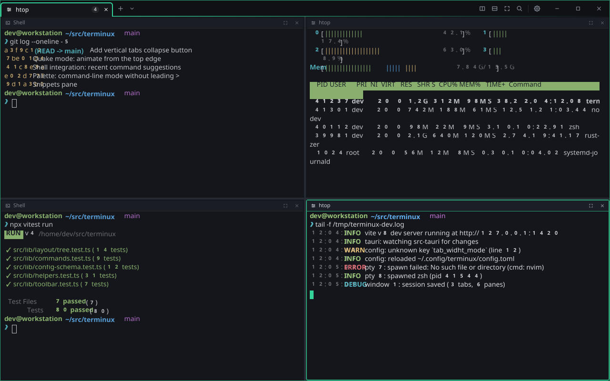
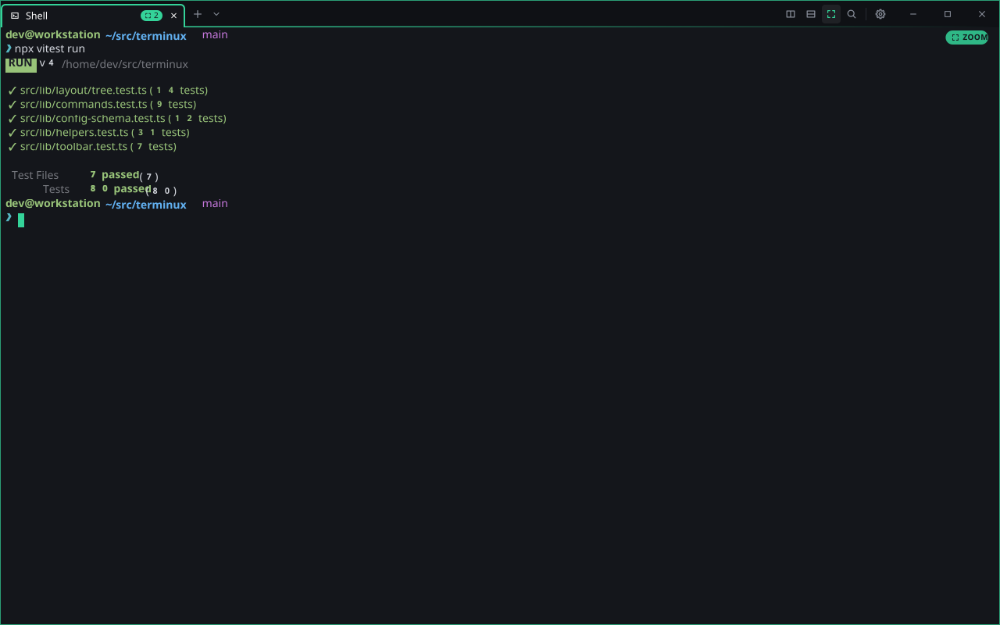
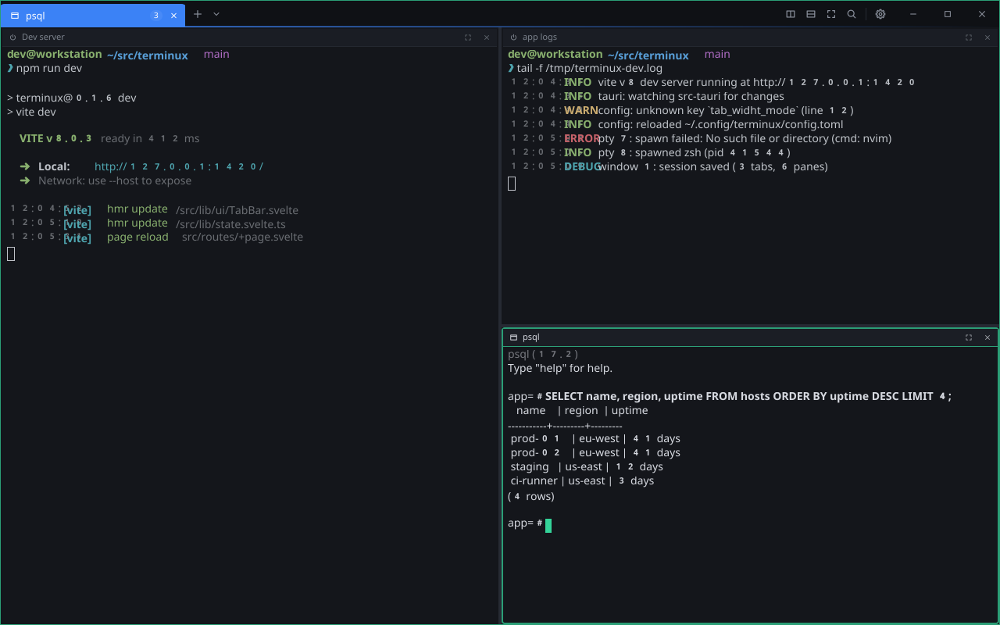
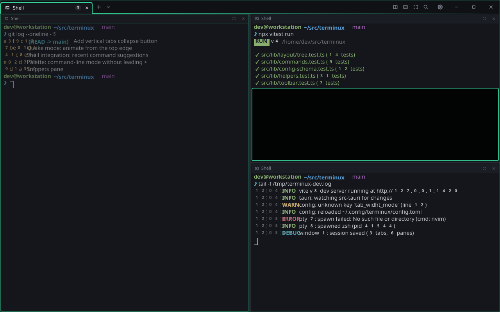
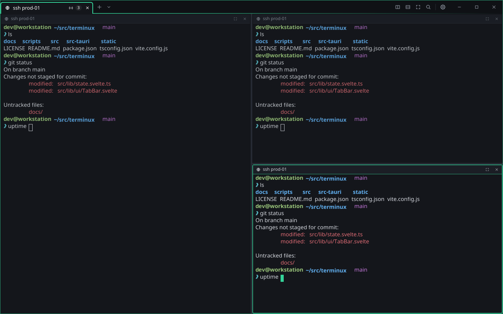

# Panes

Every tab is a tree of panes. This guide shows how to split, navigate, resize, rearrange, zoom, lock and broadcast to panes, and how panes move between tabs and windows.

## Contents

- [Splitting](#splitting)
- [Moving focus](#moving-focus)
- [Resizing](#resizing)
- [Swapping, orientation and equalizing](#swapping-orientation-and-equalizing)
- [Zoom](#zoom)
- [Pane title bar](#pane-title-bar)
- [Selecting a whole group: parent and child](#selecting-a-whole-group-parent-and-child)
- [Moving panes](#moving-panes)
- [Moving panes to another tab or window](#moving-panes-to-another-tab-or-window)
- [Closing panes](#closing-panes)
- [Read-only panes](#read-only-panes)
- [Broadcast input](#broadcast-input)
- [Restarting a pane](#restarting-a-pane)
- [The pane context menu](#the-pane-context-menu)
- [Pane layouts as code](#pane-layouts-as-code)

## Splitting



| Goal | Default key | Command |
| --- | --- | --- |
| Duplicate right | `Alt+Shift+Plus` | `duplicate_pane_right` |
| Duplicate below | `Alt+Shift+-` | `duplicate_pane_down` |
| Duplicate, direction chosen automatically | `Alt+Shift+D` | `duplicate_pane_auto` |
| Split left / up | none | `split_pane_left`, `split_pane_up` |
| Split right / down | none | `split_pane_right`, `split_pane_down` |
| Split with a chosen profile | palette: "Split pane..." | `split_pane` with `profile` |

"Auto" picks a side-by-side split when the pane is at least as wide as it is tall, otherwise a stacked split.

By default a split *continues* the pane it came from: same profile, same working directory (read from the process on Linux, from the directory the shell reports elsewhere), but a fresh process. The same happens for `split_pane_*` without a `profile`. A pane running `ssh` reconnects to the same host in the remote directory instead (see [SSH sessions](10-shell-integration.md#ssh-sessions)). Naming a profile starts that profile instead:

```toml
[[action]]
name = "Split right: shell"
keys = "Ctrl+Alt+Right"
command = "split_pane"
split = "right"
profile = "shell"
```

`split_pane` arguments:

| Argument | Meaning |
| --- | --- |
| `split` | `auto` (default), `right`, `down`, `left`, `up`. `vertical` means right and `horizontal` means down (the `-V` / `-H` flags of `wt`). |
| `split_mode` | `duplicate` starts from the source pane's settings even when other arguments are given (explicit arguments such as `profile` still override them). |
| `size` | Share of the existing pane given to the new one, between 0.05 and 0.95 (default 0.5). |
| `type` | `snippets` / `git`: toggles that [sidebar](18-sidebar.md) view instead of splitting (accepted for configs written for older versions, where these were panes). |
| `profile`, `index`, `commandline`, `starting_directory`, `tab_title`, `tab_color`, `color_scheme`, `suppress_application_title` | Same as `new_tab`. |

Splitting in the same direction as the enclosing split adds a sibling to that split (the target pane's share is divided) instead of nesting a new split. A split un-zooms the tab.

From the command line:

```sh
terminux nt -p python ; sp -V -s .3 -p shell ; sp -H
```

See [`split-pane`](../reference/command-line.md#split-pane) for every flag, and the [`split_pane`](../reference/actions.md#split_pane) action.

The toolbar's first two default buttons are "duplicate pane right" and "duplicate pane down".

## Moving focus

| Goal | Default key | Command |
| --- | --- | --- |
| Focus left / right / up / down | `Alt+Left` / `Alt+Right` / `Alt+Up` / `Alt+Down` | `move_focus_left` ... |
| Previously focused pane (MRU) | `Ctrl+Alt+Left` | `move_focus_previous` |
| Next / previous in creation order | none | `move_focus_next_in_order`, `move_focus_previous_in_order` |
| First pane in the layout | none | `move_focus_first` |
| Parent / child group | none | `move_focus_parent`, `move_focus_child` |

- Clicking a pane focuses it. With [`focus_follow_mouse`](../reference/configuration.md#focus_follow_mouse) = `true`, hovering does.
- The focused pane gets an accent border when the tab has several panes; the other panes are drawn slightly dimmed. Use [`unfocused_appearance`](../reference/profile-settings.md#unfocused_appearance) for a stronger effect.
- When there is nowhere to go (a single pane, or no neighbor in that direction), the key is passed to the terminal. That keeps `Alt+Arrow` working inside programs when you are not in a split.
- While a pane is zoomed, directional focus does nothing; unzoom first, or focus another pane by clicking it (which unzooms).
- "Creation order" is the order in which panes were created in the window session, not their position.

Command line: `terminux mf left`, `terminux mf nextInOrder` ([`move-focus`](../reference/command-line.md#move-focus)).

## Resizing

| Goal | How |
| --- | --- |
| Move a separator by keyboard | `Alt+Shift+Left` / `Right` / `Up` / `Down` (`resize_pane_*`), 5 % of the parent split per press |
| Drag | Drag the 4 px divider between panes |
| Equalize by mouse | Double-click a divider |
| Equalize by command | `equalize_panes` (palette / pane menu) |

Resizing toward a direction grows the pane that way if a separator exists on that side, and otherwise moves the opposite separator (like Windows Terminal). A pane cannot be made smaller than 5 % of its parent split. Resize keys do nothing with a single pane.

## Swapping, orientation and equalizing

- **Swap** the focused pane with another: `swap_pane_left/right/up/down`, `swap_pane_previous`, `swap_pane_previous_in_order`, `swap_pane_next_in_order`, `swap_pane_first`. No default keys. The pane menu has "Swap with previous pane". Command line: [`swap-pane`](../reference/command-line.md#swap-pane). Swapping is disabled while zoomed.
- **Toggle split orientation** (`toggle_split_orientation`): flips the split holding the focused pane between side-by-side and stacked. Handy to rotate a two-pane tab.
- **Equalize** (`equalize_panes`): every split in the tab gets equal shares. Disabled while a pane is zoomed.

```toml
[keys]
toggle_split_orientation = "Alt+R"
equalize_panes = "Ctrl+Shift+Alt+E"
swap_pane_left = "Ctrl+Alt+H"
```

## Zoom

`toggle_pane_zoom` shows the focused pane alone, filling the tab; run it again to restore the layout. It has no default key (bind one, or use the default toolbar button).



```toml
[keys]
toggle_pane_zoom = "Ctrl+Shift+Z"
```

- A "ZOOM" badge appears in the pane's corner while zoomed; click it to unzoom. On by default; hide it with [`show_zoom_badge`](../reference/configuration.md#show_zoom_badge) = `false`. (The tab shows a zoom icon next to the pane count either way; the pane title bar also has a zoom button.)
- Focusing a pane outside the zoomed subtree, splitting, or restoring a pane un-zooms.
- Zoom works on a whole group too, see [parent and child](#selecting-a-whole-group-parent-and-child).
- Zoom is ignored in a tab with a single pane.

## Pane title bar

By default a split tab shows a bar above each pane with its icon, title, a zoom button and a close button ([`show_pane_title_bar`](../reference/configuration.md#show_pane_title_bar) = `"multiple"`). Set it to `"always"` to show it on single panes too, or `"never"` to hide it. With `"multiple"` the bar is hidden while a pane is zoomed. A bell icon replaces the pane icon after a bell; a lock marks a read-only pane. The zoom button only shows in split tabs.



| Goal | How |
| --- | --- |
| Rename | Double-click the title, the pane menu "Rename pane…", or `open_pane_renamer` (no default key). `Enter` or clicking away saves, `Escape` cancels. |
| Back to the automatic title | `reset_pane_title` (palette "Reset pane title"; also what an empty name does) |
| Set from a custom action | `{ command = "rename_pane", title = "app logs" }` (without `title`: reset) |
| Move the pane | Drag the title bar, see [Drag and drop](#drag-and-drop) |
| Move, swap or send elsewhere | Right-click the title bar: "Move pane" / "Swap pane" (left, right, up, down), "Move pane to tab" (another tab or a new one), "Move pane to new window", plus zoom, rename, equalize and close |
| Close the pane | Close button or middle-click on the title bar |

```toml
show_pane_title_bar = "always"
```

## Selecting a whole group: parent and child

`move_focus_parent` selects the split that contains the focused pane (highlighted with an accent border on all its panes). Pane commands then act on the whole group:

- `toggle_pane_zoom` zooms the subtree,
- `close_pane` closes the subtree,
- `move_pane_*` moves it,
- `swap_pane_*` swaps it with another pane or group,
- `resize_pane_*` and `toggle_split_orientation` use it as the target.

`move_focus_child` steps back down. Focusing any pane by key or mouse clears the group selection.

## Moving panes

### Drag and drop

With the [pane title bar](#pane-title-bar) shown, drag a pane by its title bar:

| Drop on | Result |
| --- | --- |
| Edge of another pane (outer quarter) | The pane is docked on that side of it (the highlighted half shows where) |
| Center of another pane | The two panes are swapped |
| A tab | The pane moves into that tab, next to its active pane |
| A tab, held for half a second | That tab is shown: keep dragging to dock the pane at a precise spot in it |
| Empty space of the tab bar | The pane moves to a new tab |
| Outside the window | The pane moves to the window under the pointer, or a new window |

`Escape` cancels the drag. Processes keep running.



A whole tab (terminal, built-in file editor, or settings) can be dragged the same way from the tab bar onto a pane while holding **Shift** (without Shift, dropping on the content area splits [tab groups](03-tabs.md#tab-groups)): the last other terminal tab is shown while dragging over the content area, and the tab's panes dock there (its split layout is kept). Right-click the tab > **Show in a pane** does the same beside the active pane.

### With the keyboard

`Ctrl+Alt+Shift+Arrow` ([`move_pane_left`](../reference/actions.md#move_pane_left) / `_right` / `_up` / `_down`) moves the active pane (or selected group) to that side of its neighbour, or along that edge of the tab when there is no neighbour, like VS Code's "Move editor group". `swap_pane_*` exchanges two panes instead.

## Moving panes to another tab or window

| Goal | How |
| --- | --- |
| Pane to a new tab | `move_pane_to_new_tab` |
| Pane to tab N (1-9) | `move_pane_to_tab_1` ... `move_pane_to_tab_9` (key-only commands, no defaults) |
| Choose the tab from a list | Palette: "Move pane to tab..." |
| Pane to a new window | `move_pane_to_new_window` |
| Pane to a specific window | `{ command = "move_pane", window = "<id or name>" }` |
| CLI | `terminux mp -t 2` ([`move-pane`](../reference/command-line.md#move-pane)) |

Moves keep the process running. Within a window the pane is inserted next to the target tab's active pane; to another window the process is detached, buffered (up to 8 MB of output) and re-attached by the receiver. A pane that is alone in its tab cannot be moved to a new tab (it already is one), but moving it to a new window moves the whole tab. The target must be a terminal tab, not a settings tab. See [Windows](05-windows.md#window-ids-names-and-targets) for window targets.

## Closing panes

`Ctrl+Shift+W` closes the focused pane, or the selected group. Closing the last pane closes the tab. Other commands: `close_other_panes` (keep only the focused pane or group; also in the pane menu).

- A read-only pane asks for confirmation before closing.
- What happens when the *process* ends is set by [`close_on_exit`](../reference/profile-settings.md#close_on_exit): `automatic` and `graceful` close the pane after a clean exit (code 0), `always` always closes, `never` keeps the pane open. A pane that stays open shows "process exited with code N" and the hint "Press Enter to restart, Ctrl+D to close.".
- Closed panes are remembered (last 20 with tabs) for `restore_last_closed`; see [Tabs](03-tabs.md#closing-tabs-and-restoring-them).

## Read-only panes

Lock a pane so nothing can be typed or pasted into it, for example a log tail you do not want to disturb.

| Command | Effect |
| --- | --- |
| `toggle_read_only_mode` | Toggle (pane menu: "Read-only") |
| `enable_read_only_mode` / `disable_read_only_mode` | Explicit on / off |

None have default keys. A "READ-ONLY" badge and a lock icon on the tab show the state. Typing shows a toast ("This pane is read-only...") and the input is dropped; broadcast input skips read-only panes; the process keeps running and its output still appears. Mouse selection and copying still work.

## Broadcast input

`toggle_broadcast_input` mirrors what you type in the focused pane to every other pane of the tab (skipping read-only panes and panes whose process exited). The tab shows a broadcast icon. It works per tab, and is useful for running the same command on several SSH sessions.



```toml
[keys]
toggle_broadcast_input = "Alt+A"
```

## Restarting a pane

`restart_connection` kills the pane's process and starts the profile again in the same pane (pane menu: "Restart connection"). When a process has exited and the pane is kept open, pressing `Enter` restarts it. Fresh processes that print nothing within [`startup_timeout`](../reference/profile-settings.md#startup_timeout) seconds (15 by default) are restarted automatically up to [`startup_retries`](../reference/profile-settings.md#startup_retries) times (2 by default); spawn failures are retried with a growing delay.

## The pane context menu

Right-click opens it when `right_click_context_menu = true`; `Ctrl+right-click` or `Shift+right-click` always opens it, and the `Menu` key (`show_context_menu`) too.

| Group | Items |
| --- | --- |
| Clipboard | Copy (enabled with a selection), Paste |
| Selection (only with a selection) | Search the web, Highlight selection, Save as snippet |
| Shell integration (when commands were detected) | Select previous command, Select previous output |
| Layout | Split pane (Duplicate right, Duplicate down, Split left, Split up, then each profile), Zoom pane / Unzoom pane, Rename pane..., Swap with previous pane, Toggle split orientation, Equalize panes |
| Buffer | Find..., Add scroll mark, Explorer (opens the [Explorer sidebar](18-sidebar.md#explorer)), Source control (Git) (opens the [Git sidebar](18-sidebar.md#git)), Clear buffer, Export text... |
| State | Focus mode, Read-only, Broadcast input to all panes, Restart connection |
| Close | Close other panes, Close pane |

Layout items that need several panes are disabled in a single-pane tab.

## Pane layouts as code

A custom action can build a whole workspace:

```toml
[[action]]
name = "Dev workspace"
keys = "Ctrl+Alt+W"
commands = [
  { command = "new_tab", profile = "python", tab_title = "dev" },
  { command = "split_pane", split = "right", profile = "shell", size = 0.3 },
  { command = "split_pane", split = "down", profile = "shell", size = 0.4 },
  { command = "move_focus", direction = "first" },
]
```

Or at startup, with the `wt` command-line syntax:

```toml
startup_actions = "new-tab -p python ; split-pane -V -s 0.3 -p shell ; move-focus first"
```

See the [cookbook](15-recipes.md) for more layouts.

## See also

- [Tabs](03-tabs.md)
- [Windows](05-windows.md)
- [Command palette](11-command-palette.md)
- [Custom actions](12-custom-actions.md)
- [Command-line reference](../reference/command-line.md)
- [Actions reference](../reference/actions.md)
