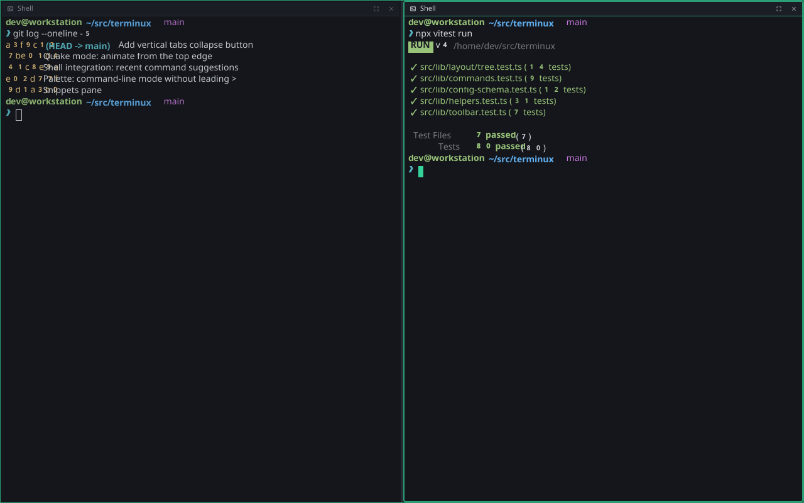

# Windows

Terminux runs as a single process with any number of windows. This page covers opening, naming and targeting windows, window states (fullscreen, focus mode, always on top), launch size and position, session restore, the quake dropdown and global shortcuts, the tray icon, autostart and headless mode.

## Contents

- [Multiple windows](#multiple-windows)
- [Window ids, names and targets](#window-ids-names-and-targets)
- [Launching again and windowing_behavior](#launching-again-and-windowing_behavior)
- [Fullscreen, focus mode and always on top](#fullscreen-focus-mode-and-always-on-top)
- [Launch mode, size and position](#launch-mode-size-and-position)
- [Closing windows and quitting](#closing-windows-and-quitting)
- [Session restore](#session-restore)
- [Quake mode and global_summon](#quake-mode-and-global_summon)
- [Tray, autostart and headless mode](#tray-autostart-and-headless-mode)
- [Transparency and window effects](#transparency-and-window-effects)

## Multiple windows

| Goal | How |
| --- | --- |
| New window | `Ctrl+Shift+N` (`new_window`); it opens with one tab running the default profile (or the arguments you pass) |
| Move a tab to a new window | Drag the tab out of the window, or `move_tab_to_new_window`. Works for the settings editor too (unsaved edits are not carried over) |
| Move a tab to an existing window | Drag it onto that window, or `{ command = "move_tab", window = "name" }` |
| Move a pane to a new / existing window | Drag its [title bar](04-panes.md#drag-and-drop) outside the window (or onto another one), `move_pane_to_new_window`, or `{ command = "move_pane", window = "name" }` |
| Open a window from a terminal | `terminux nt -p shell` (starts a new window under the default `use_new` behavior) |

Moving a tab or pane between windows hands over the *running processes*: nothing restarts. The source window detaches the session (its output is buffered, up to 8 MB), and the target window re-attaches it. A detached session nobody picks up within 60 seconds is killed.

Each window has its own tabs and panes; all windows share the configuration file, which is hot-reloaded in every one of them.

## Window ids, names and targets

Every window has a numeric **id** (1, 2, 3, ... in creation order during this run) and an optional **name**.

| Task | How |
| --- | --- |
| Rename the current window | Palette: "Rename window..." (`open_window_renamer`) |
| Clear the name | Rename to an empty string |
| See which window is which | "Identify window" (`identify_window`) flashes this window's id and name for 2 seconds; "Identify windows" (`identify_windows`) does it in every window |
| Name a window at creation | `terminux -w logs nt -p shell` (creates window `logs` if none has that name) |

A *window target* (the `-w` option, the `window` argument of `move_tab`/`move_pane`) is one of:

| Target | Meaning |
| --- | --- |
| An id (`2`) | The window with that id |
| A name (`logs`) | The window with that name; created with that name if it does not exist (command line) |
| `new` or `-1` | Always create a new window |
| `last` or `0` | The most recently focused window (other than the sender; the quake window is never chosen) |

```sh
terminux -w 0 nt -d ~/src htop     # new tab in the most recent window
terminux -w new nt -p python       # always a new window
terminux -w logs nt tail -f /var/log/syslog
```

Window names are saved in the session, so named windows come back with their names after a restart.

## Launching again and windowing_behavior

Terminux is single-instance. Running `terminux ...` while it is already running forwards the command line to the existing process, which decides where it goes:

| [`windowing_behavior`](../reference/configuration.md#windowing_behavior) | Where a new invocation opens |
| --- | --- |
| `use_new` (default) | A new window. |
| `use_existing` | The most recently focused window (a new tab there). |
| `use_any_existing` | Same as `use_existing` in this implementation. |

An explicit `-w <target>` on the command line always wins over the setting. With no command, the invocation opens a new tab. If `last` is requested but no window exists, a new one is created.

```toml
windowing_behavior = "use_existing"
```

The palette's command-line mode (delete the leading `>`) uses the same parser and honors `-w` too. See the [command-line reference](../reference/command-line.md#global-options).

## Fullscreen, focus mode and always on top



| Feature | Command | Default key | Config |
| --- | --- | --- | --- |
| Fullscreen | `toggle_fullscreen` | `F11`, `Alt+Enter` | `launch_mode = "fullscreen"` |
| Show tabs in fullscreen | | | [`show_tabs_fullscreen`](../reference/configuration.md#show_tabs_fullscreen) |
| Focus mode (hides the tab bar and toolbar) | `toggle_focus_mode` | none | `launch_mode = "focus"` |
| Always on top | `toggle_always_on_top` | none | [`always_on_top`](../reference/configuration.md#always_on_top) |
| Hide to the tray when minimized | `minimize_to_tray` | none | [`minimize_to_tray`](../reference/configuration.md#minimize_to_tray) |
| Hide when the window loses focus | | | [`auto_hide_window`](../reference/configuration.md#auto_hide_window) |

Focus mode is also in the pane menu and the tab-bar menu ("Focus mode", "Always on top", "Fullscreen" appear there as checkable items).

## Launch mode, size and position

These settings apply to the first window of a launch (and to windows opened by a new invocation that passes launch flags). Windows opened later (new window, tear-out) use the default 1200 x 760 and are not repositioned, except tear-out windows which appear under the pointer. Restored windows reuse their saved bounds.

| Setting | Values | Notes |
| --- | --- | --- |
| [`launch_mode`](../reference/configuration.md#launch_mode) | `default`, `maximized`, `fullscreen`, `focus`, `maximized_focus` | WT `launchMode` |
| [`initial_cols`](../reference/configuration.md#initial_cols), [`initial_rows`](../reference/configuration.md#initial_rows) | integers | Terminal grid, default 120 x 30; clamped to 20-1000 columns and 5-500 rows. The window is sized to fit that many cells of the first terminal. |
| [`initial_position`](../reference/configuration.md#initial_position) | `"x,y"`, `"x,"`, `",y"` | Top-left corner in logical pixels |
| [`center_on_launch`](../reference/configuration.md#center_on_launch) | bool | Used when the position is not fully given |

Command-line equivalents override the config:

| Flag | Effect |
| --- | --- |
| `-M`, `--maximized` | maximized |
| `-F`, `--fullscreen` | fullscreen |
| `-f`, `--focus` | focus mode (`-M -f` = `maximized_focus`) |
| `--pos x,y` | position |
| `--size cols,rows` | grid size |

```toml
launch_mode = "maximized"
initial_cols = 140
initial_rows = 40
initial_position = "100,80"
```

```sh
terminux --size 100,30 --pos 50, nt -p shell
```

## Closing windows and quitting

| Action | Default key | Notes |
| --- | --- | --- |
| `close_window` | `Alt+F4` | Asks "Close all tabs?" if the window has more than one terminal tab, unless [`confirm_close_all_tabs`](../reference/configuration.md#confirm_close_all_tabs) is `false` (the dialog has a "Don't ask again" checkbox that writes it). An unsaved config editor asks to discard changes. |
| Window close button | | Same as `close_window`. |
| Last tab closed | | Closes the window. |
| `quit` | none | Asks for confirmation, then closes every window and ends all processes. Also in the tray menu. |

Closing a window ends the processes of its panes (unless they were moved to another window first).

## Session restore

By default Terminux restores your windows when it starts: [`first_window_preference`](../reference/configuration.md#first_window_preference) defaults to `persisted_window_layout`.

What is saved, per window: its name, its bounds (position, size, maximized), every terminal tab with its pane layout and split sizes, tab names and colors, pane titles, working directories, read-only flags, the active tab, up to 5000 lines of scrollback text per pane, and which settings tabs were open. The snapshot is written every 30 seconds, when a window closes, and on `quit`.

What is **not** saved: running processes. After a restart each pane starts a fresh process in its saved working directory and the old scrollback is printed above it.

When it applies:

| Situation | Result |
| --- | --- |
| Start with no arguments | Saved windows are reopened. |
| Start with a command (`terminux nt -p x`) | The command runs; nothing is restored. |
| Nothing to restore | [`startup_actions`](../reference/configuration.md#startup_actions) run, else one tab with the default profile. |
| `first_window_preference = "default_profile"` | Restoring is off and nothing is written; `startup_actions` always apply. |

Which windows come back: `quit` (or the OS ending the session) keeps all windows. Closing windows one at a time keeps only the last window you closed that still had tabs; closing the last *tab* of the last window clears the saved session. The quake window is never saved.

```toml
# Always start fresh with a dev layout
first_window_preference = "default_profile"
startup_actions = "new-tab -p python ; split-pane -V -s 0.3 -p shell"
```

The file is `session.json` in the state directory, see [file locations](../reference/file-locations.md).

## Quake mode and global_summon

### Quake mode

`quake_mode` shows and hides a dropdown terminal from anywhere. Default key: `Win+\`` (`Super+\`` on Linux). It is a *global* shortcut, registered with the operating system, so it works while another application has focus.

Behavior:

- The first press creates a window named `_quake`: full width, half the height of the monitor under the mouse pointer, docked at the top, always on top, hidden from the taskbar and in focus mode (no tab bar).
- Pressing again while it is visible and focused hides it; pressing when hidden shows it and focuses it.
- It is not saved in the session and never chosen by `-w last`.
- Rebind it like any command:

```toml
[keys]
quake_mode = "Ctrl+Alt+Space"
```

Global shortcuts accept the modifiers `Ctrl`, `Shift`, `Alt` and `Win` (also `Super`, `Meta`, `Cmd`), plus letters, digits, F1-F24, arrows, `Space`, `Enter`, `Tab`, `Escape`, `Home`, `End`, `PgUp`, `PgDn`, `Insert`, `Delete` and punctuation such as `` ` ``, `-`, `=`, `,`, `.`, `/`, `;`. A combination outside that set is reported as unsupported global shortcut.

### global_summon

`global_summon` generalizes quake mode: a custom action bound to a global shortcut that shows, hides or creates a window.

```toml
[[action]]
name = "Summon a terminal"
keys = "Ctrl+Alt+L"
command = "global_summon"
monitor = "to_mouse"
dropdown_duration = 200
toggle_visibility = true
```

| Argument | Meaning |
| --- | --- |
| `name` | Target window name; created with this name if missing. Omitted: the most recently focused window. <!-- TODO verify: in an [[action]] table the key `name` is read as the action's display name and is not passed as an argument (commands.ts META), so a window name may not be settable from config --> |
| `monitor` | `to_mouse` moves the window to the monitor under the pointer before showing it. |
| `dropdown_duration` | Milliseconds. When greater than 0 the window slides down from above its position when shown, and hides (instead of minimizing) when toggled off. |
| `toggle_visibility` | Default `true`: summoning a visible, focused window hides it (minimizes it, or hides it for quake and dropdown windows). Set `false` to only bring it forward. |

Global shortcuts are re-registered whenever the configuration changes. Registration errors (a combination another application owns, or an unsupported one) are logged to the console instead of failing the app. <!-- TODO verify: how errors surface to the user -->

## Tray, autostart and headless mode

| Setting | Effect |
| --- | --- |
| [`minimize_to_tray`](../reference/configuration.md#minimize_to_tray) | Minimizing a window hides it to the notification area. Also the `minimize_to_tray` action. |
| [`always_show_tray_icon`](../reference/configuration.md#always_show_tray_icon) | Show the tray icon even when not minimized. |
| [`allow_headless`](../reference/configuration.md#allow_headless) | Keep running when the last window closes (needed for quake mode / global shortcuts without a visible window). Also shows the tray icon. |
| [`start_on_user_login`](../reference/configuration.md#start_on_user_login) | Register Terminux to start at login. Turning it off removes the registration. |

The tray icon appears when any of `always_show_tray_icon`, `minimize_to_tray` or `allow_headless` is on, and disappears when none is. Left-click it to show all windows (or create one if none exist). Its menu has "Show windows", "New window" and "Quit".

```toml
allow_headless = true
minimize_to_tray = true
start_on_user_login = true
```

With `allow_headless`, closing the last window leaves the process running with only the tray icon; use the tray menu or the `quit` action (from a window) to exit. Combined with a quake shortcut this gives an always-ready dropdown terminal.

## Transparency and window effects

Whether the window can be see-through is decided when the window is created. If a profile (or `[defaults]`, or `unfocused_appearance`) has `opacity` below 100 at startup, windows are created transparent. If you lower opacity at runtime in a window that was created opaque, Terminux shows a toast asking you to restart. Acrylic (Windows and macOS) and Mica (Windows 11, through a `[[ui_theme]]` with `use_mica = true`) are applied at window creation as well. See [Appearance](07-appearance.md#opacity-acrylic-and-background-images).

## See also

- [Tabs](03-tabs.md) for dragging tabs between windows
- [Panes](04-panes.md) for moving panes
- [Command-line reference](../reference/command-line.md)
- [Configuration reference](../reference/configuration.md)
- [File locations](../reference/file-locations.md)
- [Recipes](15-recipes.md) for a quake dropdown and kiosk setups
