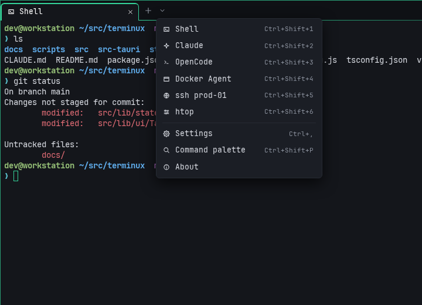

# Profiles

A profile says what a pane runs and how it looks. This guide explains `[defaults]` versus `[[profile]]`, how settings are inherited, how Terminux generates profiles for WSL, SSH, PowerShell and cmd, how to add profiles from separate files (fragments), and how to arrange the new tab dropdown.

## Contents

- [Defining a profile](#defining-a-profile)
- [Defaults and inheritance](#defaults-and-inheritance)
- [How a process is started](#how-a-process-is-started)
- [Selecting profiles](#selecting-profiles)
- [Generated profiles](#generated-profiles)
- [Fragments](#fragments)
- [new_tab_menu](#new_tab_menu)
- [Icons](#icons)
- [Recipes](#recipes)

## Defining a profile

```toml
default_profile = "shell"

[[profile]]
id = "python"
name = "Python"
cmd = "python3"
args = ["-q"]
cwd = "~/src"
env = { EDITOR = "vim" }
icon = "terminal"
tab_title = "Python"
suppress_application_title = true
tab_color = "#d97757"
color_scheme = "One Half Dark"
```

Process-related keys:

| Key | Meaning |
| --- | --- |
| `id` | Unique id. Used by `default_profile`, `-p` on the command line, `[keys]`, `new_tab_menu`. |
| `name` | Display name (defaults to the id). |
| `cmd`, `args` | Program and arguments. `"$SHELL"` (also the default for an empty `cmd`) means your login shell. |
| `commandline` | Alternative to `cmd` + `args`: a full command line, split at spaces with quotes honored. `cmd` wins if both are given. |
| `cwd` (alias `starting_directory`) | Starting directory; `~` is expanded. |
| `env` | Extra environment variables. |
| `os` | `"linux"`, `"windows"` or `"macos"`: the profile exists only on that OS. |
| `login_shell` | Unix: run the command through your shell as `-lic "exec <command>"` so PATH from your rc files (nvm, `~/.local/bin`, ...) applies. `false` runs the program directly. |
| `hidden` | Keep the profile out of menus and `Ctrl+Shift+1..9` numbering; it remains usable by id. |

Appearance and behavior keys (`icon`, `tab_title`, `tab_color`, `color_scheme`, `font`, `cursor_shape`, `opacity`, `close_on_exit`, `bell_style`, ...) are listed in the [profile settings reference](../reference/profile-settings.md) and walked through in [Appearance](07-appearance.md). A `shell` profile always exists: if you do not define one, Terminux adds `shell` running `$SHELL`. The shipped default config also defines a `wsl` profile (`wsl.exe`, `os = "windows"`).

## Defaults and inheritance

`[defaults]` holds settings applied to every profile. A key set on a profile wins over the same key in `[defaults]`. Two tables merge key by key instead of being replaced: `font` and `unfocused_appearance`.

```toml
[defaults]
color_scheme = "One Half Dark"
font = { face = "JetBrains Mono", size = 14 }
close_on_exit = "automatic"
cwd = "~/work"

[[profile]]
id = "docs"
name = "Docs"
cmd = "$SHELL"
font = { size = 16 }          # face stays "JetBrains Mono"; only the size changes
color_scheme = "Solarized Light"
```

Details:

- `cwd`, `env` and `login_shell` in `[defaults]` also apply to profiles that do not set them; `env` is merged (profile values win per variable).
- Root-level `font_size`, `font_family` and `scrollback` are older spellings that still work as fallbacks for `font.size`, the font face list and `history_size`.
- Per-pane runtime changes (font zoom with `Ctrl+Plus`, `adjust_opacity`, "Select color scheme...", the retro toggle) sit on top of the resolved profile and do not edit the file.

Order of precedence for a pane's look, lowest to highest: built-in defaults, root keys, `[defaults]`, the profile, the options of the action or command line that created the pane (`--colorScheme`, `--title`, `--tabColor`), runtime changes. While the pane is unfocused, `unfocused_appearance` is overlaid on top of all that (see [Appearance](07-appearance.md#unfocused-panes)).

## How a process is started

When a pane starts, the working directory is the first existing directory of:

1. the explicit directory of the action or command line (`-d`, `starting_directory`; also the saved directory when restoring a session),
2. the profile's `cwd`,
3. the directory inherited from the pane being split,
4. your home directory.

Environment variables Terminux sets for every process: `TERM=xterm-256color`, `COLORTERM=truecolor`, `TERM_PROGRAM=terminux`, `TERM_PROGRAM_VERSION`, `TERMINUX_PROFILE_ID` (the profile id) and `TERMINUX_SESSION` (a per-process number), then the profile's `env`.

On Windows, `cmd` ending in `.exe` is started directly; anything else (npm `.cmd` shims, scripts) goes through `cmd.exe /d /c`. The user shell on Windows is `powershell.exe` unless the `TERMINUX_SHELL` environment variable names another.

A pane whose process never prints anything within `startup_timeout` seconds (15 by default) is restarted up to `startup_retries` times (2); see [Panes](04-panes.md#restarting-a-pane). What happens when the process exits is governed by `close_on_exit`.

## Selecting profiles

| Goal | How |
| --- | --- |
| Default for new tabs | `default_profile = "python"` (falls back to `shell` if the id is unknown) |
| Pick from a menu | `+` dropdown or `Ctrl+Shift+Space` ([`new_tab_menu`](#new_tab_menu)) |
| By position | `Ctrl+Shift+1` ... `Ctrl+Shift+9` open the 1st to 9th non-hidden profile, in file order |
| In a split | Palette "Split pane..." or `{ command = "split_pane", profile = "python" }` |
| Command line | `terminux nt -p python`, `sp -p shell` (matches id first, then name, case-insensitively) |

## Generated profiles

Terminux discovers shells on your machine and adds them as profiles. They appear in the dropdown without any configuration, and on first run they are also written into your `config.toml` (look for `# generated:` comments) so that you can see and edit them.

| Source | Profiles | Platforms |
| --- | --- | --- |
| `wsl` | One per installed distribution (`wsl.exe -l -q`; `docker-desktop*` is skipped): id `wsl-<slug>`, runs `wsl.exe -d <distro> --cd ~`, with `path_translation_style = "wsl"` | Windows |
| `ssh` | One per concrete `Host` alias in `~/.ssh/config` (wildcards and negations skipped): id `ssh-<slug>`, name `SSH - <host>`, runs `ssh <host>`. Needs `ssh` on `PATH` and a readable `~/.ssh/config`. | All |
| `powershell` | `pwsh` (PowerShell 7+), when `pwsh` is on `PATH` | All |
| `windows` | `powershell` (Windows PowerShell) and `cmd` (Command Prompt) | Windows |

`<slug>` is the lowercased name with every run of characters other than letters and digits replaced by `-` (`Ubuntu-22.04` becomes `ubuntu-22-04`). Generated profiles run directly, never wrapped in your login shell.

Generated profiles are computed once when Terminux starts; restart after installing a distribution or editing `~/.ssh/config`.

### Customizing a generated profile

Define a `[[profile]]` with the same `id`. Missing pieces (command, arguments, name, directory, login shell, extra settings such as `path_translation_style`) are filled from the generated one, and everything you set wins:

```toml
[[profile]]
id = "wsl-ubuntu-22-04"
name = "Ubuntu"
color_scheme = "Tango Dark"
icon = "🐧"
```

### Hiding or disabling

```toml
# Hide one generated profile
[[profile]]
id = "cmd"
hidden = true

# Do not generate a whole source
disabled_profile_sources = ["ssh", "windows"]
```

Valid sources: `wsl`, `ssh`, `powershell`, `windows`. Disabling a source stops Terminux from generating its profiles. Profiles already written into your `config.toml` (the first-run snapshot described above) are ordinary profiles and stay: delete or `hide` them yourself. A `[[profile]]` that reuses a disabled source's id keeps working but no longer inherits the missing pieces.

## Fragments

Fragments let separate files contribute profiles, color schemes and actions without touching `config.toml`: a tool, a team repository or a per-project setup can drop a file into the fragments directory.

Location: the `fragments` folder next to `config.toml` (`~/.config/terminux/fragments/`, `%APPDATA%\terminux\fragments\`, or `<exe dir>/settings/fragments/` in [portable mode](01-installation.md#portable-mode)). Terminux creates the folder on start.

```toml
# ~/.config/terminux/fragments/project-x.toml
[[profile]]
id = "project-x"
name = "Project X"
cmd = "$SHELL"
cwd = "~/src/project-x"
tab_color = "#38bdf8"
env = { PROJECT = "x" }

[[scheme]]
name = "Project X"
background = "#101820"
foreground = "#d8dee9"

[[action]]
name = "Run tests (project X)"
command = "send_input"
input = "make test\r"
```

Rules:

- Every `*.toml` file is read, in file-name order. A file that does not parse is ignored (a message is printed to the process's standard error), not fatal.
- Only `[[profile]]`, `[[scheme]]` and `[[action]]` are merged. Other tables and keys in a fragment (`[defaults]`, `[keys]`, root settings, `[[ui_theme]]`, `[[new_tab_menu]]`) are ignored.
- A fragment profile is added only if no profile with that id exists yet (your `config.toml` wins; between fragments the first by file name wins). Fragment profiles carry the source `fragment:<file name without .toml>`.
- Fragment profiles inherit `[defaults]` like any other profile.
- The directory is watched: adding, editing or deleting a fragment hot-reloads the configuration.
- `disabled_profile_sources` does not apply to fragments; delete the file or define the profile as `hidden` in `config.toml`.

## new_tab_menu

[`new_tab_menu`](../reference/configuration.md#new_tab_menu) controls the new tab dropdown (the `v` button, `Ctrl+Shift+Space`, right-click on the tab bar then "New tab with profile"). Without it, the dropdown lists every non-hidden profile. The menu always ends with Settings, Command palette and About.



Entry types (Windows Terminal semantics):

| `type` | Fields | Meaning |
| --- | --- | --- |
| `profile` | `profile` (id or name), `icon` | One profile. |
| `separator` | | A divider line. |
| `folder` | `name`, `icon`, `entries`, `allow_empty`, `inline` | A submenu. `inline = true` with a single entry shows that entry directly. `allow_empty = false` hides an empty folder. |
| `match_profiles` | `name`, `source`, `commandline` | All profiles whose name, source or full command line equal the given values. |
| `remaining_profiles` | | Every profile not placed by another entry. |
| `action` | `id`, `icon` | A custom `[[action]]` by id. |

```toml
[[new_tab_menu]]
type = "profile"
profile = "python"

[[new_tab_menu]]
type = "separator"

[[new_tab_menu]]
type = "folder"
name = "Servers"
icon = "folder"

  [[new_tab_menu.entries]]
  type = "match_profiles"
  source = "ssh"

[[new_tab_menu]]
type = "remaining_profiles"

[[new_tab_menu]]
type = "action"
id = "dev-layout"
```

(`id` refers to an `[[action]]` that has `id = "dev-layout"`.) Profiles in the menu show their `Ctrl+Shift+1..9` hint for the first nine (in file order, hidden profiles excluded).

## Icons

`icon` accepts:

- a built-in icon name (for example `terminal`; the default),
- a path to an image (`png`, `jpg`, `gif`, `svg`, `ico`, `webp`, `bmp`; relative paths resolve against the config directory),
- an emoji or short text.

In the built-in editor (`Ctrl+,`), completion on any `icon` key (profiles, `[[action]]`, `new_tab_menu`) lists the built-in icon names and a selection of emoji searchable by name: typing `"pengu` and accepting inserts `"🐧"`.

Icons appear in tabs, menus and the palette. Tabs can hide or monochrome them with `icon_style` in a UI theme (see [Appearance](07-appearance.md#app-theme-and-ui_theme)).

## Recipes

### A program in a login shell, with a fixed tab title

```toml
[[profile]]
id = "python"
name = "Python"
cmd = "python3"
login_shell = true            # picks up PATH from ~/.zshrc / ~/.bashrc
tab_title = "Python"
suppress_application_title = true
tab_color = "#d97757"
```

### Several profiles sharing settings

```toml
[defaults]
font = { size = 15 }
close_on_exit = "always"

[[profile]]
id = "python"
name = "Python"
cmd = "python3"

[[profile]]
id = "node"
name = "Node.js"
cmd = "node"
```

### Windows-only and Linux-only variants of one profile

```toml
[[profile]]
id = "work"
name = "Work"
os = "linux"
cmd = "$SHELL"
cwd = "~/work"

[[profile]]
id = "work"
name = "Work"
os = "windows"
cmd = "wsl.exe"
args = ["-d", "Ubuntu", "--cd", "~/work"]
```

(Profiles whose `os` does not match are dropped when the file is loaded, so the same id can appear twice.)

### A dedicated SSH profile with a different look

```toml
[[profile]]
id = "ssh-prod"            # overrides the generated ssh-prod profile
color_scheme = "Dark+"
tab_color = "#c50f1f"
tab_title = "PROD"
```

See also [Recipes](15-recipes.md).

## See also

- [Appearance](07-appearance.md)
- [Tabs](03-tabs.md) and [Panes](04-panes.md)
- [Profile settings reference](../reference/profile-settings.md)
- [Configuration reference](../reference/configuration.md)
- [File locations](../reference/file-locations.md)
