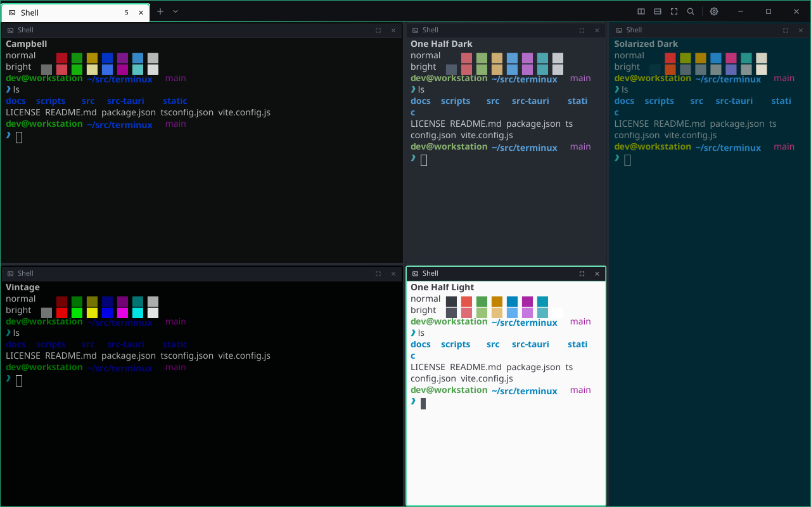
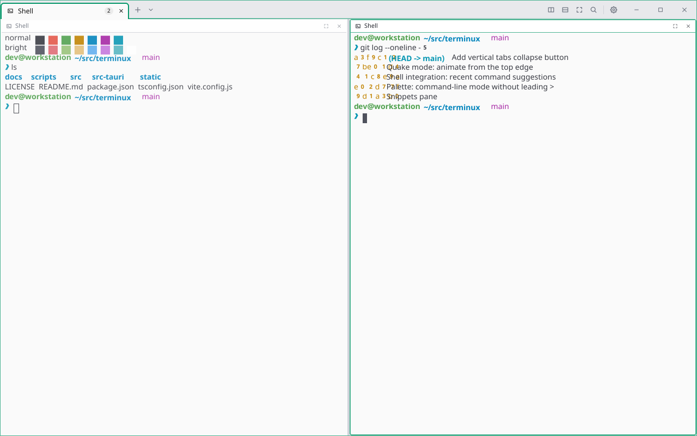
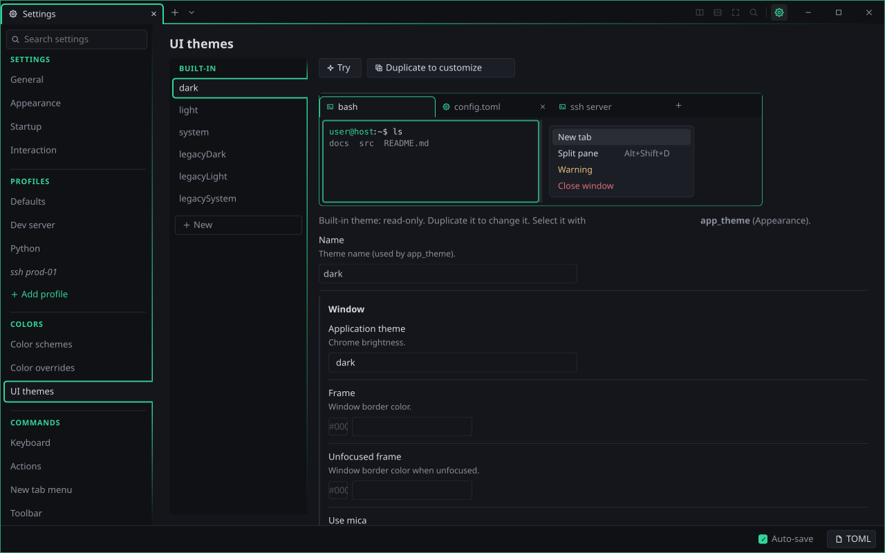

# Appearance

Colors, fonts, cursor, padding, transparency, background images, the retro effect, unfocused-pane styling, the application theme and the renderer. Most terminal settings live in `[defaults]` (all profiles) or a `[[profile]]` (one profile); application chrome settings are root keys or a `[[ui_theme]]`.

## Contents

- [Where settings go](#where-settings-go)
- [Color schemes](#color-schemes)
- [Fonts](#fonts)
- [Cursor](#cursor)
- [Padding and scrollbar](#padding-and-scrollbar)
- [Opacity, acrylic and background images](#opacity-acrylic-and-background-images)
- [Retro terminal effect](#retro-terminal-effect)
- [Unfocused panes](#unfocused-panes)
- [App theme and ui_theme](#app-theme-and-ui_theme)
- [Renderer](#renderer)
- [Changing things at runtime](#changing-things-at-runtime)

## Where settings go

```toml
[defaults]                 # applies to every profile
color_scheme = "One Half Dark"
font = { face = "JetBrains Mono", size = 14 }

[[profile]]                # overrides for one profile
id = "prod"
name = "Prod"
cmd = "ssh"
args = ["prod"]
color_scheme = "Campbell"
```

Everything in this page can also be set per profile. The full key list with defaults is in the [profile settings reference](../reference/profile-settings.md); inheritance is explained in [Profiles](06-profiles.md#defaults-and-inheritance). Changes apply as soon as you save `config.toml`.

## Color schemes

[`color_scheme`](../reference/profile-settings.md#color_scheme) takes a scheme name, or a light/dark pair.



### Built-in schemes (17)

`Terminux` (the default), `Campbell`, `Campbell Powershell`, `Vintage`, `One Half Dark`, `One Half Light`, `Solarized Dark`, `Solarized Light`, `Tango Dark`, `Tango Light`, `Dark+`, `VSCode Dark Modern`, `VSCode Light Modern`, `CGA`, `IBM 5153`, `Ottosson`, `Dimidium`. Names are matched case-insensitively. Palettes are listed in the [color schemes reference](../reference/color-schemes.md).

### A light/dark pair

The scheme follows the application's brightness (see [app theme](#app-theme-and-ui_theme)): with `app_theme = "system"` it switches when your OS does.

```toml
[defaults]
color_scheme = { light = "One Half Light", dark = "One Half Dark" }
```

If only one side is given it is used for both.

### Your own scheme

Add a `[[scheme]]` table and refer to it by name. Color names follow Windows Terminal; any color you leave out falls back to the `Terminux` scheme.

```toml
[[scheme]]
name = "Midnight"
background = "#0b1020"
foreground = "#c8d3f5"
cursor_color = "#ffcc66"
selection_background = "#2a3560"
black = "#1b2133"
red = "#ff757f"
green = "#c3e88d"
yellow = "#ffc777"
blue = "#82aaff"
purple = "#c099ff"          # "magenta" is accepted as well
cyan = "#86e1fc"
white = "#c8d3f5"
bright_black = "#444a73"
bright_red = "#ff757f"
bright_green = "#c3e88d"
bright_yellow = "#ffc777"
bright_blue = "#82aaff"
bright_purple = "#c099ff"
bright_cyan = "#86e1fc"
bright_white = "#ffffff"

[defaults]
color_scheme = "Midnight"
```

- A `[[scheme]]` with the same name as a built-in one replaces it.
- Other color keys: `cursor_accent`, `selection_foreground` and xterm.js theme names are accepted too.
- Schemes can also come from [fragments](06-profiles.md#fragments).

### Overriding single colors

Per profile (or in `[defaults]`): `foreground`, `background`, `selection_background`, `cursor_color`. A root-level `[theme]` table overrides colors of *every* scheme at once (same keys as `[[scheme]]`):

```toml
[theme]
cursor_color = "#ff00aa"
```

### Contrast and bold text

| Key | Values | Effect |
| --- | --- | --- |
| [`intense_text_style`](../reference/profile-settings.md#intense_text_style) | `none`, `bold`, `bright`, `all` | How SGR 1 text is drawn: bold weight, bright colors, both, or neither. Default `bold`. |
| [`adjust_indistinguishable_colors`](../reference/profile-settings.md#adjust_indistinguishable_colors) | `never` (default), `indexed`, `always` | Raise the contrast of hard-to-read text (a minimum ratio of 3 for `indexed`, 4.5 for `always`). |

### Switching at runtime

- Palette: "Select color scheme..." lists all schemes with live preview; `Escape` restores the previous one, `Enter` keeps it for this pane (until it closes; the file is not changed).
- Command line: `terminux nt --colorScheme "Solarized Dark"`.
- Action: `{ command = "set_color_scheme", color_scheme = "Dark+" }`.

## Fonts

```toml
[defaults]
font = { face = "JetBrains Mono", size = 14, weight = "normal", cell_height = 1.0, cell_width = 0, ligatures = false }
```

| Key | Meaning |
| --- | --- |
| `face` | Font family. Any installed font, or a CSS font list (`"'Fira Code', monospace"`). Symbol and emoji fallbacks are always appended. |
| `size` | Size in px. The effective size is clamped to 6-72 after zoom. |
| `weight` | `thin`, `extra-light`, `light`, `semi-light`, `normal`, `medium`, `semi-bold`, `bold`, `extra-bold`, `black`, `extra-black`, or a number 1-1000. Bold text uses at least weight 700 (unless `intense_text_style` is `none` or `bright`). |
| `cell_height` | Line-height multiplier, 0.8-3 (default 1). |
| `cell_width` | Extra letter spacing in px, -4 to 20 (default 0). |
| `ligatures` | Draw programming ligatures (`->`, `=>`, `!=`, `===`, `<=`, `::`, `&&`, `\|\|`, ...). The font must have them. |
| `features` | OpenType features, e.g. `{ ss01 = 1, liga = 0 }`. |
| `axes` | Variable-font axes, e.g. `{ wght = 450 }`. |

`features` and `axes` only take effect with the DOM renderer (canvas and WebGL ignore CSS font features): set `renderer = "dom"` to use them, keeping in mind that the DOM renderer does not draw custom box-drawing and Powerline glyphs.

### Bundled fonts

Terminux ships its fonts and needs nothing installed: **JetBrains Mono** (regular, bold, italic, bold italic), **Symbols Nerd Font Mono**, **Twemoji Mozilla** (color emoji), **Noto Sans Symbols**, **Noto Sans Symbols 2** and **Noto Sans Math**. The default stack is JetBrains Mono, then Symbols Nerd Font Mono, the system color emoji font (Segoe UI Emoji, Apple Color Emoji or Noto Color Emoji, when installed), Twemoji Mozilla, the Noto symbol fonts and the generic `monospace`. Licenses are under `static/fonts/LICENSES/`.

Setting `face` keeps the symbol/emoji fallbacks, so Nerd Font glyphs and emoji still render with a custom face. The legacy root keys `font_size` and `font_family` remain as fallbacks. The root key `emoji_font` picks the color emoji font (e.g. `emoji_font = "Twemoji Mozilla"` to always use the bundled one).

### Zoom

| Action | Key |
| --- | --- |
| Bigger / smaller / reset | `Ctrl+Plus`, `Ctrl+Minus`, `Ctrl+0` (numpad variants too) |
| Mouse | `Ctrl+wheel` (turn off with [`scroll_to_zoom`](../reference/configuration.md#scroll_to_zoom) = `false`) |

Zoom is one global offset (from -8 to +40 px) added to every pane's size, in every tab of the window; it is not saved, and "Reset font size" returns to the configured size. The settings editor follows the zoom too.

## Cursor

| Key | Values |
| --- | --- |
| [`cursor_shape`](../reference/profile-settings.md#cursor_shape) | `bar`, `vintage`, `underscore`, `filled_box` (default), `empty_box`, `double_underscore` |
| [`cursor_color`](../reference/profile-settings.md#cursor_color) | Color; default comes from the scheme |

The terminal engine has three cursor styles, so shapes map as: `bar` is a bar, `vintage`, `underscore` and `double_underscore` are an underline, `filled_box` and `empty_box` are a block. The cursor blinks. `cursor_height` is accepted for Windows Terminal compatibility but not applied.

## Padding and scrollbar

```toml
[defaults]
padding = "8"                # all sides
# padding = "10, 6"          # horizontal, vertical
# padding = "10, 6, 10, 2"   # left, top, right, bottom
scrollbar_state = "hidden"
```

Default padding is `6, 4, 2, 2` (left, top, right, bottom, in px). `scrollbar_state = "hidden"` removes the scrollbar (`visible` is the default; `always` is accepted and behaves like `visible`). With [`show_marks_on_scrollbar`](../reference/profile-settings.md#show_marks_on_scrollbar) the scroll marks are drawn on the scrollbar (see [Search and navigation](09-search-and-navigation.md#scroll-marks)).

## Opacity, acrylic and background images

### Opacity

```toml
[defaults]
opacity = 85                 # 0-100
```

- Whether a window can be see-through is decided when the window is created. If any profile (or `unfocused_appearance`) uses an opacity below 100 at startup, windows are created transparent. Lowering opacity at runtime in an opaque window shows a toast asking you to restart Terminux; the first time you use an opacity below 100, plan a restart.
- Change it live: `Ctrl+Shift+wheel` (5 points per notch; disable with [`scroll_to_change_opacity`](../reference/configuration.md#scroll_to_change_opacity) = `false`), the commands `increase_opacity` / `decrease_opacity` (10 points, no default keys), or the palette entry "Set background opacity..." (0, 25, 50, 75, 100 %). Runtime changes affect the pane, not the file.
- Seeing the desktop through the window also depends on your OS compositor.

### Acrylic and Mica

`use_acrylic = true` turns on a blurred backdrop on Windows (Acrylic) and macOS. On Windows 11, a UI theme with `use_mica = true` (and set as `app_theme`) uses Mica instead. Both are applied when the window is created and have no effect on Linux. Combine with an `opacity` below 100.

```toml
[defaults]
use_acrylic = true
opacity = 70
```

### Background images

```toml
[defaults]
background_image = "~/Pictures/bg.png"       # relative paths: from the config directory
background_image_stretch_mode = "uniform_to_fill"
background_image_alignment = "center"
background_image_opacity = 0.3
```

| Key | Values |
| --- | --- |
| `background_image_stretch_mode` | `none`, `fill`, `uniform`, `uniform_to_fill` (default) |
| `background_image_alignment` | `center` (default), `left`, `top`, `right`, `bottom`, `top_left`, `top_right`, `bottom_left`, `bottom_right` |
| `background_image_opacity` | 0 to 1 (default 1) |

A pane with a background image is transparent over the image. The setting [`use_background_image_for_window`](../reference/configuration.md#use_background_image_for_window) stretches the active pane's image under *all* panes of the window, so splits share one picture.

## Retro terminal effect

`retro_terminal_effect = true` adds CRT scanlines and glow (the Windows Terminal "retro" look, implemented with CSS instead of HLSL shaders; custom shader files are not supported). Toggle it for the current pane with `toggle_shader_effects` ("Toggle retro terminal effect" in the palette, no default key).

```toml
[[profile]]
id = "crt"
name = "CRT"
cmd = "$SHELL"
retro_terminal_effect = true
color_scheme = "IBM 5153"
cursor_shape = "vintage"
```

## Unfocused panes

`unfocused_appearance` is a table of overrides applied while a pane is not focused: every pane except the active one, and all panes while the window itself is unfocused. Accepted keys are the appearance ones: `color_scheme`, `foreground`, `background`, `selection_background`, `cursor_color`, `cursor_shape`, `opacity`, `use_acrylic`, `background_image`, `background_image_stretch_mode`, `background_image_alignment`, `background_image_opacity`, `retro_terminal_effect`.

```toml
[defaults]
unfocused_appearance = { opacity = 80, color_scheme = "Campbell" }
```

Tables from `[defaults]` and the profile are merged key by key. Splits also dim non-focused panes slightly and outline the focused one with an accent color. An opacity below 100 here also makes windows transparent at creation (see above).

## App theme and ui_theme

[`app_theme`](../reference/configuration.md#app_theme) styles the window chrome: title bar, tabs, menus, palette.



| Value | Look |
| --- | --- |
| `dark` (default) | Dark chrome; the active tab matches the terminal background |
| `light` | Light chrome |
| `system` | Follows the OS setting live |
| `legacyDark`, `legacyLight`, `legacySystem` | Same brightness, but the active tab uses the chrome's own color instead of the terminal background |
| a `[[ui_theme]]` name | Your own theme |

A light chrome also selects the `light` side of a `{ light, dark }` color scheme.

### Custom UI themes

```toml
app_theme = "ocean"

[[ui_theme]]
name = "ocean"

[ui_theme.window]
application_theme = "dark"        # dark | light | system
frame = "#38bdf8"                 # window border color
unfocused_frame = "#334155"
use_mica = false                  # Windows 11
rainbow_frame = false             # animated rainbow border

[ui_theme.tab_row]
background = "#0f172a"
unfocused_background = "#0b1220"

[ui_theme.tab]
background = "accent"             # a color, "terminalBackground" or "accent"
unfocused_background = "#1e293b"  # inactive tabs
show_close_button = "hover"       # always | hover | never | active_only
icon_style = "default"            # default | hidden | monochrome
foreground = "#e2e8f0"            # active tab text
unfocused_foreground = "#94a3b8"  # inactive tabs text
indicator = "outline"             # outline | underline | filled | none
radius = 6                        # corner radius (px)
height = 34                       # tab row height (px)

[ui_theme.colors]                 # interface palette (unset: dark / light defaults)
accent = "#38bdf8"
background = "#0f172a"            # settings, editors
foreground = "#e2e8f0"
muted = "#94a3b8"
panel = "#1e293b"                 # menus, dialogs, buttons
border = "#334155"
hover = "#ffffff14"
warning = "#fbbf24"
danger = "#f87171"

[ui_theme.pane]
divider = "#334155"               # split divider
divider_width = 2                 # px
active_border = "#38bdf8"         # active pane outline (several panes)
```

`[ui_theme.window]` also takes `font` and `font_size` for the interface font (terminals keep their profile font).

In the settings UI (**Colors** > **UI themes**), the page previews the edited theme live and its **Try** button applies it to the window until you stop or leave the page. The six built-in themes (`dark`, `light`, `system`, `legacyDark`, `legacyLight`, `legacySystem`) are listed read-only and can be duplicated into a `[[ui_theme]]`.



The same settings app also edits color schemes (**Color schemes**) and root-level `[theme]` overrides (**Color overrides**); edits keep the comments and layout of `config.toml`.

Tabs that have their own color (see [Tabs](03-tabs.md#colors)) keep it. Other chrome settings: [`disable_animations`](../reference/configuration.md#disable_animations), [`show_tabs_fullscreen`](../reference/configuration.md#show_tabs_fullscreen), [`tab_title_ellipsis`](../reference/configuration.md#tab_title_ellipsis) (`"end"` default, or `"start"` to cut long tab titles on the left and keep the end). See the [`ui_theme`](../reference/configuration.md#ui_theme) reference.

## Renderer

[`renderer`](../reference/configuration.md#renderer) picks the terminal drawing backend:

| Value | Notes |
| --- | --- |
| `webgl` | Fastest. Default on Windows and macOS. If WebGL fails or the context is lost, Terminux falls back to `canvas`. |
| `canvas` | Default on Linux, where WebGL in WebKitGTK is unreliable (blank terminals on WSLg and some drivers). |
| `dom` | Opt-in only. Supports CSS font `features` and `axes`, but does not draw custom box-drawing/Powerline glyphs. |

```toml
renderer = "webgl"     # force WebGL on Linux if your driver is good
```

If terminals render blank or glitchy, try `canvas`, then `dom`; see [Troubleshooting](16-troubleshooting.md).

## Changing things at runtime

| Change | How | Persists |
| --- | --- | --- |
| Color scheme | Palette "Select color scheme...", `set_color_scheme` | For the pane, including splits copied from it and session restore; not written to `config.toml` |
| Font size | `Ctrl+Plus` / `Ctrl+Minus` / `Ctrl+wheel` | No (reset on restart) |
| Opacity | `Ctrl+Shift+wheel`, `increase_opacity`, palette | No |
| Retro effect | `toggle_shader_effects` | No |
| Tab position, vertical tab width | Tab menu, drag | Yes, per machine (browser storage), see [Tabs](03-tabs.md#vertical-tabs) |
| Toolbar | Right-click, drag | Yes, written to `toolbar` in `config.toml` |

## See also

- [Profiles](06-profiles.md)
- [Tabs](03-tabs.md)
- [Profile settings reference](../reference/profile-settings.md)
- [Color schemes reference](../reference/color-schemes.md)
- [Configuration reference](../reference/configuration.md)
- [Troubleshooting](16-troubleshooting.md)
