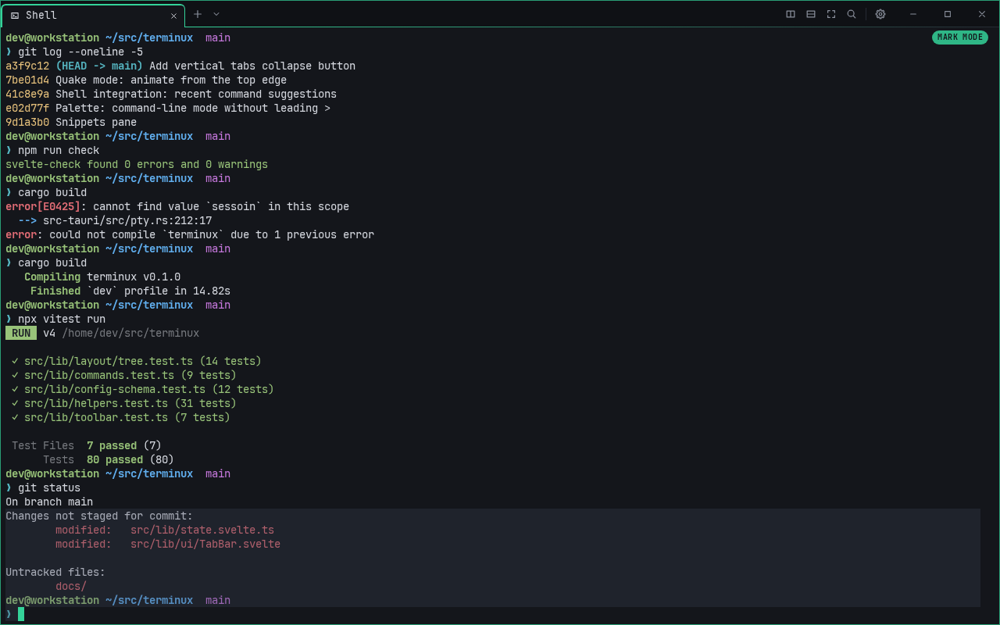

# Text and clipboard

Selecting, copying and pasting text: mouse and keyboard selection (mark mode), block selection, copy formats, paste safety, OSC 52, word separators, links, dropped files and special key handling such as Shift+Enter and image paste.

## Contents

- [Selecting with the mouse](#selecting-with-the-mouse)
- [Copying](#copying)
- [Pasting](#pasting)
- [Mouse buttons and the context menu](#mouse-buttons-and-the-context-menu)
- [Mark mode (keyboard selection)](#mark-mode-keyboard-selection)
- [Block selection](#block-selection)
- [Word separators](#word-separators)
- [OSC 52: programs setting the clipboard](#osc-52-programs-setting-the-clipboard)
- [Links](#links)
- [Dropping files](#dropping-files)
- [Shift+Enter](#shiftenter)
- [Image paste passthrough](#image-paste-passthrough)
- [Programs that grab the mouse](#programs-that-grab-the-mouse)

## Selecting with the mouse

| Gesture | Result |
| --- | --- |
| Drag | Select text. |
| Double-click | Select a word; the characters that delimit words are [`word_separators`](#word-separators). |
| `Alt+drag` | Rectangular (block) selection. |
| `Ctrl+Shift+A` | Select all (`select_all`). |
| Click | Clears the selection and leaves mark mode. |

Set [`copy_on_select`](../reference/configuration.md#copy_on_select) = `true` to copy automatically when you release the mouse button.

## Copying

`copy` is bound to `Ctrl+C`, `Ctrl+Shift+C`, `Ctrl+Insert` and `Enter`. It only acts when something is selected; with no selection the key goes to the program, so `Ctrl+C` still interrupts a running command and `Enter` still runs it.

After copying the selection is dismissed (set `dismiss_selection = false` in a custom action to keep it).

### Copy variants

The `copy` action accepts arguments; bind variants as custom actions (see [Custom actions](12-custom-actions.md)):

```toml
[[action]]
name = "Copy as one line"
keys = "Ctrl+Alt+C"
command = "copy"
single_line = true            # remove line breaks

[[action]]
name = "Copy with colors (ANSI)"
command = "copy"
with_control_sequences = true # keep the escape sequences of the selected rows

[[action]]
name = "Copy as HTML"
command = "copy"
copy_formatting = "html"      # also put colors and styles on the clipboard
```

| Argument | Effect |
| --- | --- |
| `single_line` | Join the selected lines (line breaks removed). |
| `with_control_sequences` | Copy the selected rows with their ANSI sequences instead of plain text. |
| `copy_formatting` | `true`, `"all"` or `"html"`: also write an HTML version (colors, styles); the plain text is written too, so pasting into a text field still works. |
| `dismiss_selection` | Default `true`. |

The global default for `copy_formatting` is [`copy_formatting`](../reference/configuration.md#copy_formatting) (default `false`; `"html"`, `"all"` or `true` turn it on).

### Block selections and trailing spaces

By default, rectangular selections drop trailing spaces on each line ([`trim_block_selection`](../reference/configuration.md#trim_block_selection) = `true`). Set it to `false` to pad every line to the width of the rectangle.

## Pasting

`paste` is bound to `Ctrl+V`, `Ctrl+Shift+V` and `Shift+Insert`. Middle-click also pastes (see [mouse buttons](#mouse-buttons-and-the-context-menu)).

What Terminux does to the text before sending it:

1. **Filters control characters.** Everything in the C0 range except tab, carriage return and line feed (plus DEL) is removed. A clipboard that holds escape sequences cannot inject them into your shell.
2. **Trims trailing whitespace** (spaces, tabs, newlines) when [`trim_paste`](../reference/configuration.md#trim_paste) is `true` (default). Set `trim_paste = false` to paste text exactly, including a trailing newline.
3. **Warns** before pasting risky text (below).
4. **Pastes through the terminal engine**, so programs that enabled bracketed paste (most modern shells, vim, TUI programs) receive it as a paste, not as typed input.

### Paste warnings

| Setting | Warns when | Default |
| --- | --- | --- |
| [`large_paste_warning`](../reference/configuration.md#large_paste_warning) | The text is longer than 5 KiB (5,120 characters) | on |
| [`multi_line_paste_warning`](../reference/configuration.md#multi_line_paste_warning) | The text has more than one line (a single trailing newline does not count) | on |

Each accepts `true` / `"automatic"` (the default behavior), `"always"`, or `false` / `"never"`:

- `true`: warn, *unless* the application in the pane enabled bracketed paste (it can then tell a paste from typing, so the risk is low).
- `"always"`: warn even with bracketed paste.
- `false`: never warn.

The dialog shows how many characters or the first lines of the text, with "Paste anyway" and "Cancel".

```toml
large_paste_warning = "always"
multi_line_paste_warning = false
trim_paste = true
```

Pasting into a [read-only pane](04-panes.md#read-only-panes) is refused with a notice.

## Mouse buttons and the context menu

| Button | Default behavior | Setting |
| --- | --- | --- |
| Middle click | Paste | [`middle_click_paste`](../reference/configuration.md#middle_click_paste) (default `true`) |
| Right click | Copy the selection if there is one, otherwise paste (like Windows Terminal). With `copy_on_select = true` a right click always pastes. | [`right_click_paste`](../reference/configuration.md#right_click_paste) (default `true`) |
| Right click, menu mode | Opens the pane context menu instead | [`right_click_context_menu`](../reference/configuration.md#right_click_context_menu) (default `false`; also a profile setting) |
| `Ctrl+right-click` / `Shift+right-click` / the `Menu` key | Always opens the context menu | |

The pane context menu (full list in [Panes](04-panes.md#the-pane-context-menu)) has, for text work: Copy, Paste, and with a selection: Search the web, Highlight selection, Save as snippet; with shell integration: Select previous command, Select previous output; plus Find..., Add scroll mark, Clear buffer and Export text....

Optional: `reposition_cursor_with_mouse = true` (profile setting) lets a click on the command line move the shell cursor there. It needs [shell integration](10-shell-integration.md) so Terminux knows where the prompt is.

## Mark mode (keyboard selection)

Mark mode selects text with the keyboard, like the Windows Terminal feature of the same name. Toggle it with `Ctrl+Shift+M` (`mark_mode`).



- Entering starts from the current selection if there is one, otherwise from the cursor.
- A "MARK MODE" badge appears in the pane (and "BLOCK SELECT" in block mode).
- Moving without `Shift` collapses the selection to a single cell at the new position; moving with `Shift` extends it from the anchor.
- The view scrolls to keep the moving end visible.
- `Enter` copies the selection and leaves mark mode (it is the `copy` key); `Escape` leaves it and clears the selection; clicking with the mouse leaves mark mode but keeps the selection.
- While mark mode is active, the keys below are handled first. Any other key behaves as usual (matching shortcuts run, other keys reach the program).

### Mark mode keys

| Key | Action |
| --- | --- |
| `Left` / `Right` | Move one cell; wraps to the previous / next line at the edges |
| `Up` / `Down` | Move one line |
| `Ctrl+Left` / `Ctrl+Right` | Move one word left / right (word separators apply) |
| `Home` | Start of the line |
| `End` | End of the line text (last non-blank character) |
| `Ctrl+Home` | Start of the buffer (top of the scrollback) |
| `Ctrl+End` | End of the buffer text |
| `PageUp` / `PageDown` | Move one screen of rows up / down (also with `Ctrl`) |
| `Shift` + any of the keys above | Extend the selection instead of moving the caret |
| `Ctrl+A` | Select the whole buffer |
| `Ctrl+Shift+M` | Leave mark mode (clears the selection) |
| `Escape` | Leave mark mode (clears the selection) |
| `Enter`, `Ctrl+C`, `Ctrl+Shift+C`, `Ctrl+Insert` | Copy and leave mark mode (the `copy` action) |

Keys with `Alt` or `Meta` are not treated as motions.

### Related commands (no default keys)

| Command | Effect |
| --- | --- |
| `toggle_block_selection` | Switch between linear and rectangular selection; starts mark mode if it is not active |
| `switch_selection_endpoint` | Swap which end of the selection moves, so you can extend from the other side (only while mark mode is active) |
| `expand_selection_to_word` | Grow the selection to whole words at both ends; starts mark mode if needed |

```toml
[keys]
toggle_block_selection = "Ctrl+Shift+B"
switch_selection_endpoint = "Ctrl+Shift+E"
expand_selection_to_word = "Ctrl+Alt+W"
```

(Pick combinations you do not already use.)

## Block selection

A block (rectangular, column) selection copies a column of text, for example one column of `ls -l` output.

- Mouse: hold `Alt` while dragging.
- Keyboard: enter mark mode, then run `toggle_block_selection`; the arrows now move a rectangle corner.
- Copying trims trailing spaces by default ([`trim_block_selection`](#block-selections-and-trailing-spaces)).

## Word separators

Double-click selection and mark-mode word motions stop at a space or at any character in [`word_separators`](../reference/configuration.md#word_separators). The default is a space plus ``()[]{}',"` ``.

```toml
# Also stop at slashes and colons, so a double-click selects one path component
word_separators = " ()[]{}',\"`/:"
```

`word_delimiters` is accepted as an alias. A tighter set (without `/`) lets a double-click grab a whole path; a larger set picks smaller pieces.

## OSC 52: programs setting the clipboard

Programs such as vim, tmux or a remote shell over SSH can set your clipboard through the `OSC 52` escape sequence. This is **off by default**, because any output (even a `cat` of an untrusted file) could silently replace what you are about to paste. Turn it on when you trust your programs:

```toml
osc52_clipboard = true
```

Only *writing* is supported; a program can never read your clipboard through OSC 52.

## Links

- With [`detect_urls`](../reference/configuration.md#detect_urls) (default `true`) URLs in the output are underlined on hover and open in your default browser when clicked. <!-- TODO verify: the schema text says Ctrl+click, but no modifier check exists in session.ts or the web-links addon -->
- Hyperlinks that programs emit with `OSC 8` (for example `ls --hyperlink`, `gcc` diagnostics, `eza`) are always active and open the same way.
- Set `detect_urls = false` to stop automatic URL detection (OSC 8 links keep working).

## Dropping files

Dropping files or folders onto a terminal pastes their paths, separated by spaces and quoted for the shell (single quotes on Unix, double quotes on Windows when the path has spaces). For shells running inside WSL, Cygwin, MSYS2 or MinGW, set [`path_translation_style`](../reference/profile-settings.md#path_translation_style) so Windows paths become `/mnt/c/...`, `/cygdrive/c/...`, `/c/...` or `C:/...`:

```toml
[[profile]]
id = "ubuntu"
name = "Ubuntu"
cmd = "wsl.exe"
args = ["-d", "Ubuntu"]
path_translation_style = "wsl"   # generated WSL profiles already set this
```

The dropped text goes through the same paste path (bracketed paste when the program asks for it).

## Shift+Enter

A plain `Shift+Enter` sends `ESC` followed by carriage return (`\x1b\r`, the same as `Alt+Enter`). Programs that support it interpret it as "insert a newline" rather than "submit". Shells and editors see an Alt+Enter, which is usually harmless. There is no setting; combinations with `Ctrl`, `Alt` or `Meta` are unaffected.

## Image paste passthrough

When the clipboard holds an image (or no text at all), `Ctrl+V` sends the literal `Ctrl+V` character (`0x16`) to the application. Programs that support it react by reading the image from the system clipboard themselves. Nothing is pasted into the terminal by Terminux in that case. It only applies to the exact `Ctrl+V` combination; `Ctrl+Shift+V` with an empty text clipboard does nothing.

## Programs that grab the mouse

Full-screen programs that enable mouse reporting (vim, htop, tmux with mouse mode) receive clicks, drags and wheel events. Hold `Shift` to bypass them: `Shift+drag` selects text in the terminal, middle and right clicks with `Shift` held paste/copy as described above, and `Shift+right-click` opens the context menu. Without `Shift`, right and middle clicks go to the program.

## See also

- [Search and navigation](09-search-and-navigation.md)
- [Panes](04-panes.md) for read-only panes and the context menu
- [Shell integration](10-shell-integration.md) for select command / output
- [Custom actions](12-custom-actions.md)
- [Configuration reference](../reference/configuration.md)
- [Keybindings reference](../reference/keybindings.md)
