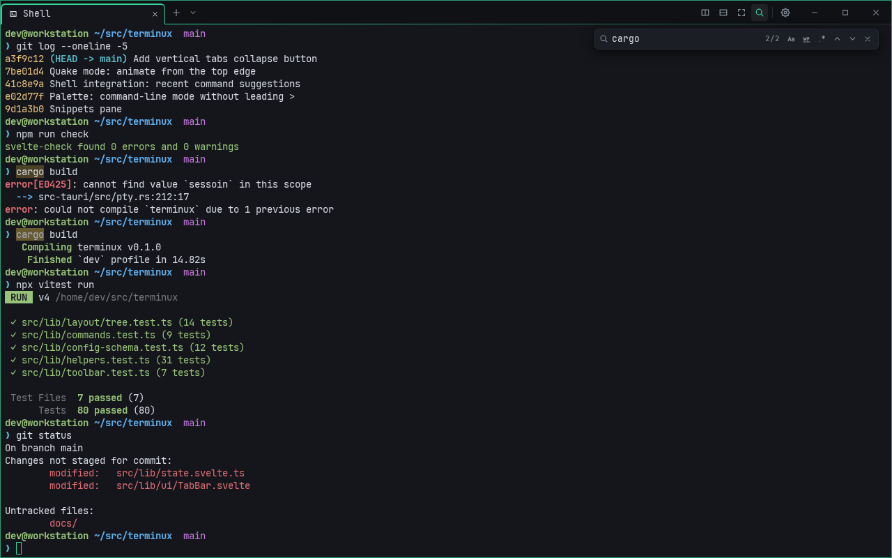
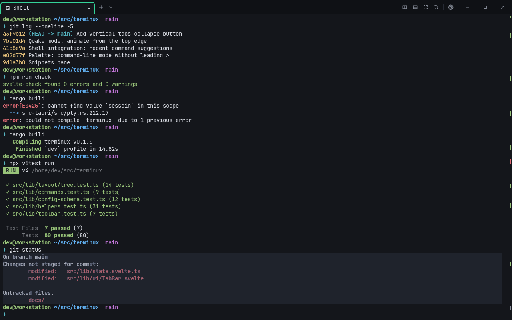

# Search and navigation

Find text in the scrollback, jump between scroll marks and shell prompts, scroll and clear the buffer, export it to a file, highlight text and search the web for a selection.

## Contents

- [Find](#find)
- [Scrolling](#scrolling)
- [Scroll marks](#scroll-marks)
- [Jumping between commands](#jumping-between-commands)
- [Clearing the buffer](#clearing-the-buffer)
- [Export the buffer](#export-the-buffer)
- [Highlight selection](#highlight-selection)
- [Search the web](#search-the-web)
- [Scrollback size](#scrollback-size)

## Find

Press `Ctrl+Shift+F` (`find`) to open the search bar in the top-right corner of the focused pane.



```
[ magnifier | Find ........... | 3/17 | Aa | ab | .* | ^ | v | x ]
```

| Control | Key | Meaning |
| --- | --- | --- |
| Text box | | Searches while you type (incremental). |
| Counter | | `index/total`, or "No results". |
| Match case | `Alt+C` | Case-sensitive search. |
| Whole word | `Alt+W` | Match only whole words. |
| Regular expression | `Alt+R` | Treat the text as a regex. An invalid regex turns the text red and searches nothing. |
| Previous match | `Enter` | Searches towards older output (upwards); typing starts a backward search. |
| Next match | `Shift+Enter` | Searches towards newer output (downwards). |
| Close | `Escape` | Closes the bar, clears the highlights and returns focus to the terminal. |

Matches are highlighted in the buffer, the current one in a stronger color; they are also drawn on the scrollbar when `show_marks_on_scrollbar` is on.

Details:

- The query and the three options are shared by all panes of the window and are kept while the window lives, so reopening the bar (or searching in another pane) starts from the same text.
- Pressing `Ctrl+Shift+F` while the terminal has focus and the bar is open closes the bar.
- The search covers the whole scrollback, not just the visible screen.
- Find works on terminal panes; the settings editor has its own search (`Ctrl+F` inside the editor).
- The search bar belongs to a pane: closing the pane closes its bar.

### Repeat the search without the bar

`find_next` and `find_prev` jump to the next or previous match of the current query without focusing the search box. They have no default keys:

```toml
[keys]
find_next = "F3"
find_prev = "Shift+F3"
```

They do nothing (the key reaches the program) until a query has been typed in the bar once.

## Scrolling

| Goal | Default key | Command |
| --- | --- | --- |
| Up / down one line | `Ctrl+Shift+Up` / `Ctrl+Shift+Down` | `scroll_up`, `scroll_down` |
| Up / down one page | `Ctrl+Shift+PgUp` / `Ctrl+Shift+PgDn` | `scroll_up_page`, `scroll_down_page` |
| Top of the scrollback | `Ctrl+Shift+Home` | `scroll_to_top` |
| Bottom | `Ctrl+Shift+End` | `scroll_to_bottom` |

The mouse wheel and the scrollbar work as usual. `scroll_up` / `scroll_down` take a `rows_to_scroll` argument (default 1):

```toml
[[action]]
name = "Scroll up 10 lines"
keys = "Ctrl+Alt+Up"
command = "scroll_up"
rows_to_scroll = 10
```

By default typing scrolls back to the bottom (`snap_on_input = true`, a profile setting). Turn it off to keep reading old output while typing.

## Scroll marks

A scroll mark is a colored tick in the left gutter of a line (and, optionally, on the scrollbar). Marks let you jump around long output.



| Goal | Command | Default key |
| --- | --- | --- |
| Mark the cursor line | `add_mark` | none |
| Remove marks in the selection, or on the cursor line | `clear_mark` | none |
| Remove all marks of the pane | `clear_all_marks` | none |
| Jump to the previous / next mark | `scroll_to_previous_mark`, `scroll_to_next_mark` | none |
| Jump to the first / last mark | `scroll_to_first_mark`, `scroll_to_last_mark` | none |

Previous/next are relative to the top line of the viewport. Pane menu: "Add scroll mark". One mark per line; a new mark replaces the old one. Marks live in the pane's buffer and are dropped with the text they annotate.

```toml
[keys]
add_mark = "Ctrl+Alt+M"
scroll_to_previous_mark = "Ctrl+Alt+PgUp"
scroll_to_next_mark = "Ctrl+Alt+PgDn"

[[action]]
name = "Mark in red"
command = "add_mark"
color = "#ff5555"
```

Colors: your marks are yellow (`#f0c674`) unless you pass `color`; prompt marks from shell integration are gray (`#8a909c`), turning green (`#98c379`) when the command succeeded and red (`#e06c75`) when it failed.

Related profile settings:

| Setting | Effect |
| --- | --- |
| [`show_marks_on_scrollbar`](../reference/profile-settings.md#show_marks_on_scrollbar) | Also draw marks on the scrollbar (default off). |
| [`auto_mark_prompts`](../reference/profile-settings.md#auto_mark_prompts) | Mark the line when you press `Enter`, for shells that do not emit prompt marks. Ignored once [shell integration](10-shell-integration.md) is active, and in the alternate screen. |

With shell integration, every prompt gets a mark automatically, colored by the command's exit status, so `scroll_to_previous_mark` becomes "previous command".

## Jumping between commands

With [shell integration](10-shell-integration.md) (OSC 133 / 633), Terminux knows where each command and its output start and end:

| Command | Effect |
| --- | --- |
| `select_previous_command` / `select_next_command` | Select the typed command line, and scroll to it. Repeating walks through history. |
| `select_previous_output` / `select_next_output` | Select the whole output of a command (copy it with `Enter`). |

No default keys; also in the pane menu ("Select previous command", "Select previous output") once commands have been detected. `Ctrl+Shift+Period` opens suggestions (`show_suggestions`), a list of recent commands and tasks, see the [command palette guide](11-command-palette.md). The same page explains the palette itself.

```toml
[keys]
select_previous_output = "Ctrl+Alt+Up"
select_next_output = "Ctrl+Alt+Down"
```

## Clearing the buffer

| Command | Default key | Effect |
| --- | --- | --- |
| `clear_buffer` | `Ctrl+Shift+K` | Clear the screen *and* the scrollback. |
| `clear_screen` | none | Clear the visible screen, keep the scrollback; the prompt line stays at the top. |
| `clear_scrollback` | none | Clear only the scrollback. |

Pressing `Ctrl+L` in a shell (which erases the screen) first pushes the visible content into the scrollback, like VTE-based terminals, so you do not lose it.

## Export the buffer

"Export text..." (`export_buffer`; also in the pane menu and the tab menu) writes the whole buffer, scrollback included, as plain text: wrapped lines are joined and trailing blank lines are dropped. A save dialog opens with `<tab title>.txt` as the file name, and a toast shows the written path.

A custom action can write to a fixed file with `path`. For safety only paths that appear in your configuration can be written, so name the file in the action itself:

```toml
[[action]]
name = "Export to ~/last-session.txt"
command = "export_buffer"
path = "~/last-session.txt"
```

`~` and paths relative to the config directory are expanded.

## Highlight selection

Select text, then use "Highlight selection" (pane menu or palette; `color_selection`) to paint a background over it. Highlights follow the text as it scrolls.

| Command | Effect |
| --- | --- |
| `color_selection` | Highlight the selection (default color `#7a6420aa`). |
| `clear_color_selection` | Remove all highlights of the pane ("Clear highlights"). |

Arguments for a custom action: `background` (or `foreground`, used as the highlight color if no `background` is given), and `match_mode = "all"` to highlight *every* occurrence of the selected single-line text in the buffer.

```toml
[[action]]
name = "Highlight all in orange"
keys = "Ctrl+Alt+H"
command = "color_selection"
background = "#ff8800aa"
match_mode = "all"
```

Highlights are not saved with the session.

## Search the web

With a selection, "Search the web" (pane menu, palette; `search_web`) opens your default browser on a search for the selected text. The URL comes from [`search_web_url`](../reference/configuration.md#search_web_url), where `%s` stands for the URL-encoded selection. The default is Bing: `https://www.bing.com/search?q=%s`.

```toml
search_web_url = "https://duckduckgo.com/?q=%s"

[[action]]
name = "Search docs.rs"
command = "search_web"
query_url = "https://docs.rs/releases/search?query=%s"
```

## Scrollback size

The number of lines kept per pane is `history_size` (a profile / `[defaults]` setting) or, as a root fallback, `scrollback`. The shipped config sets `scrollback = 100000`. A larger value uses more memory; session restore and moving a pane to another window keep up to 5000 lines of it.

```toml
[defaults]
history_size = 50000
```

## See also

- [Text and clipboard](08-text-and-clipboard.md)
- [Shell integration](10-shell-integration.md)
- [Command palette](11-command-palette.md)
- [Keybindings reference](../reference/keybindings.md)
- [Actions reference](../reference/actions.md)
- [Configuration reference](../reference/configuration.md)
