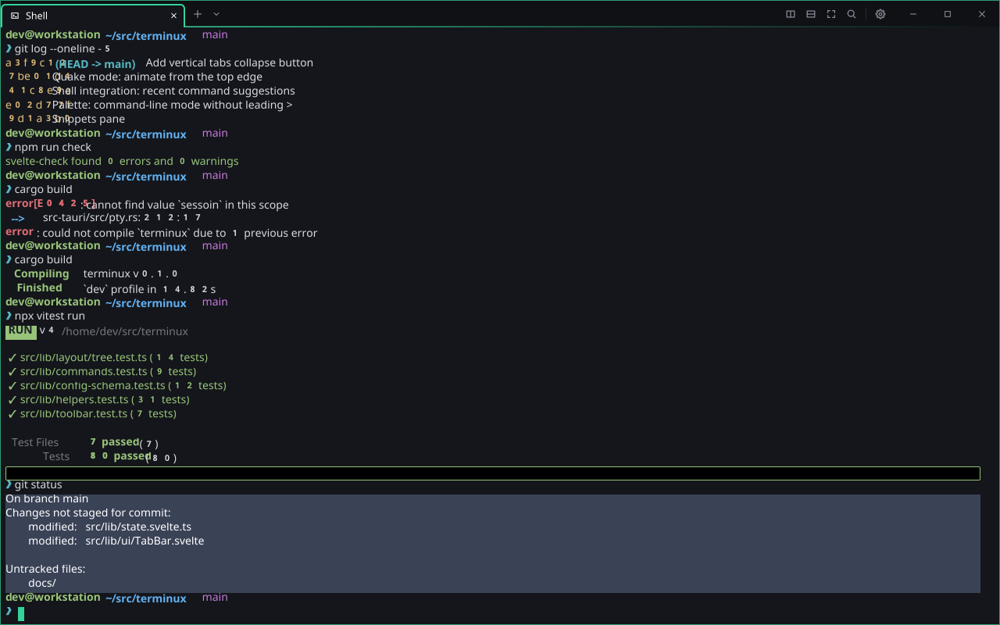
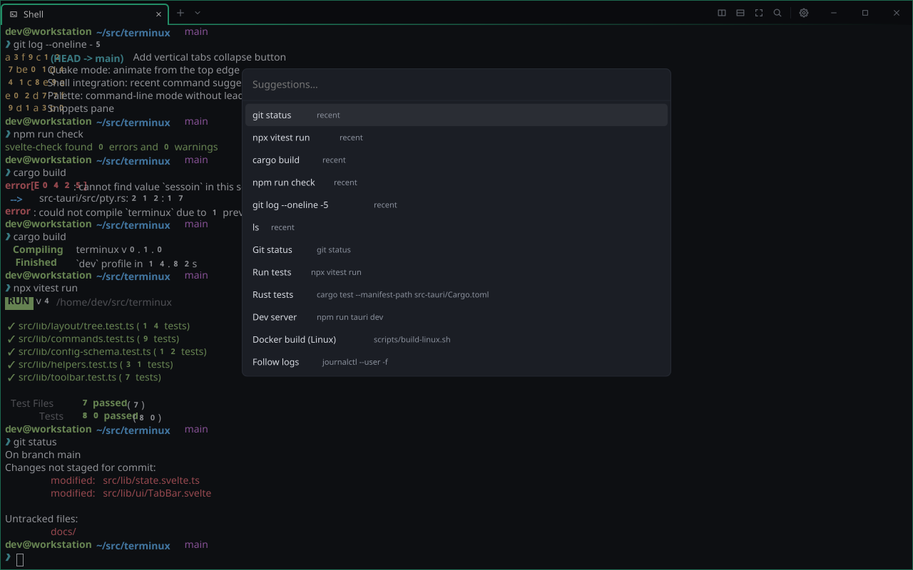

# Shell integration

Shell integration is a handful of escape sequences that your shell prints around each prompt. Terminux reads them to know where every prompt, command and output starts and ends, whether the command succeeded, and which directory the shell is in. Nothing is required for Terminux to work, but with these sequences you get colored command marks, "select command / output", recent-command suggestions, click-to-move-cursor and new splits that start in the current directory.

## Contents

- [What you get](#what-you-get)
- [The sequences](#the-sequences)
- [Which feature needs which sequence](#which-feature-needs-which-sequence)
- [Current directory: OSC 7 vs OSC 9;9](#current-directory-osc-7-vs-osc-99)
- [Setup snippets](#setup-snippets)
  - [bash](#bash)
  - [zsh](#zsh)
  - [fish](#fish)
  - [PowerShell](#powershell)
  - [cmd with Clink](#cmd-with-clink)
  - [cmd without Clink](#cmd-without-clink)
- [Using the features](#using-the-features)
- [Verifying it works](#verifying-it-works)
- [Troubleshooting](#troubleshooting)

## What you get



- **Command marks**: a thin bar in the left gutter of every prompt, gray while the command runs, green on exit code 0, red otherwise. They can also be shown on the scrollbar with [`show_marks_on_scrollbar`](../reference/profile-settings.md#show_marks_on_scrollbar).
- **Select command / select output**: [`select_previous_command`](../reference/actions.md#select_previous_command), [`select_next_command`](../reference/actions.md#select_next_command), [`select_previous_output`](../reference/actions.md#select_previous_output), [`select_next_output`](../reference/actions.md#select_next_output).
- **Scroll to mark**: [`scroll_to_previous_mark`](../reference/actions.md#scroll_to_previous_mark) (`Ctrl+Up`, start of the last command) and friends (`Ctrl+Down`) jump between prompts (see [Search and navigation](09-search-and-navigation.md)).
- **Recent commands**: [`show_recent_commands`](../reference/actions.md#show_recent_commands) and [`show_suggestions`](../reference/actions.md#show_suggestions) (`Ctrl+Shift+Period`) list the commands you ran in this pane.
- **Click to move the cursor** on the command line ([`reposition_cursor_with_mouse`](../reference/profile-settings.md#reposition_cursor_with_mouse)).
- **Save the command line as a snippet** ([`save_snippet`](../reference/actions.md#save_snippet)) when nothing is selected.
- **Working directory** for new splits, duplicated tabs and restored sessions.

## The sequences

All sequences are OSC (Operating System Command) strings: `ESC ] <payload> BEL`. `ST` (`ESC \`) is accepted as a terminator too. In the tables below `\e` is the ESC byte (`0x1b`) and `\a` is BEL (`0x07`).

| Sequence | Name in Terminux | Meaning |
| --- | --- | --- |
| `\e]133;A\a` | `prompt` | A prompt starts. Adds a gray mark on the cursor line and opens a new "command" record. |
| `\e]133;B\a` | `command_start` | The prompt ended; what the user types starts here (the cursor column is remembered). |
| `\e]133;C\a` | `output_start` | The user pressed Enter; the command's output starts here. Terminux reads the text between B and C as the command line. |
| `\e]133;D;<code>\a` | `command_end` | The command finished with exit code `<code>` (omit `;<code>` when unknown). Turns the mark green (0) or red (non-zero). |
| `\e]633;A\a` ... `D` | same as 133 | VS Code's variant, parsed identically to OSC 133. |
| `\e]633;E;<text>\a` | `commandline` | The exact command line (overrides the text read from the screen). `\\` encodes a backslash, `\xNN` any byte; a literal `;` must be written `\x3b`. Control characters are stripped. |
| `\e]633;P;Cwd=<path>\a` | `cwd` | Current directory (same escapes as `E`). |
| `\e]7;file://<host>/<path>\a` | cwd | Current directory as a `file://` URL (percent-encoded; the host is ignored). `file:///C:/dir` becomes `C:/dir`. |
| `\e]9;9;<path>\a` | cwd | ConEmu / Windows Terminal style current directory. The path may be wrapped in double quotes. |

Only the first parameter of 133/633 is interpreted; extra parameters (for example `133;A;k=s`) are ignored.

Other sequences that are not shell integration but often travel with it: `OSC 9;4` (progress, see [Tabs](03-tabs.md)), `OSC 9;<text>` and `OSC 777;notify;<title>;<body>` (notifications, see [Notifications and bell](14-notifications-and-bell.md)), `OSC 52` (clipboard, see [Text and clipboard](08-text-and-clipboard.md)). The exhaustive list is in [escape-sequences](../reference/escape-sequences.md).

> Terminux treats a pane as "integrated" once it has received any 133/633 mark. From then on [`auto_mark_prompts`](../reference/profile-settings.md#auto_mark_prompts) (which marks a line each time you press Enter) stops adding its own marks.

## Which feature needs which sequence

| Feature | A | B | C | D | cwd (7 / 9;9 / 633;P) |
| --- | :-: | :-: | :-: | :-: | :-: |
| Gray prompt marks, `scroll_to_*_mark` | required | | | | |
| Green / red marks | required | | required | required | |
| `select_previous_command` / `select_next_command` | required | required | required | | |
| `select_previous_output` / `select_next_output` | required | | required | required | |
| Recent commands in `show_suggestions` | required | required | required | | (or `633;E` instead of B + C) |
| `save_snippet` from the command line, replacing the line when picking a suggestion | required | required | | | |
| Click to move the cursor | required | required | | | |
| Split / duplicate in the same directory | | | | | recommended on Windows, see below |
| `open_cwd` | | | | | recommended on Windows |

Practical minimum: emit `A` and `B` around the prompt, `C` just before the command runs and `D;<exit code>` when it ends. That is exactly what the snippets below do.

## Current directory: OSC 7 vs OSC 9;9

When you split a pane, duplicate a tab or restore a session, Terminux resolves the directory like this (first hit wins):

1. On **Linux**, the live working directory of the pane's foreground process (read from `/proc`). The shell does not need to report anything.
2. The directory the shell reported through **OSC 7**, **OSC 9;9** or **OSC 633;P;Cwd=**. They all feed the same value, the most recent one wins.
3. The pane's configured `cwd` / `starting_directory`.

On Windows (and macOS) step 1 does not exist, so shell reporting is what makes "split here" work.

Which one to emit:

- **OSC 7** is the standard (supported by most terminals, shells such as fish and zsh plugins, `vte.sh`). Use it for bash, zsh, fish and PowerShell on Linux.
- **OSC 9;9** is what Windows Terminal documents for PowerShell and cmd. Use it on Windows, where it carries a plain `C:\dir` path with no URL escaping to get wrong.
- Both can be sent together; it is harmless.

Things to know:

- A duplicate (tab, or split without a profile) uses this directory even when the profile sets its own `starting_directory`. A split that names another profile keeps that profile's `starting_directory` and only falls back to the source pane's directory when the profile sets none.
- WSL (`wsl.exe` profiles): a Linux path (`/home/me`, `~`) is passed to `wsl.exe --cd`, replacing any `--cd` in the profile's `args`. A Windows path (`//wsl.localhost/...`, `C:\...`) is used as-is.
- The reported path is used as a directory on the machine running Terminux. If it does not exist there, Terminux silently falls back to the profile `cwd`, then the home directory. Panes running `ssh` are the exception: see [SSH sessions](#ssh-sessions).
- An explicit `-d` / `starting_directory` always wins, and so does the profile's `cwd`: a profile with `cwd = "~/work"` always starts there, even for splits. Leave `cwd` unset on profiles where you want splits to inherit.
- New tabs do **not** inherit the directory; they start in the profile `cwd` (or the home directory).
- For WSL: generated WSL profiles pass `--cd ~`; an inherited Linux directory (reported by the shell in WSL) replaces it, as described above.

## SSH sessions

When a pane runs an interactive `ssh` (an SSH profile, or `ssh host` typed in a local shell on Linux, where Terminux sees the foreground process):

- **Split / duplicate** (split without a profile, `duplicate_tab`) reconnects with the same destination and connection options (`-p`, `-l`, `-i`, `-J`, `-F`, `-o`, ...; port forwards are not repeated) and runs `cd <dir>; exec $SHELL -l` on the host, `<dir>` being the last directory the **remote** shell reported with OSC 7. Disable with [`ssh_follow_directory = false`](../reference/configuration.md#ssh_follow_directory).
- **Reconnect** (Enter after the connection dropped, `restart_connection`, startup retries) and **session restore** of a pane started with `ssh` (SSH profile) reconnect in the last remote directory, the same way.
- **Ctrl+click a file path** copies the file from the host with `scp` (resolved against the remote directory) and opens it in the built-in editor, labeled `host:path`. Ctrl+S saves the local copy and uploads it back. This ignores `file_link_open`, except `"builtin_pane"` which opens it as a split.

Requirements:

- The remote shell must emit OSC 7. Install a [remote snippet](#remote-hosts-ssh-directory-only) for the host's shell (bash, zsh, fish, ash/BusyBox, sh/dash/ksh, tcsh). Without it, the new session starts in the remote home and relative paths are resolved from it.
- `scp` runs non-interactively (`BatchMode=yes`): use a key / `ssh-agent`, or share the pane's connection with ControlMaster, for example in `~/.ssh/config`:

  ```
  Host *
    ControlMaster auto
    ControlPath ~/.ssh/cm-%C
    ControlPersist 10m
  ```

  A password prompt cannot be answered: the copy fails with an error toast.
- Copies live in the cache directory (`~/.cache/terminux/remote`, `%LOCALAPPDATA%\terminux\remote`). An editor tab restored after a restart only saves its local copy; Ctrl+click the file again to re-link it to the host.
- On Windows (no foreground process information) only panes started with an `ssh` command (SSH profiles) are detected, and they stay detected while the ssh session runs.

## Setup snippets

All snippets were written for the exact sequences above. The bash and zsh ones were run in a pseudo-terminal and the emitted bytes checked (`D;0`, `D;1`, `A`, `B`, `C`, `OSC 7` in the right order). Add them to the shell's startup file and open a new pane.

Ordering rule shared by all of them, per command: `C` (command starts) → output → `D;<code>` → `OSC 7` → `A` → prompt → `B`.

### bash

Add to `~/.bashrc` (after any prompt framework such as starship or oh-my-posh is initialised):

```sh
# Terminux shell integration (OSC 133 / OSC 7)
if [[ -z ${__TERMINUX_SI-} && $TERM_PROGRAM == terminux ]]; then
  __TERMINUX_SI=1

  # First in PROMPT_COMMAND: needs the exit status of the command that just ran.
  __terminux_pre() {
    local ret=$?
    printf '\e]133;D;%s\a\e]7;file://%s%s\a' "$ret" "$HOSTNAME" "${PWD//%/%25}"
    return "$ret"
  }
  # Last in PROMPT_COMMAND: wraps whatever PS1 the other hooks built.
  __terminux_post() {
    local ret=$?
    case $PS1 in
      *']133;A'*) ;;
      *) PS1='\[\e]133;A\a\]'"$PS1"'\[\e]133;B\a\]' ;;
    esac
    return "$ret"
  }

  PS0='\e]133;C\a'"${PS0-}"
  PROMPT_COMMAND="__terminux_pre${PROMPT_COMMAND:+;$PROMPT_COMMAND};__terminux_post"
fi
```

Notes:

- The `$TERM_PROGRAM == terminux` guard makes the same `~/.bashrc` safe on other terminals. Terminux sets `TERM_PROGRAM=terminux` (and `TERM_PROGRAM_VERSION`) for every process it spawns. Remove the condition to enable it everywhere, but note that over `ssh` the variable is usually not forwarded.
- `PS0` needs bash 4.4+. Older versions can use a `DEBUG` trap instead (not covered here); without `C` you lose colored marks, select-command and recent commands.
- `PS1` brackets (`\[ \]`) are required around the escapes in `PS1` so readline computes the prompt width correctly. `PS0` is printed verbatim and must **not** contain them.
- `PROMPT_COMMAND` as a **string** is assumed. In bash 5.1+ it can be an array (`declare -p PROMPT_COMMAND` shows `-a`); then use instead:

  ```sh
  PROMPT_COMMAND=(__terminux_pre "${PROMPT_COMMAND[@]}" __terminux_post)
  ```

- `%` in the path is escaped as `%25` for OSC 7; spaces are sent as-is and accepted.
- To also send the exact command line (useful for multi-line commands), you would need a `DEBUG` trap and `633;E`; the on-screen text read between `B` and `C` is normally enough.

### zsh

Add to `~/.zshrc`, after your prompt theme:

```zsh
# Terminux shell integration (OSC 133 / OSC 7)
if [[ -z ${__TERMINUX_SI-} && $TERM_PROGRAM == terminux ]]; then
  __TERMINUX_SI=1

  __terminux_pre() {          # first precmd: needs $?
    local ret=$?
    print -rn -- $'\e]133;D;'"$ret"$'\a\e]7;file://'"$HOST${PWD//\%/%25}"$'\a'
    return $ret
  }
  __terminux_post() {         # last precmd: wraps the final PS1
    local ret=$?
    [[ $PS1 == *']133;A'* ]] || PS1=$'%{\e]133;A\a%}'"$PS1"$'%{\e]133;B\a%}'
    return $ret
  }
  __terminux_preexec() { print -rn -- $'\e]133;C\a' }

  precmd_functions=(__terminux_pre $precmd_functions __terminux_post)
  preexec_functions+=(__terminux_preexec)
fi
```

Notes:

- `%{ ... %}` tells zsh the enclosed text takes no screen width.
- Running the wrap in the **last** `precmd` hook survives themes that rebuild `PS1` on every prompt.
- A stray inverse `%` at the start of a prompt in a test run is zsh's `PROMPT_SP` end-of-line marker, not related to this snippet.

### Remote hosts (ssh): directory only

Minimal snippets for the **remote** side of [SSH sessions](#ssh-sessions): they only report the directory (OSC 7) at each prompt, have no `$TERM_PROGRAM` guard (ssh does not forward it) and are harmless in other terminals. The full snippets of this page also work remotely once their guard is removed. Following a directory starts a **login** shell on the host (`$SHELL -l`), so put them where both login and interactive shells read them.

#### bash

`~/.bashrc` (make sure `~/.bash_profile` or `~/.profile` sources it):

```sh
# Terminux: report the directory (OSC 7) at each prompt
__terminux_osc7() { printf '\e]7;file://%s%s\a' "$HOSTNAME" "${PWD//%/%25}"; }
[[ $PROMPT_COMMAND == *__terminux_osc7* ]] || PROMPT_COMMAND="__terminux_osc7${PROMPT_COMMAND:+;$PROMPT_COMMAND}"
```

#### zsh

`~/.zshrc`:

```zsh
# Terminux: report the directory (OSC 7) at each prompt
__terminux_osc7() { print -rn -- $'\e]7;file://'"$HOST${PWD//\%/%25}"$'\a' }
(( ${precmd_functions[(I)__terminux_osc7]} )) || precmd_functions+=(__terminux_osc7)
```

#### fish

`~/.config/fish/conf.d/terminux.fish`:

```fish
# Terminux: report the directory (OSC 7) at each prompt
function __terminux_osc7 --on-event fish_prompt
    printf '\e]7;file://%s%s\a' (hostname) (string replace -a % %25 -- $PWD)
end
```

#### ash / BusyBox

Routers, NAS, Alpine. `~/.profile`:

```sh
# Terminux: report the directory (OSC 7) at each prompt
case $- in *i*)
  __esc=$(printf '\033') __bel=$(printf '\007')
  PS1='\['"$__esc]7;file://$(hostname)"'${PWD}'"$__bel"'\]'"${PS1:-\\w \\$ }"
  unset __esc __bel
esac
```

- The escape characters are inserted raw (not every BusyBox build understands `\e` / `\a` in `PS1`). `\[ \]` keep them out of the prompt width; if they show up literally (BusyBox without `FEATURE_EDITING_FANCY_PROMPT`), remove them.

#### sh / dash / ksh / mksh

`~/.profile` (and the file named by `$ENV` for non-login interactive shells):

```sh
# Terminux: report the directory (OSC 7) at each prompt
case $- in *i*)
  __esc=$(printf '\033') __bel=$(printf '\007')
  PS1="$__esc]7;file://$(hostname)"'${PWD}'"$__bel${PS1:-\$ }"
  unset __esc __bel
esac
```

- These shells have no marker for zero-width prompt text: on a long command line the cursor may be misplaced when editing. ksh93 and mksh users can wrap the sequence with their own non-printing delimiters.

#### tcsh / csh

`~/.tcshrc` (`~/.cshrc` for csh):

```csh
# Terminux: report the directory (OSC 7) at each prompt
alias precmd 'printf "\033]7;file://%s%s\007" "$HOST" "$cwd"'
```

Notes (all of the above):

- `${PWD}` in a prompt string is single-quoted so the shell expands it at each prompt, not once.
- In the ash, sh and tcsh snippets, paths containing `%` are not escaped; such directories are reported wrong.
- Tested in a pseudo-terminal: bash, zsh, dash, BusyBox ash. Not tested: fish, ksh, mksh, tcsh.

### fish

Add to `~/.config/fish/config.fish` (after prompt initialisation such as `starship init fish | source`):

```fish
# Terminux shell integration (OSC 133 / OSC 7)
if test "$TERM_PROGRAM" = terminux; and not set -q __terminux_si
    set -g __terminux_si 1

    function __terminux_preexec --on-event fish_preexec
        printf '\e]133;C\a'
    end

    function __terminux_postexec --on-event fish_postexec
        printf '\e]133;D;%s\a' $status
    end

    function __terminux_cwd --on-variable PWD --on-event fish_prompt
        printf '\e]7;file://%s%s\a' (hostname) (string escape --style=url -- $PWD)
    end

    # Wrap the existing prompt with A / B, keeping $status intact for it.
    functions -q fish_prompt; and functions -c fish_prompt __terminux_orig_prompt
    function __terminux_restore_status
        return $argv[1]
    end
    function fish_prompt
        set -l last_status $status
        printf '\e]133;A\a'
        __terminux_restore_status $last_status
        __terminux_orig_prompt
        printf '\e]133;B\a'
    end
end
```

Notes:

- This snippet could **not** be run in the environment where this guide was written (no fish available). It follows fish's documented event names (`fish_preexec`, `fish_postexec`, `fish_prompt`). <!-- TODO verify: run in fish; also check whether the installed fish already emits OSC 133 itself (recent versions do), in which case skip the snippet -->
- If your fish already emits OSC 133 natively, do not add the snippet: duplicated marks double up. Check with a quick `printf` test (see [Verifying](#verifying-it-works)).
- `string escape --style=url` percent-encodes the path.

### PowerShell

Add to your profile (`$PROFILE`, run `notepad $PROFILE`). Works in Windows PowerShell 5.1 and PowerShell 7+:

```powershell
# Terminux shell integration (OSC 133 / OSC 9;9)
if ($env:TERM_PROGRAM -eq 'terminux' -and -not $global:__TerminuxSI) {
    $global:__TerminuxSI = $true
    $global:__TerminuxFirst = $true
    $global:__TerminuxOriginalPrompt = $function:prompt

    function global:prompt {
        # $? and $LASTEXITCODE must be read before anything else runs.
        $ok = $?
        $native = $global:LASTEXITCODE
        $esc = [char]27
        $bel = [char]7
        $out = ''
        if (-not $global:__TerminuxFirst) {
            $code = if ($ok) { 0 } elseif ($native) { $native } else { 1 }
            $out += "$esc]133;D;$code$bel"
        }
        $global:__TerminuxFirst = $false
        if ($PWD.Provider.Name -eq 'FileSystem') {
            $out += "$esc]9;9;`"$($PWD.ProviderPath)`"$bel"
        }
        $out += "$esc]133;A$bel"
        $out += & $global:__TerminuxOriginalPrompt
        $out += "$esc]133;B$bel"
        $out
    }

    # C: sent when the command line is accepted (needs PSReadLine, the default).
    if (Get-Module PSReadLine) {
        $global:__TerminuxOriginalReadLine = $function:PSConsoleHostReadLine
        function global:PSConsoleHostReadLine {
            $line = & $global:__TerminuxOriginalReadLine
            [Console]::Write("$([char]27)]133;C$([char]7)")
            $line
        }
    }
}
```

Notes:

- `$env:TERM_PROGRAM` is `terminux` inside Terminux (also on Windows). Drop the condition to enable it unconditionally.
- This snippet could not be executed where this guide was written (no PowerShell available); the mark order mirrors the verified bash and zsh output. <!-- TODO verify in pwsh 5.1 and 7 -->
- On Linux/macOS `pwsh`, the same snippet works; `OSC 9;9` carries the path there too.
- Prompt frameworks (oh-my-posh, starship) define `prompt` themselves. Put this snippet **after** their init line so `$function:prompt` captures their prompt.
- The exit code is `0` when the last command succeeded; for a failed native program it is `$LASTEXITCODE`, for a failed cmdlet `1`.

### cmd with Clink

[Clink](https://chrisant996.github.io/clink/) adds Lua scripting to `cmd.exe`. Save as `%LOCALAPPDATA%\clink\terminux.lua`:

```lua
-- Terminux shell integration (OSC 133 / OSC 9;9)
if os.getenv("TERM_PROGRAM") == "terminux" then
    local ESC, BEL = "\027", "\a"
    local first = true

    -- Before each prompt: previous command's exit code, then the directory.
    clink.onbeginedit(function()
        if not first then
            io.write(ESC .. "]133;D;" .. tostring(os.geterrorlevel()) .. BEL)
        end
        first = false
        io.write(ESC .. "]9;9;\"" .. os.getcwd() .. "\"" .. BEL)
    end)

    -- Wrap the prompt with A / B. A high priority number runs after the other filters.
    local pf = clink.promptfilter(999)
    function pf:filter(prompt)
        return ESC .. "]133;A" .. BEL .. prompt .. ESC .. "]133;B" .. BEL
    end

    -- Enter pressed: the command starts.
    clink.onendedit(function()
        io.write(ESC .. "]133;C" .. BEL)
    end)
end
```

Notes:

- `os.getenv("TERM_PROGRAM")` works because Terminux exports it. `os.geterrorlevel()` is Clink's accessor for the last exit code.
- This script could not be tested where this guide was written (no Windows / Clink). <!-- TODO verify: os.geterrorlevel availability and prompt-filter ordering in the installed Clink version; whether onendedit output lands before cmd prints the newline -->
- Clink prompt filters may embed escape sequences; Clink accounts for them when computing the prompt width.

### cmd without Clink

Plain `cmd.exe` cannot report exit codes or command starts, but it can emit `A`, `B` and the directory through `PROMPT` (`$E` is ESC, `$E\` is the string terminator, `$P` the current path):

```bat
set PROMPT=$E]133;A$E\$E]9;9;$P$E\$P$G$E]133;B$E\
```

Put it in the profile's `env` or set it in the `commandline` (`cmd.exe /k "set PROMPT=..."`) to make it permanent. You get gray prompt marks, `scroll_to_*_mark` and a working directory for splits, but no green / red marks, no select-command / output and no recent commands (those need `C` and `D`).

## Using the features

Of the shell-integration actions only `show_suggestions` (`Ctrl+Shift+Period`) and `scroll_to_previous_mark` / `scroll_to_next_mark` (`Ctrl+Up` / `Ctrl+Down`) have default keys. Bind what you use in [`[keys]`](../reference/configuration.md#keys):



```toml
[keys]
select_previous_command = "Ctrl+Alt+Up"
select_next_command     = "Ctrl+Alt+Down"
select_previous_output  = "Alt+PgUp"
select_next_output      = "Alt+PgDn"
scroll_to_previous_mark = "Ctrl+Alt+PgUp"   # default: Ctrl+Up
scroll_to_next_mark     = "Ctrl+Alt+PgDn"   # default: Ctrl+Down
show_recent_commands    = "Ctrl+Alt+R"
```

Pick combos that are free in your setup (see [keybindings](../reference/keybindings.md)).

Behavior details:

- **Select command**: selects what you typed after the prompt, wrapped lines included. Press again to walk to the previous/next command. The view scrolls to the prompt. A command with an empty line selects nothing.
- **Select output**: selects the output lines of a finished command (from `C` up to the line before `D`). A command still running, or with no output lines, is skipped.
- **Recent commands**: most recent first, duplicates and blanks removed, up to 100 entries from the last 500 commands kept per pane. Picking one replaces what is currently typed on the command line (Terminux sends Backspace for each typed character, then the text; it does not press Enter).
- **Marks**: one mark per line, kept in the scrollback. Add your own with [`add_mark`](../reference/actions.md#add_mark).
- **Click to move the cursor**: set `reposition_cursor_with_mouse = true` in `[defaults]` or a profile, then click inside the command line you are editing. Terminux sends the right number of Left/Right arrow keys. Programs that capture the mouse (vim, tmux) still get the click unless you hold `Shift`.

```toml
[defaults]
auto_mark_prompts = false          # irrelevant once the shell sends marks
show_marks_on_scrollbar = true
reposition_cursor_with_mouse = true
```

## Verifying it works

In a Terminux pane, run:

```sh
printf '\e]133;A\a'; echo hi; false; true
```

- A gray bar appears in the gutter of the line where `A` was printed.
- With a configured shell, run `true` then `false`: the gutter marks of those two commands turn green and red.
- `printf '\e]7;file:///tmp\a'` then split the pane (on Windows): the new pane starts in `/tmp` if it exists.
- Open `show_suggestions` (`Ctrl+Shift+Period`): the placeholder reads "No suggestions: enable shell integration or add send_input actions" when nothing was captured.

## Troubleshooting

**No marks at all.** The sequences are not reaching Terminux. Check that `TERM_PROGRAM` is `terminux` (`echo $TERM_PROGRAM`) if you used the guard, that the snippet is in the right file (`.bashrc` for interactive non-login bash; many distros source `.bashrc` from `.bash_profile` only if configured), and that you are not inside `tmux`/`screen`, which swallow OSC sequences unless passthrough is enabled.

**Marks stay gray.** `C` or `D` is missing (bash older than 4.4 has no `PS0`; PowerShell without PSReadLine; cmd without Clink).

**Marks appear on the wrong line / duplicated.** Two sources emit `A`: for example the snippet and a prompt framework's own integration, or fish 4's native marks. Keep one.

**starship / oh-my-posh / powerlevel10k overwrite my `PS1`.** Frameworks rebuild `PS1` (bash) or `PROMPT` (zsh) before every prompt, which discards an `A`/`B` wrapper added once at startup. The snippets above avoid this by wrapping in the last hook (`__terminux_post`) and by never assuming the prompt text. If your framework runs *after* our hook, move the snippet to the end of the rc file, or look for the framework's own switch: recent Oh My Posh versions and Powerlevel10k have options to emit OSC 133 themselves <!-- TODO verify option names: oh-my-posh `shell_integration`, p10k `POWERLEVEL9K_TERM_SHELL_INTEGRATION` -->. Use either the framework's option or this snippet, not both. Starship: use the snippet.

**`PROMPT_COMMAND` conflicts.** Frameworks that *replace* `PROMPT_COMMAND` (`PROMPT_COMMAND='...'` without appending) drop `__terminux_pre`. Source the snippet last, or append in your own function. `direnv`, `zoxide` and `atuin` usually append and are fine, but their position matters: `__terminux_pre` must be first so that `$?` is still the command's status, and the snippet's order of `__terminux_pre; ...; __terminux_post` ensures it. If you see exit codes that are always `0`, some earlier hook ran before `__terminux_pre` (or something re-assigned `PROMPT_COMMAND` after the snippet): source the snippet last.

**Exit code always 0 in zsh.** `precmd_functions` ran another function before `__terminux_pre`; the snippet puts it first, so something re-ordered the array later. Re-add at the end of `.zshrc`.

**The prompt wraps or shifts after adding the snippet.** In bash the escapes in `PS1` must be inside `\[ \]`; in zsh inside `%{ %}`. Do not add them to `PS0` / `print`.

**Splits do not open in the current directory.** See [Current directory](#current-directory-osc-7-vs-osc-99): profile `cwd` overrides inheritance; on Windows the shell must report the directory; remote or non-existent paths fall back to home.

**Commands with `;` look truncated in suggestions** when you send `633;E`: encode `;` as `\x3b`.

**Does it slow my prompt?** The snippets only call `printf` / `print` (shell builtins in bash and zsh); the cost is negligible.

## See also

- [Search and navigation](09-search-and-navigation.md) (scroll marks)
- [Command palette](11-command-palette.md) (suggestions)
- [Text and clipboard](08-text-and-clipboard.md)
- [Escape sequences](../reference/escape-sequences.md)
- [Profile settings](../reference/profile-settings.md): [`auto_mark_prompts`](../reference/profile-settings.md#auto_mark_prompts), [`show_marks_on_scrollbar`](../reference/profile-settings.md#show_marks_on_scrollbar), [`reposition_cursor_with_mouse`](../reference/profile-settings.md#reposition_cursor_with_mouse)
- [Troubleshooting](16-troubleshooting.md)
