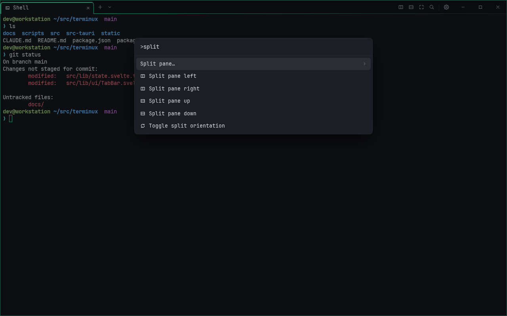
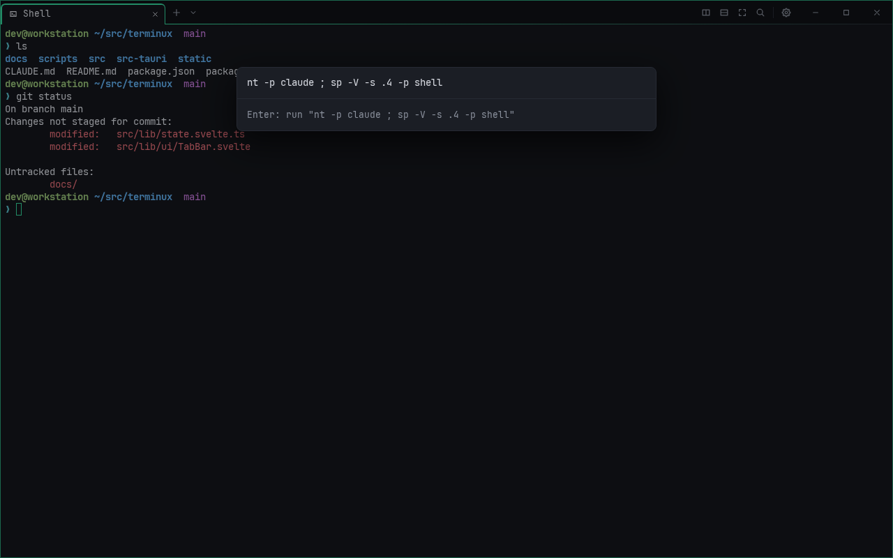
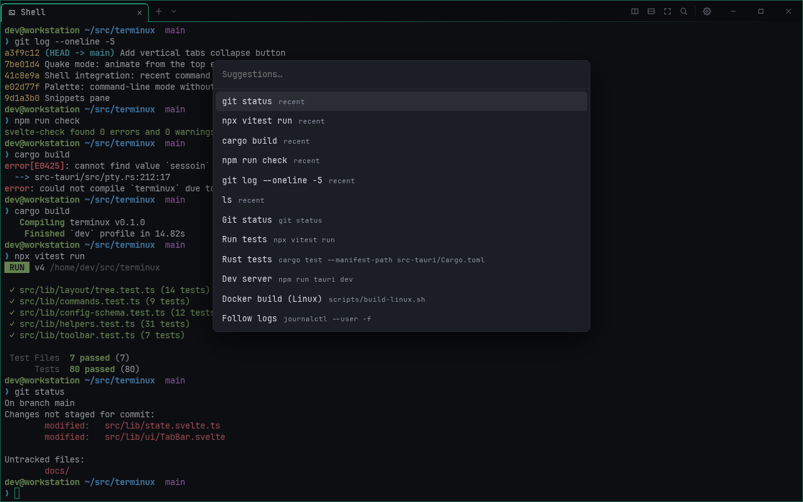
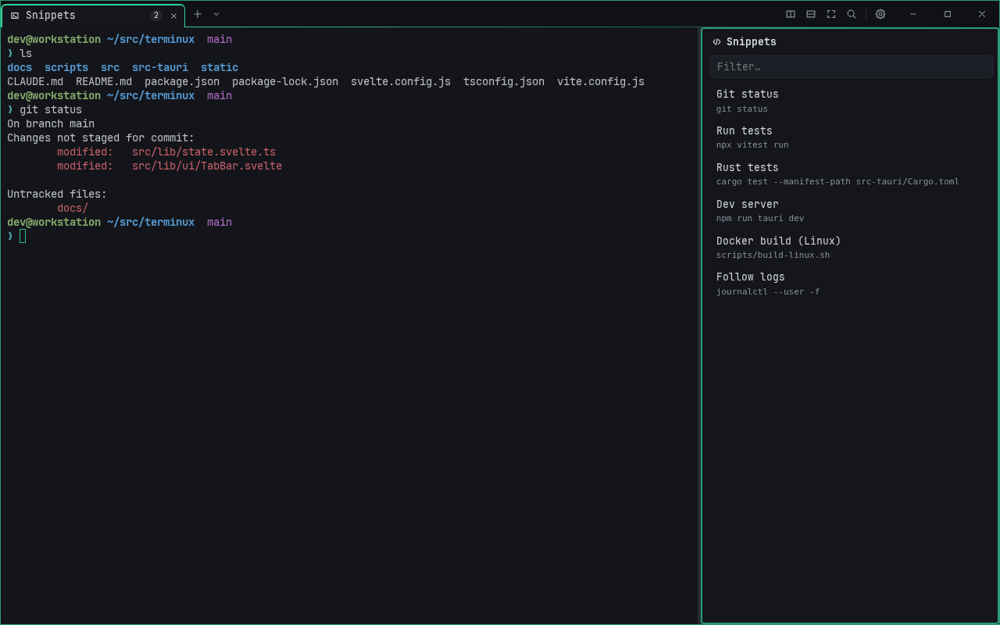

# Command palette

The command palette lists every action, lets you drill into nested menus (profiles, color schemes, tabs) and doubles as a command line that accepts the same syntax as `terminux` / `wt.exe`. Open it with `Ctrl+Shift+P` ([`command_palette`](../reference/actions.md#command_palette)).

## Contents

- [Action mode](#action-mode)
- [Command-line mode](#command-line-mode)
- [Nested menus](#nested-menus)
- [Other palettes](#other-palettes)
- [Suggestions](#suggestions)
- [Snippets pane](#snippets-pane)
- [Keys inside the palette](#keys-inside-the-palette)
- [Customizing](#customizing)

## Action mode

The palette opens with a `>` already typed in the input. In this mode you type to filter:



- **Fuzzy matching**: every typed character must appear in order in the label. A contiguous substring ranks highest, then matches on consecutive characters and word starts. Several words are matched independently (`new tab` finds "New tab…" and "Duplicate tab").
- The list contains, in this order: **New tab…** and **Split pane…** (nested), then (in a terminal tab) **Select color scheme…**, **Set background opacity…**, **Move pane to tab…**, then **Switch to tab…**, then every named command, then your own [`[[action]]`](12-custom-actions.md) entries.
- The right side of each row shows the **key binding** currently bound to it (from the defaults and your [`[keys]`](../reference/configuration.md#keys) / `keys` of actions).
- Some commands are hidden because they have a dedicated entry or are only meant for keys: `command_palette`, `switch_to_last_tab`, `switch_to_tab_1..8`, `new_tab_profile_1..9`, `move_pane_to_tab_1..9`, `show_context_menu`.
- Run an item with `Enter` or a click. The palette closes and focus returns to the terminal.

Every row is a command documented in [actions](../reference/actions.md).

## Command-line mode

Delete the leading `>` (a single Backspace) and the palette becomes a command line. What you type is parsed exactly like arguments of `terminux` and run through the [`wt`](../reference/actions.md) action, so you can build layouts without a config entry:



```text
new-tab -p python ; split-pane -V -s .3 -p shell
nt -d ~/src htop
ft -t 0
mf nextInOrder
```

Rules (same as the CLI, see [command line](../reference/command-line.md)):

- Subcommands: `new-tab` / `nt`, `split-pane` / `sp`, `focus-tab` / `ft`, `move-focus` / `mf`, `move-pane` / `mp`, `swap-pane`. A line without subcommand is an implicit `new-tab`, so `ping example.com` opens a tab running it.
- Separate commands with ` ; ` (or `;` glued to the end of an argument). Escape a literal semicolon as `\;`.
- Window options such as `-w`, `-M`, `--size` are parsed too; layout commands act on the current window.
- Syntax errors are reported as an error toast; nothing is executed.
- Press `Enter` to run. The hint line shows `Enter: run "<your line>"`.

Typing `>` again at the start returns to action mode.

Relative `-d` paths are resolved against the directory Terminux was launched from when coming from the real command line; from the palette use absolute paths or `~/...`. <!-- TODO verify: base directory of relative -d from the palette -->

## Nested menus

Entries ending in `…` open a sub-list:

- **New tab…** → your visible profiles (the first nine show their `Ctrl+Shift+1..9` hint).
- **Split pane…** → a profile → direction (`auto`, `right`, `down`, `left`, `up`).
- **Switch to tab…** → open tabs with their index (also the quickest tab search; there is also [`tab_search`](../reference/actions.md#tab_search) as its own palette).
- **Select color scheme…** → all built-in and custom schemes with **live preview** as you move the selection; `Escape` restores the previous scheme.
- **Set background opacity…** → 0 / 25 / 50 / 75 / 100 %.
- **Move pane to tab…** → tabs, or a new tab.

Inside a nested list a breadcrumb is shown. `Escape` or `Backspace` (on an empty input) goes up one level; `Escape` at the top closes the palette.

## Other palettes

The same widget powers a few focused pickers:

| Opened by | Content |
| --- | --- |
| [`tab_search`](../reference/actions.md#tab_search) | open tabs; `Enter` switches. |
| `set_color_scheme` action without argument (use it from an [`[[action]]`](12-custom-actions.md)) | scheme picker with live preview. With `color_scheme = "Name"` it applies the scheme directly. |
| [`customize_toolbar`](../reference/actions.md#customize_toolbar) | toolbar editor, see [Toolbar](13-toolbar.md). |
| [`show_suggestions`](../reference/actions.md#show_suggestions), [`show_recent_commands`](../reference/actions.md#show_recent_commands) | see below. |

## Suggestions

`Ctrl+Shift+Period` opens the **suggestions** palette for the active terminal:



- `source = "all"` (default): recent commands plus "tasks".
- `source = "recent_commands"` ([`show_recent_commands`](../reference/actions.md#show_recent_commands)): only commands recorded through [shell integration](10-shell-integration.md). Choosing one replaces the command line you are typing (no Enter is sent).
- `source = "tasks"`: your `send_input` [custom actions](12-custom-actions.md); choosing one types its `input` (a trailing `\r` runs it).
- `source` can also be a list, e.g. `["recent_commands", "tasks"]`.
- `use_commandline = true` prefills the filter with what is currently on the command line.

```toml
[[action]]
name = "Recent, prefilled"
keys = "Ctrl+Alt+R"
command = "show_suggestions"
source = "recent_commands"
use_commandline = true
```

Without shell integration and without `send_input` actions the palette shows "No suggestions: enable shell integration or add send_input actions".

## Snippets pane

A snippet is a `send_input` action. The **snippets pane** is a pane type that lists them in a side panel so you can click to send:



- Toggle it with [`toggle_snippets_pane`](../reference/actions.md#toggle_snippets_pane) (palette: "Toggle snippets pane"): a tab has at most one snippets pane, and running the action again closes it (so does the × button in its header). It splits to the right, taking 20% of the width (set `size` to change it), with `split_pane` `type = "snippets"`. Equivalent action: `command = "split_pane"`, `type = "snippets"`, `split = "right"`.
- A filter box matches both the action name and the text it sends.
- Clicking a snippet writes its `input` to the last focused terminal of that tab (the most recently used terminal pane other than the snippets pane itself) and focuses it. With no terminal in the tab you get a "No terminal in this tab." toast.
- Only `[[action]]` entries with `command = "send_input"` and a string `input` are listed.
- **Save as snippet**: [`save_snippet`](../reference/actions.md#save_snippet) saves the current selection, or the command line being typed when nothing is selected (needs [shell integration](10-shell-integration.md)), as a new `[[action]]`. It asks for a name and appends the block to `config.toml` just before the first `[keys]` / `[theme]` table:

```toml
[[action]]
name = "deploy staging"
command = "send_input"
input = "make deploy ENV=staging"
```

(The saved input has no trailing `\r`: it types the text and leaves you to press Enter. Add `\r` in the file if you want snippets to run immediately.)

## Keys inside the palette

| Key | Effect |
| --- | --- |
| `Up` / `Down` | previous / next row |
| `PgUp` / `PgDn` | 10 rows up / down |
| `Enter` | run, open the nested list, or run the typed command line |
| `Escape` | up one level, or close |
| `Backspace` (empty input, nested) | up one level |
| `Alt+Up` / `Alt+Down` | move the row (toolbar editor only) |

A click outside the palette closes it.

## Customizing

- Add commands with [`[[action]]`](12-custom-actions.md); give them `name`, `icon` and `keys`.
- Rebind the palette itself with `[keys] command_palette = "Ctrl+Alt+P"` (the Terminator-style example in the default config does this).
- Startup layouts use the same syntax as command-line mode: [`startup_actions`](../reference/configuration.md#startup_actions) `= "new-tab -p shell ; split-pane -H -p python"`.

## See also

- [Custom actions](12-custom-actions.md)
- [Toolbar](13-toolbar.md)
- [Shell integration](10-shell-integration.md)
- [Command line reference](../reference/command-line.md)
- [Actions reference](../reference/actions.md)
- [Panes](04-panes.md)
