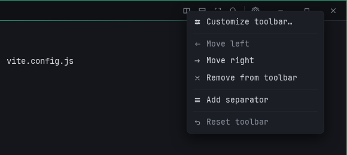

# Toolbar

The title bar has a row of buttons on the right. It is configurable: each button runs a command or one of your [custom actions](12-custom-actions.md). Edit it by hand with the [`toolbar`](../reference/configuration.md#toolbar) key, or from the UI; both write the same key in `config.toml`.

## The `toolbar` key

```toml
toolbar = ["duplicate_pane_right", "duplicate_pane_down", "toggle_pane_zoom", "find", "separator", "open_settings"]
```

That list is the default (used when the key is absent). Each entry is one of:

- a **command name** from [actions](../reference/actions.md) (`find`, `toggle_pane_zoom`, `new_tab`, `toggle_broadcast_input`, ...). Legacy pre-parity names (`zoom`, `split_right`, ...) are accepted and shown under their canonical name.
- the **`id` of an `[[action]]`** ([custom actions](12-custom-actions.md)). Its `name` is its label and its `icon` (or the command's icon) the glyph.
- `"separator"`: a thin vertical divider.

Rules:

- The key is a **root key**: it must appear before the first `[table]` / `[[array]]` header of the file.
- Unknown entries are skipped (not rendered, not deleted), so a typo or a renamed action never breaks the bar.
- Two separators in a row collapse into one. A leading or trailing separator stays visible so you can still move it.
- Hidden commands (those that are not in the palette, such as `command_palette` or `switch_to_tab_1`) are not offered by the editor but may be listed by hand.
- Clicking a button runs the command exactly as the palette or a key would.
- An empty list (`toolbar = []`) shows no buttons.

Example with a custom action and a broadcast toggle:

```toml
toolbar = ["new_tab", "duplicate_pane_right", "toggle_broadcast_input", "separator", "gs", "separator", "open_settings"]

[[action]]
id = "gs"
name = "Git status"
icon = "terminal"
command = "send_input"
input = "git status\r"
```

(`gs` must be defined as an action with that `id`, otherwise it is ignored.)

## Editing from the UI

Right-click the toolbar (a button or the empty area) to open its menu:



| Menu item | Effect |
| --- | --- |
| Customize toolbar… | Opens the toolbar editor palette (also [`customize_toolbar`](../reference/actions.md#customize_toolbar) from the command palette). |
| Move left / Move right | Reorders the button you right-clicked (only on a button). |
| Remove from toolbar | Removes the button you right-clicked. |
| Add separator | Inserts a separator after the clicked button, or at the end. |
| Reset toolbar | Removes the `toolbar` key so the default buttons return. Disabled while the toolbar is not customized. |

Other gestures:

- **Drag a button** left or right to reorder it (a small movement threshold avoids accidental drags). Dropping saves the new order.
- **Customize toolbar…** shows a palette: the buttons currently on the toolbar first (marked "on toolbar" with a check mark), then *Add separator*, your custom actions that have an `id`, then every other command that can be added. `Enter` toggles the highlighted entry (it stays open so you can add several), `Alt+Up` / `Alt+Down` moves a selected entry within the toolbar. See [Command palette](11-command-palette.md).

## How edits are saved

Every UI change rewrites the `toolbar = [...]` line of `config.toml`, keeping your comments and layout; if the key is missing it is inserted next to a commented example, after the last root setting, or before the first table. *Reset toolbar* deletes the line. The button row updates immediately (optimistically) and then the file watcher reloads the config like any other edit, so a hand edit and a UI edit never diverge. If the write fails (invalid config, read-only file), a toast says "Could not save the toolbar to config.toml".

Versions that stored the toolbar in the browser's local storage migrate it to `config.toml` once on first start.

## Tips

- Combine with [`new_tab_menu`](06-profiles.md) for profile launchers: a toolbar button can run `new_tab` with a `profile` through an `[[action]]`:

  ```toml
  toolbar = ["python_tab", "find"]

  [[action]]
  id = "python_tab"
  name = "Python"
  command = "new_tab"
  profile = "python"
  ```

- Useful buttons: `toggle_broadcast_input`, `toggle_read_only_mode`, `toggle_pane_zoom`, `command_palette` (hidden command, add by hand), `save_snippet`, `open_snippets_pane`, `toggle_vertical_tabs`.

## See also

- [Custom actions](12-custom-actions.md)
- [Command palette](11-command-palette.md)
- [Getting started](02-getting-started.md) (UI tour)
- [Configuration: `toolbar`](../reference/configuration.md#toolbar)
- [Actions reference](../reference/actions.md)
